# ECG Analog Front-End Project Report

Updated 2026-10-17 from archived schematic-level analysis exports.

## 1. Project scope and architecture

This project implements an ECG analog front end in GF180MCU: low-noise amplification, low-pass filtering, programmable gain, common-mode feedback, bias distribution, and differential output buffering. The current scope ends at FDBUF. ADC development is not included.

This is an independent, self-directed project. The IEEE SSCS 2026 Chipathon environment is used as a technical reference only; this is not an official program submission or a tapeout through that program.

The report summarizes each implemented block. Detailed sizing calculations, complete corner tables, and full Monte Carlo statistics remain in the linked block reports. No new simulations were run for this document.

### Signal path

Electrodes → INA + RLD → LPF → PGA → FDBUF.

BIAS/MIRROR supply shared bias currents. SEOTA and FDOTA provide the amplifier cores; FDOTA contains FDC and CMFB. INV, TG, MUX, and MUXD implement selection and bypass control.

[Schematic source](Design_Files/IC%20Design/Schematic/AFE_BLOCKS/AFE/AFE.sch)

| Stage | Nominal target | Purpose |
| :--- | :--- | :--- |
| INA | 240 V/V | Amplify the differential electrode signal |
| RLD | Common-mode feedback | Suppress input common-mode interference |
| LPF | 1 V/V; −1 dB frequency ≥150 Hz | Preserve the ECG passband and attenuate higher frequencies |
| PGA | 2 / 4 / 8 / 16 V/V | Select signal-path gain |
| FDBUF | 1 V/V | Drive the specified differential capacitive loads |

The nominal gain plan is **480 / 960 / 1920 / 3840 V/V**. It is the product of stage targets, not a measured full-chain gain. Integrated AFE exports are not yet available.

### Conditions and interpretation

Nominal means NOM process, 3.3 V, and 27°C. PVT covers five processes and all nine combinations of 3.0/3.3/3.6 V with −40/27/125°C. `FFVHTH`, for example, means FF process at 3.6 V and 125°C.

Blank Spec cells are report-only. Worst means the analyzer-selected limiting value, not necessarily the largest number. A tested range bound is not an exact compression point. Very large deterministic rejection values can reflect symmetry and numerical cancellation; they are not silicon guarantees.

## 2. Power and bias blocks

### 2.1 BIAS — master bias generation

BIAS generates the PMOS bias voltage BP. The nominal current target is 40 µA. The nwell resistor uses W = 3.000 µm and L = 1.520 µm.

[Schematic source](Design_Files/IC%20Design/Schematic/POWER_BLOCKS/BIAS/BIAS.sch)

| Parameter | Unit | Spec | NOM | PVT worst | Corner |
| :--- | :--- | :--- | :--- | :--- | :--- |
| Ibias | µA | 40±10 | 40.018 | 49.466 | FFVHTH |
| BP | V |  | 1.642 | 1.137 | FSVLTH |
| Total current | µA |  | 119.978 | 148.377 | FFVHTH |
| Total power | µW |  | 395.928 | 534.156 | FFVHTH |
| Mirror error | % | ±1 | -0.003 | 0.149 | FSVLTH |
| MST margin | V | >0 | 1.541 | 0.742 | FFVHTH |
| Startup time | µs |  | 807.522 | 3701.808 | SSVLTL |
| Temperature coefficient | ppm/°C |  | 1184.733 | 1235.503 | FFVL sweep |
| Line regulation | %/V |  | 4.293 | 5.322 | SSTL sweep |

The DC current spans **31.071–49.466 µA** against 30–50 µA limits. The high-side margin is 0.534 µA. Ibias worst case is selected by the largest deviation from 40 µA.

Ibias: nominal **40.018 µA**; worst **49.466 µA** at `FFVHTH`. The surface characterizes the separate 50,630-point voltage/temperature grid.

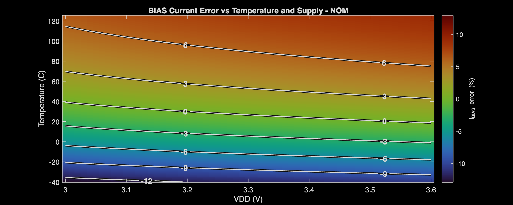

Startup time: nominal **807.522 µs**; worst **3701.808 µs** at `SSVLTL`. All 45 archived startup cases completed with zero reported startup failures.

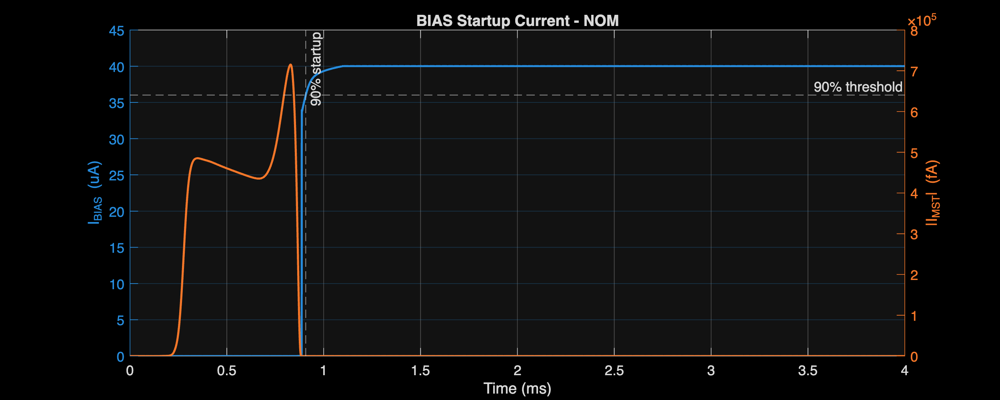

TC comparison values use VDD = 3.3 V; line regulation uses T = 27°C. Their worst cases search 15 temperature and 15 supply sweeps, respectively.

**FULL MC:** 200/200 valid samples; measured joint yield 100%. MM and GL also have 200/200 valid samples and 100% yield. These campaigns use nominal supply and temperature.

[Detailed design, measurements, plots, and source exports](Report/POWER_BLOCKS/BIAS_Report.md).

### 2.2 MIRROR — bias distribution

MIRROR copies the reference bias into the required branches. It is verified as part of the BIAS testbench and the amplifier operating-point checks, not as an independent 45-corner block campaign.

[Schematic source](Design_Files/IC%20Design/Schematic/POWER_BLOCKS/MIRROR/MIRROR.sch)

The BIAS testbench reports a nominal mirror error of **−0.003%**, a full-DC-PVT maximum magnitude of **0.149%**, and a **±1%** limit. These values apply to the measured mirror path, not automatically to every loaded branch in the integrated AFE.

[Detailed design, measurements, plots, and source exports](Report/POWER_BLOCKS/BIAS_Report.md).

## 3. Amplifier building blocks

### 3.1 SEOTA — single-ended amplifier

SEOTA is a two-stage Miller-compensated amplifier. Its verification combines open-loop gain/stability/noise measurements with closed-loop accuracy, range, and transient tests at a 10-pF load.

[Schematic source](Design_Files/IC%20Design/Schematic/ANALOG_BLOCKS/SEOTA/SEOTA.sch)

| Parameter | Unit | Spec | NOM | PVT worst | Corner |
| :--- | :--- | :--- | :--- | :--- | :--- |
| Total current | mA | ≤1.25 | 0.825 | 1.107 | FFVHTH |
| DC gain | dB | ≥88 | 96.522 | 93.985 | FSVLTH |
| UGF | MHz | ≥8 | 12.842 | 8.767 | SSVLTH |
| Phase margin | ° | ≥55 | 67.773 | 56.371 | FFVLTH |
| Input offset | µV | ±2000 | 3.198 | 12.101 | FSVLTH |
| Input-referred noise 0.05-150 Hz | µVrms | ≤2.5 | 1.873 | 2.189 | SSVLTH |
| Input low | mV | ≤600 | 154 | 430 | SSVHTL |
| Input high | V | ≥2.75 | 3.237 | 2.814 | FSVLTH |
| SR rise | V/µs | ≥6.5 | 9.819 | 6.931 | SSVLTL |
| SR fall | V/µs | ≥5.0 | 7.971 | 5.64 | SSVLTL |
| Settling time | ns | ≤225 | 162.9 | 213.4 | SSVLTL |

Phase margin: nominal **67.773 °**; worst **56.371 °** at `FFVLTH`. UGF is 12.842 MHz nominal and 8.767 MHz at the limiting PVT corner.

Settling time: nominal **162.9 ns**; worst **213.4 ns** at `SSVLTL`. The phase-margin and transient limits remain important post-layout checks.

**FULL MC:** 200/200 valid samples; exported joint yield 100%. This applies to measured MC quantities at nominal supply and temperature.

[Detailed design, measurements, plots, and source exports](Report/ANALOG_BLOCKS/SEOTA_Report.md).

### 3.2 FDOTA — fully differential amplifier

FDOTA combines two-stage differential amplification with common-mode feedback. The integrated OL/CL benches use 40 pF per output. Differential and common-mode responses are evaluated separately.

[Schematic source](Design_Files/IC%20Design/Schematic/ANALOG_BLOCKS/FDOTA/FDOTA/FDOTA.sch)

| Parameter | Unit | Spec | NOM | PVT worst | Corner |
| :--- | :--- | :--- | :--- | :--- | :--- |
| Total current | mA | ≤2.5 | 1.605 | 2.196 | FFVHTH |
| Differential DC gain | dB | ≥85 | 92.064 | 90.321 | FFVLTH |
| Differential UGF | MHz | ≥8 | 14.586 | 9.415 | SSVLTH |
| Differential phase margin | ° | ≥60 | 77.134 | 69.171 | FFVLTH |
| Input differential offset | µV | ±3000 | 0 | 0 | SFVHNOM |
| Output CM error | mV | ±20 | -0.132 | 11.982 | SSVHTH |
| Input CM low | mV | ≤1000 | 870 | 975 | SSVHNOM |
| Input-referred noise 0.05-150 Hz | µVrms | ≤4 | 3.083 | 3.513 | SSVHTH |
| Differential output swing high | V | ≥1.8 | 3.248 | 2.898 | FSVLTH |
| Differential SR rise | V/µs | ≥4 | 7.208 | 5.099 | SSVLTL |
| Differential settling time | ns | ≤300 | 175.867 | 246.549 | SSVLTL |
| Differential-step CM disturbance | mV | ≤60 | 37.052 | 47.416 | SSNOMTH |
| CMFB settling time | ns | ≤1000 | 309.735 | 418.338 | SSVLTH |

Differential UGF: nominal **14.586 MHz**; worst **9.415 MHz** at `SSVLTH`. The minimum phase margin is 69.171° against 60°.

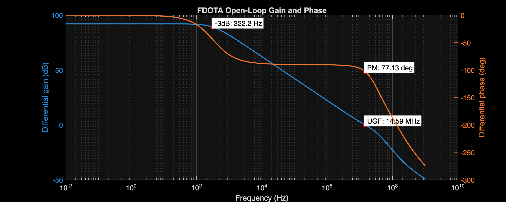

Differential settling time: nominal **175.867 ns**; worst **246.549 ns** at `SSVLTL`. The corresponding differential-step CM disturbance reaches 47.416 mV worst case.

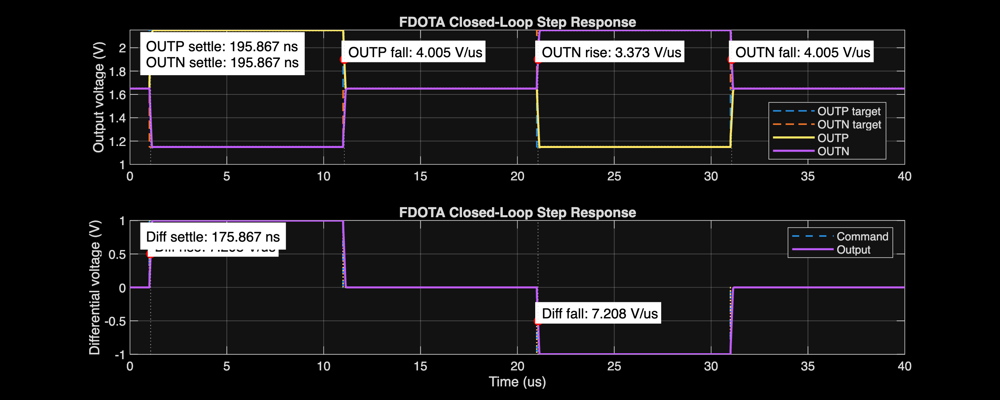

**FULL MC:** 200/200 valid samples; exported joint yield 100%. This applies to measured MC quantities at nominal supply and temperature.

[Detailed design, measurements, plots, and source exports](Report/ANALOG_BLOCKS/FDOTA_Report.md).

### 3.3 FDC — differential core

FDC supplies the differential forward path. Its isolated characterization uses a common-mode control input; those results must not be confused with the integrated FDOTA return ratio.

[Schematic source](Design_Files/IC%20Design/Schematic/ANALOG_BLOCKS/FDOTA/FDC/FDC.sch)

FDC nominal testbenches and MATLAB diagnostics support FDOTA sizing and debugging. Standalone fixture results are not project-level verification results. Integrated FDOTA nominal, PVT, and MC results are reported in Section 3.2.

[Detailed circuit sizing and integrated results](Report/ANALOG_BLOCKS/FDOTA_Report.md).

### 3.4 CMFB — common-mode regulation

CMFB senses the average output and adjusts the FDC load bias. The isolated bench includes an ideal plant; its very high crossover frequency is a test-fixture result, not the integrated FDOTA bandwidth.

[Schematic source](Design_Files/IC%20Design/Schematic/ANALOG_BLOCKS/FDOTA/CMFB/CMFB.sch)

CMFB nominal testbenches and MATLAB diagnostics support FDOTA sizing and debugging. Standalone fixture results are not project-level verification results. Integrated FDOTA nominal, PVT, and MC results are reported in Section 3.2.

[Detailed circuit sizing and integrated results](Report/ANALOG_BLOCKS/FDOTA_Report.md).

## 4. ECG signal-conditioning blocks

### 4.1 INA — instrumentation amplifier

The INA target is 240 V/V, formed by nominal S1 = 60 V/V and S2 = 4 V/V. It provides front-end gain before downstream filtering and programmable amplification.

[Schematic source](Design_Files/IC%20Design/Schematic/AFE_BLOCKS/INA/INA.sch)

| Parameter | Unit | Spec | NOM | PVT worst | Corner |
| :--- | :--- | :--- | :--- | :--- | :--- |
| Total current | mA | ≤6.2 | 3.862 | 4.815 | FFVHTH |
| INA gain | V/V |  | 240.027 | 239.815 | SSVLTL |
| INA gain error | % | ±0.5 | 0.011 | -0.077 | SSVLTL |
| Gain flatness 0.05-150 Hz | dB | ≤0.1 | 1.432e-06 | 2.246e-06 | SSVLTH |
| INA -3 dB bandwidth | kHz |  | 259.251 | 207.051 | SSVLTH |
| Input-referred noise 0.05-150 Hz | µVrms | ≤4 | 2.677 | 3.107 | SSVLTH |
| Input range high | mV | ≥5 | 12.8 | 11.2 | SSVLTH |
| Output range high | V | ≥1.2 | 3.071 | 2.687 | SSVLTH |
| THD @ 60 Hz, 5 mVpp | % | ≤0.05 | 9.267e-05 | 1.025e-04 | SFVLTH |

INA gain: nominal **240.027 V/V**; worst **239.815 V/V** at `SSVLTL`. Bandwidth is characterization only; gain flatness has the direct passband requirement.

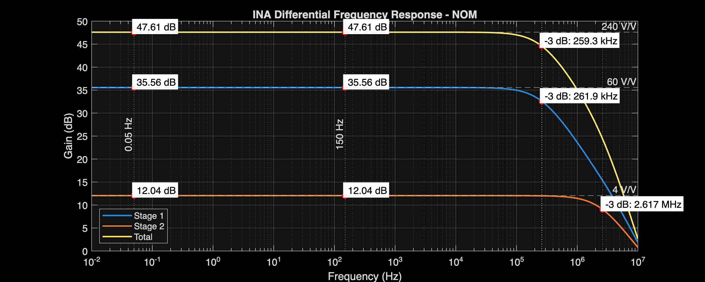

Input-referred noise 0.05-150 Hz: nominal **2.677 µVrms**; worst **3.107 µVrms** at `SSVLTH`. The front-end noise requirement remains ≤4 µVrms.

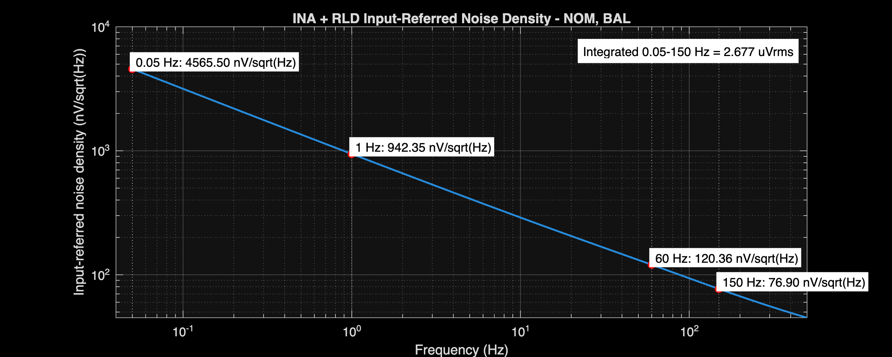

**FULL MC:** 200/200 valid samples; exported joint yield 100%. This applies to measured MC quantities at nominal supply and temperature.

[Detailed design, measurements, plots, and source exports](Report/AFE_BLOCKS/INA_RLD_Report.md).

### 4.2 RLD — input common-mode feedback

RLD uses the sensed common-mode signal to drive the body model through the safety path. Its important checks are loop phase margin and common-mode suppression, not a standalone bandwidth target. INA and RLD share the same verification campaign.

[Schematic source](Design_Files/IC%20Design/Schematic/AFE_BLOCKS/RLD/RLD.sch)

| Parameter | Unit | Spec | NOM | PVT worst | Corner |
| :--- | :--- | :--- | :--- | :--- | :--- |
| RLD gain | V/V |  | 4.999 | 4.999 | FSVLTH |
| RLD phase margin | ° | ≥60 | 64.006 | 62.118 | SSVLTH |
| Input CM suppression @ 60 Hz | dB | ≥35 | 37.231 | 37.121 | SSVLTL |
| Input CM suppression @ 150 Hz | dB | ≥25 | 27.735 | 27.309 | SSVLTL |
| RTI residual - MIS-P | µVpp | ≤1000 | 8.519 | 9.247 | SSVLTL |
| RTI residual - MIS-N | µVpp | ≤1000 | 8.519 | 9.247 | SSVLTL |

RLD phase margin: nominal **64.006 °**; worst **62.118 °** at `SSVLTH`. The formal minimum is 60°.

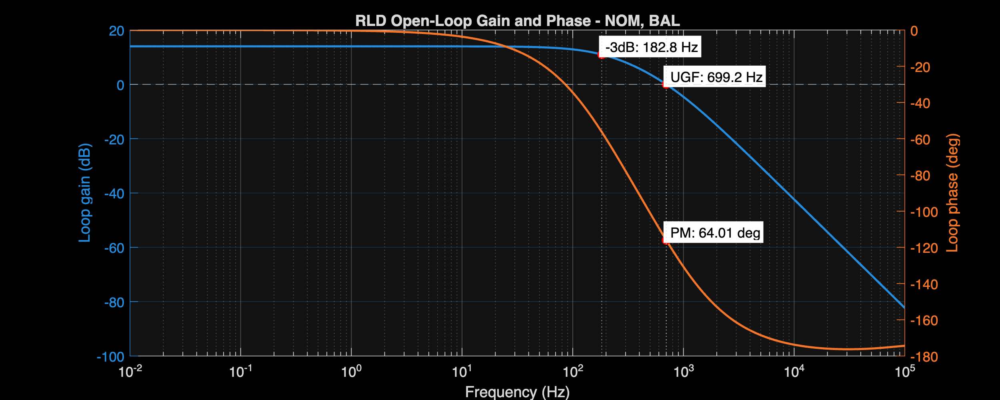

Input CM suppression @ 60 Hz: nominal **37.231 dB**; worst **37.121 dB** at `SSVLTL`. The 150-Hz minimum is 27.309 dB against a 25-dB requirement.

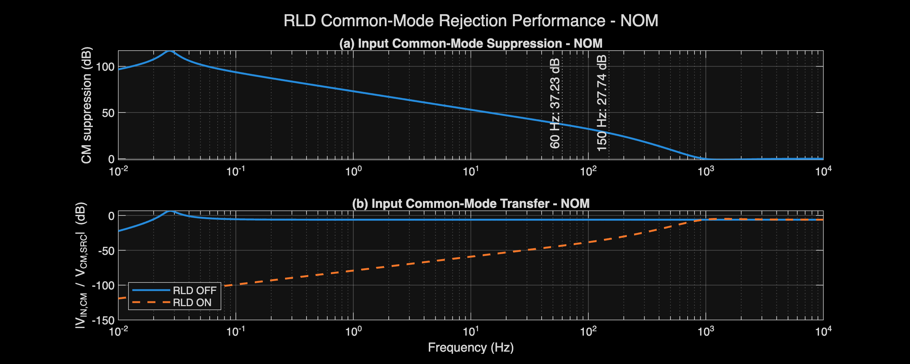

[Detailed design, measurements, plots, and source exports](Report/AFE_BLOCKS/INA_RLD_Report.md).

### 4.3 LPF — differential low-pass filter

The LPF target is unity gain. The −1 dB frequency must remain at or above 150 Hz; the −3 dB point and standalone noise are characterization quantities.

[Schematic source](Design_Files/IC%20Design/Schematic/AFE_BLOCKS/LPF/LPF.sch)

| Parameter | Unit | Spec | NOM | PVT worst | Corner |
| :--- | :--- | :--- | :--- | :--- | :--- |
| Total current | mA | ≤2.5 | 1.605 | 2.196 | FFVHTH |
| Passband gain | V/V |  | 1 | 1 | SSVLTL |
| Passband gain error | % | ±0.5 | -0.024 | -0.048 | SSVLTL |
| LPF -1 dB frequency | Hz | ≥150 | 258.688 | 174.134 | SSVHTL |
| LPF -3 dB frequency | Hz |  | 506.908 | 340.983 | SSVHTL |
| Input range high | V | ≥1.2 | 3.158 | 2.798 | FSVLTH |
| Output CM error | mV | ±20 | -0.132 | 11.997 | SSVHTH |
| Input-referred noise 0.05-150 Hz | µVrms |  | 6.173 | 7.033 | SSVHTH |
| THD @ 60 Hz, 1.2 Vpp | % | ≤0.05 | 0.004 | 0.006 | SSVHTL |

LPF -1 dB frequency: nominal **258.688 Hz**; worst **174.134 Hz** at `SSVHTL`. The nominal attenuation at 150 Hz and complete curve remain in the detailed report.

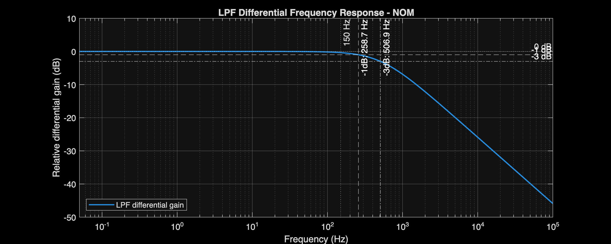

Input range high: nominal **3.158 V**; worst **2.798 V** at `FSVLTH`. The required differential operating range includes ±1.2 V.

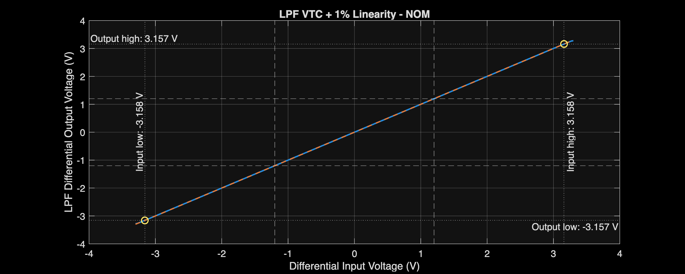

**FULL MC:** 200/200 valid samples; exported joint yield 100%. This applies to measured MC quantities at nominal supply and temperature.

[Detailed design, measurements, plots, and source exports](Report/AFE_BLOCKS/LPF_Report.md).

### 4.4 PGA — programmable differential gain

The PGA selects G2/G4/G8/G16. Its 45-corner campaign contains 180 gain/corner combinations. Each gain must meet ±1% gain accuracy, its specified operating range, and ≤0.05% THD.

[Schematic source](Design_Files/IC%20Design/Schematic/AFE_BLOCKS/PGA/PGA.sch)

| Parameter | Unit | Spec | NOM | PVT worst | Corner |
| :--- | :--- | :--- | :--- | :--- | :--- |
| Total current | mA | ≤2.5 | 1.605 | 2.196 | FFVHTH |
| Output CM error | mV | ±20 | -0.132 | 11.992 | SSVHTH |
| G2 gain error | % | ±1 | -0.011 | 0.409 | SSVLTH |
| G4 gain error | % | ±1 | -0.001 | 0.12 | SSVLTH |
| G8 gain error | % | ±1 | 0.002 | 0.133 | SSVLTH |
| G16 gain error | % | ±1 | 0.001 | -0.053 | FFVLTL |
| G2 THD @ 60 Hz, 1.20 Vpp | % | ≤0.05 | 0.015 | 0.023 | FSVLTL |
| G4 THD @ 60 Hz, 0.60 Vpp | % | ≤0.05 | 0.004 | 0.006 | FSVLTL |
| G8 THD @ 60 Hz, 0.30 Vpp | % | ≤0.05 | 2.146e-04 | 5.248e-04 | SSVLTL |
| G16 THD @ 60 Hz, 0.15 Vpp | % | ≤0.05 | 2.296e-04 | 4.064e-04 | FFVLTH |
| G16 input range low | V | ≤-0.15 | -0.186 | -0.16 | FSVLTH |
| G16 input range high | V | ≥0.15 | 0.186 | 0.16 | FSVLTH |
| G16 output range high | V | ≥2.4 | 2.968 | 2.562 | FSVLTH |

All THD stimuli target the same ideal **2.4 Vpp differential output**, at zero imposed offset. This differs from the VTC requirement of ±2.4 V differential output.

G2 gain error: nominal **-0.011 %**; worst **0.409 %** at `SSVLTH`. The figure compares all four gain configurations; bandwidth remains report-only.

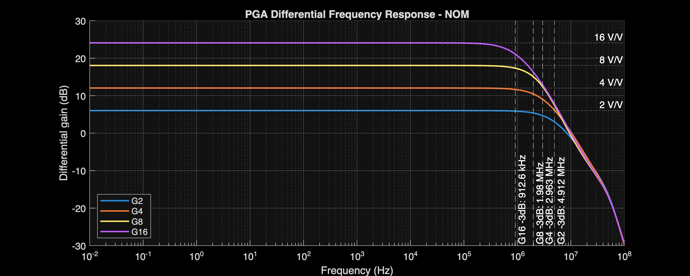

G16 input range high: nominal **0.186 V**; worst **0.16 V** at `FSVLTH`. G16 requires ±0.15 V input and ±2.4 V output; do not treat the sweep endpoint as an exact compression crossing.

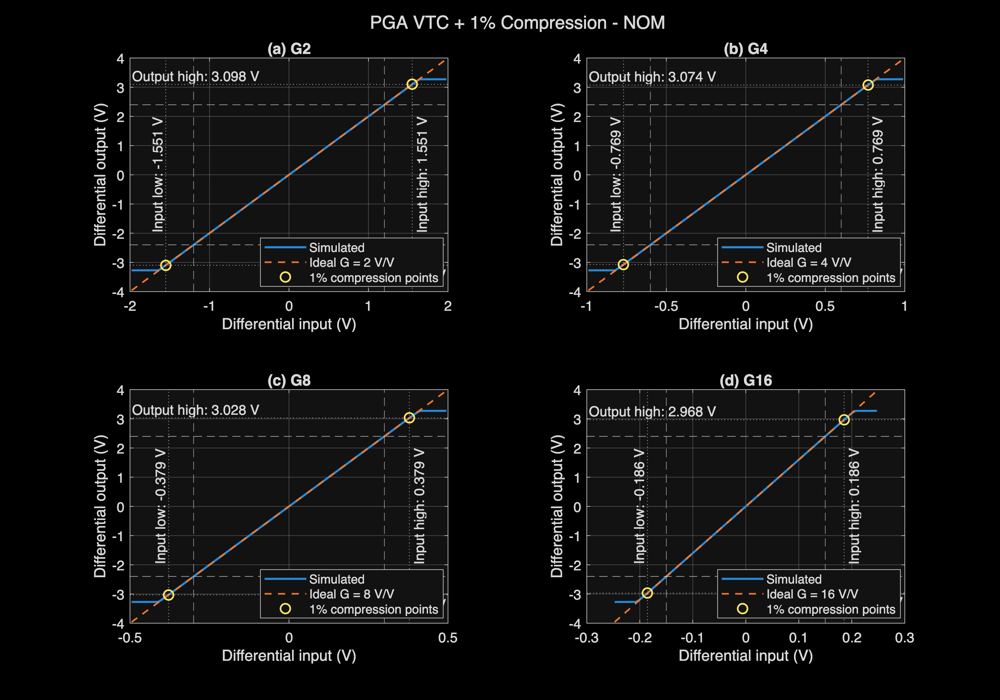

**FULL MC:** 200/200 valid samples; exported joint yield 100%. This applies to measured MC quantities at nominal supply and temperature.

[Detailed design, measurements, plots, and source exports](Report/AFE_BLOCKS/PGA_Report.md).

### 4.5 FDBUF — differential output buffer

FDBUF is a unity-gain output stage. Loads of 40, 60, 80, and 100 pF per output are verified across PVT; CL60 is the nominal shared operating-point load. The hard transient requirement is ≤1 µs to enter and remain within ±0.05%.

[Schematic source](Design_Files/IC%20Design/Schematic/AFE_BLOCKS/FDBUF/FDBUF.sch)

| Parameter | Unit | Spec | NOM | PVT worst | Corner |
| :--- | :--- | :--- | :--- | :--- | :--- |
| Total current | mA | ≤2.5 | 1.605 | 2.196 | FFVHTH |
| Output CM error | mV | ±20 | -0.132 | 11.997 | SSVHTH |
| Input offset | mV | ±10 | -6.329e-07 | 1.440e-06 | SSVHTL |
| CL40 gain error | % | ±1 | -0.008 | -0.011 | FFVLTH |
| CL60 gain error | % | ±1 | -0.008 | -0.011 | FFVLTH |
| CL80 gain error | % | ±1 | -0.008 | -0.011 | FFVLTH |
| CL100 gain error | % | ±1 | -0.008 | -0.011 | FFVLTH |
| CL40 0.05% settling time | µs | ≤1 | 0.225 | 0.282 | SSVLTH |
| CL60 0.05% settling time | µs | ≤1 | 0.319 | 0.36 | FSVLTH |
| CL80 0.05% settling time | µs | ≤1 | 0.364 | 0.432 | SSVHTH |
| CL100 0.05% settling time | µs | ≤1 | 0.399 | 0.514 | SSVLTH |
| CL100 -3 dB bandwidth | MHz |  | 7.334 | 4.757 | SSVLTH |
| CL100 Overshoot | % |  | 12.768 | 18.495 | FFVHTL |

CL100 -3 dB bandwidth: nominal **7.334 MHz**; worst **4.757 MHz** at `SSVLTH`. The curve shows all four loads at the nominal process/environment.

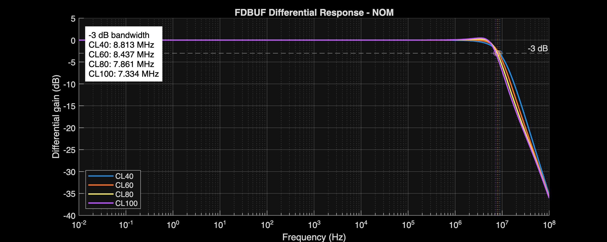

CL100 0.05% settling time: nominal **0.399 µs**; worst **0.514 µs** at `SSVLTH`. Overshoot is report-only; the internal settling calculation still uses the ±0.05% criterion.

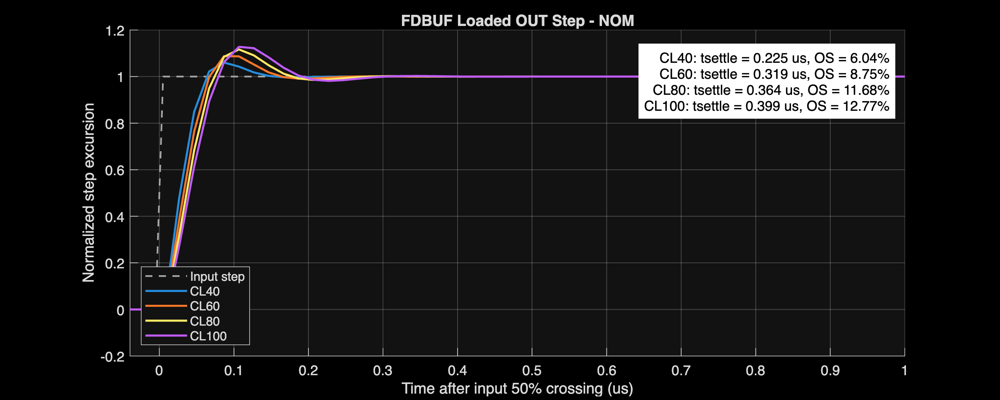

**FULL MC:** 200/200 valid samples; exported joint yield 100%. This applies to measured MC quantities at nominal supply and temperature.

[Detailed design, measurements, plots, and source exports](Report/AFE_BLOCKS/FDBUF_Report.md).

## 5. Selector and control cells

These cells support internal/external signal selection and bypass operation. Their schematics are included for hierarchy completeness. Standalone delay, leakage, on-resistance, distortion, or digital timing signoff is not available in the current project exports.

### INV

Generates the complementary control polarity used by the selection logic.

[Schematic source](Design_Files/IC%20Design/Schematic/DIGITAL_BLOCKS/INV/INV.sch)

### TG

Provides the complementary MOS transmission path. Its sizing affects analog loading and distortion; no independent TG linearity result is claimed here.

[Schematic source](Design_Files/IC%20Design/Schematic/DIGITAL_BLOCKS/TG/TG.sch)

### MUX

Selects the single-ended bias-control path in the BIAS testbench.

[Schematic source](Design_Files/IC%20Design/Schematic/DIGITAL_BLOCKS/MUX/MUX.sch)

### MUXD

Selects differential internal/external signal paths in the AFE block testbenches.

[Schematic source](Design_Files/IC%20Design/Schematic/DIGITAL_BLOCKS/MUXD/MUXD.sch)

The block-level selector transients provide in-context functional evidence, not full digital-cell characterization.

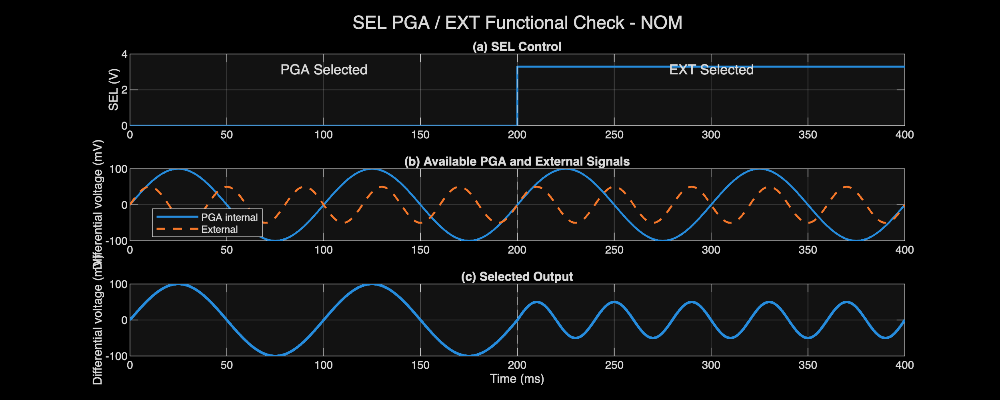

The PGA trace compares internal, external, control, and selected differential signals under the nominal selector test. Further details remain in the [PGA report](Report/AFE_BLOCKS/PGA_Report.md).

## 6. Project-level verification status

| Block campaign | PVT conditions | MM valid / yield | GL valid / yield | FULL valid / yield |
| :--- | :--- | :--- | :--- | :--- |
| BIAS | 45 + 50,630-point DC grid | 200/200; 100% | 200/200; 100% | 200/200; 100% |
| SEOTA | 45 | 200/200; 100% | 200/200; 100% | 200/200; 100% |
| FDOTA | 45 | 200/200; 100% | 200/200; 100% | 200/200; 100% |
| INA_RLD | 45 | 200/200; 100% | 200/200; 100% | 200/200; 100% |
| LPF | 45 | 200/200; 100% | 200/200; 100% | 200/200; 100% |
| PGA | 45 × 4 gains | 200/200; 100% | 200/200; 100% | 200/200; 100% |
| FDBUF | 45 × 4 loads | 200/200; 100% | 200/200; 100% | 200/200; 100% |

MM means local mismatch; GL means global variation; FULL combines both at the nominal environment. A finite set of nominal-environment MC samples does not establish mismatch yield at every PVT extreme. The analyzer’s non-valid/failed count may include missing or invalid files, not only demonstrated circuit failures.

### Completed versus pending

| Item | Current evidence | Remaining work |
| :--- | :--- | :--- |
| Block schematic verification | Exported PVT and MC tables for the measured blocks | Repeat verification after layout and extraction |
| Integrated AFE | Top schematic and MATLAB analyzer exist | Generate full-chain gain, noise, rejection, RLD-loop, and transient results |
| Selector/control cells | Schematics and in-context functional traces | Independent cell characterization if required by the implementation |
| Physical implementation | Schematic-level results only | Layout, DRC/LVS, extraction, and re-verification |
| Measured silicon | No measurements reported | Not part of the present evidence |

Individual block passes are not an integrated AFE pass. Do not sum independently selected worst-case currents or combine unrelated corners as though they were a simulated system operating point.

## 7. Design method and reproducibility

The OTA reports retain the step-by-step $g_m/I_D$ sizing flow: specification → required $g_m$ → current → current density → width → compensation → simulation comparison. Component-level reasons and trade-offs remain in those detailed reports.

The signal-chain design follows the same requirement-to-component sequence:

| Block | Starting requirement | Calculated design choice | Verification used to close the design |
| :--- | :--- | :--- | :--- |
| BIAS/MIRROR | 40-µA reference and accurate distribution | MOS/BJT loop equation, 1:30 PNP ratio, model-corrected RS, matched unit mirrors | Current range, mirror error, and startup |
| INA | 240-V/V gain with low input-referred noise | 60 × 4 gain allocation and matched feedback ratios | Gain accuracy, noise, usable range, and THD |
| RLD | Mains/common-mode suppression with stable feedback | Gain-five controller and approximately 80-pF feedback capacitor | Complete-loop phase margin and suppression |
| LPF | −1 dB frequency ≥150 Hz at unity gain | Approximately 500-Hz nominal pole; matched multi-megaohm resistors and 60-pF feedback branches | Passband loss, frequency margin, and THD |
| PGA | Gains 2/4/8/16 and ±2.4-V output range | 20-kΩ input network and switched 40/40/120/120-kΩ feedback sections | Gain-dependent error, range, and distortion |
| FDBUF | Unity gain and 0.05% settling ≤1 µs into 40–100 pF per output | Equal 20-kΩ input/feedback resistors around the FDOTA | Delivered-output settling across all four loads |

These are reconstructed design explanations, not a claim that every final dimension follows from one closed-form optimum. The block reports distinguish raw sheet-resistance estimates, PDK corrections, implemented geometries, and measured circuit behavior.

- [Device characterization and lookup plots](Report/SIZING/Gm_Id_Report.md)
- [Integrated AFE verification scope](Report/AFE_BLOCKS/AFE_Report.md)

SEOTA and FDOTA are evaluated in open-loop and closed-loop configurations. PVT sweeps cover process, supply, and temperature; separate MM, GL, and FULL campaigns assess mismatch and global variation.

FDC and CMFB fixtures isolate differential amplification, common-mode control sensitivity, and feedback polarity during design. Integrated FDOTA simulation evaluates their interaction with the actual output sensor and load.

Run ngspice to completion before invoking MATLAB. The analyzers read existing files; they do not launch simulations. Detailed CSVs and block reports are the source for the summaries above. No result files, specifications, circuits, or analyzers were changed for this document.

## 8. Conclusions and next steps

The project has a documented transistor-level AFE hierarchy, numerical block verification, and nominal functional traces. The current evidence supports continued AFE implementation and integration work; it does not establish extracted-layout or silicon performance.

1. Simulate the integrated AFE at every programmed gain with the intended output loads.
2. Complete layout and extraction, then repeat the existing acceptance limits.
3. Track phase margin, offset, noise, usable swing, and settling across the extracted hierarchy.
