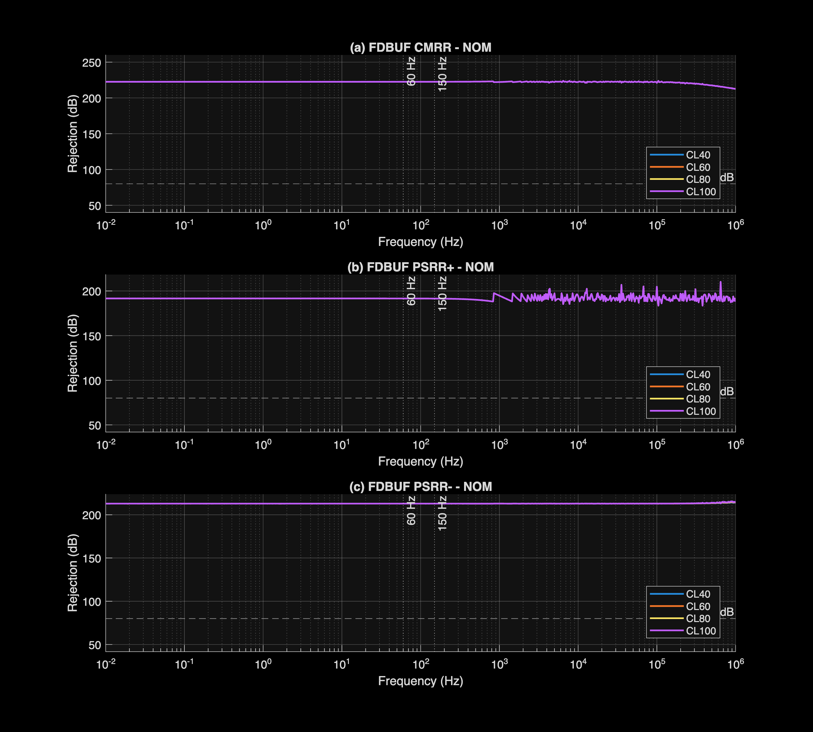
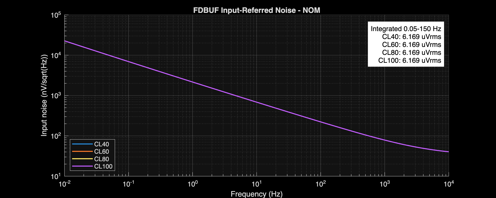
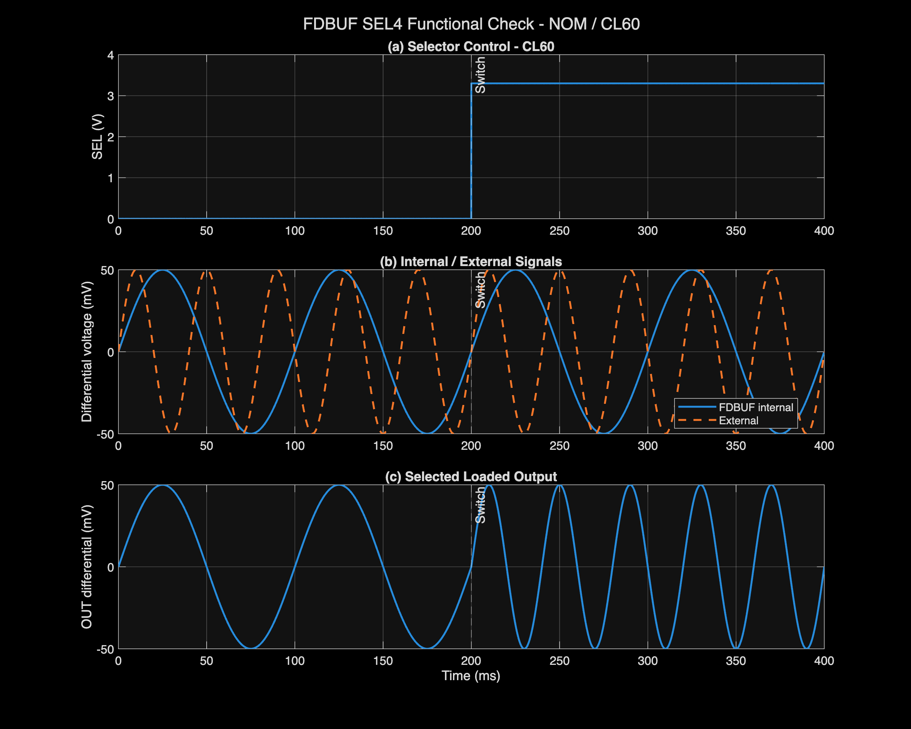
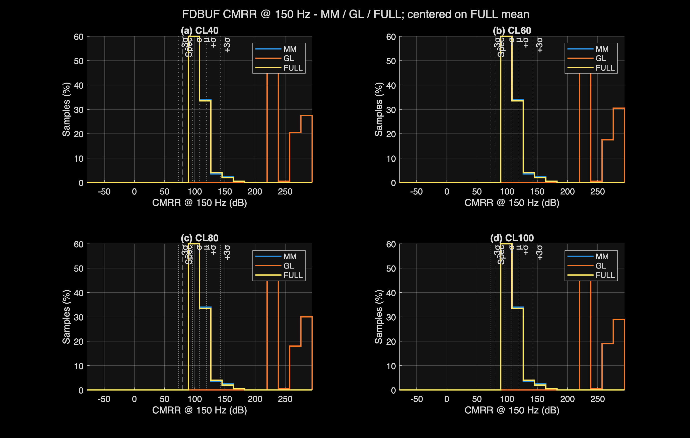
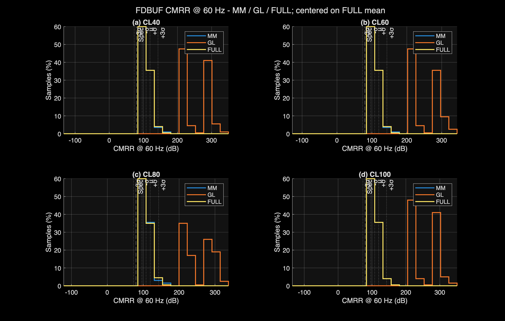
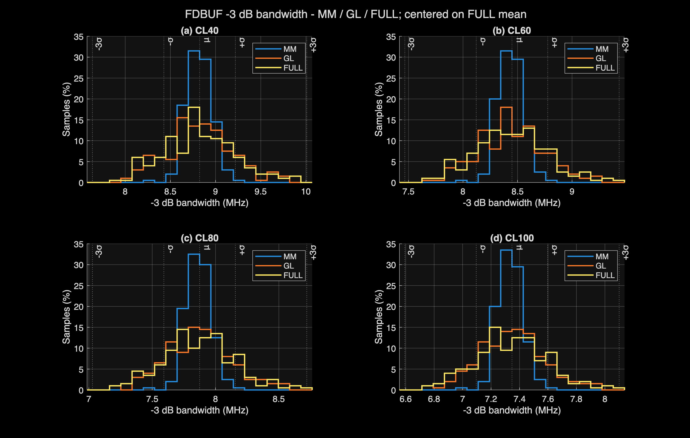
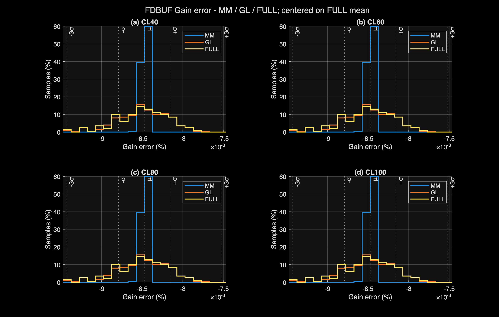
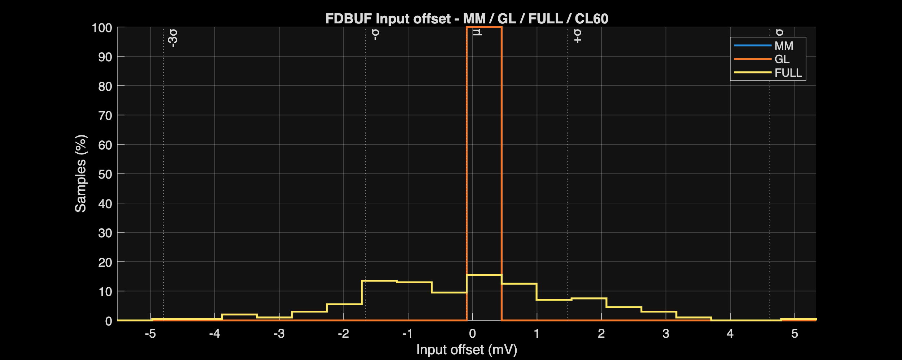

# FDBUF Design and Verification Report

[← Project report](../../Project_Report.md)

## Circuit and role

The unity-gain differential buffer is verified at 40, 60, 80, and 100 pF per output. CL60 is the nominal operating-point load.

[Circuit schematic](../../Design_Files/IC%20Design/Schematic/AFE_BLOCKS/FDBUF/FDBUF.sch)

## Design requirements and sequence

The buffer must reproduce the differential input with unity gain while driving 40, 60, 80, or 100 pF per output. CL60 is the nominal load. Gain error is limited to ±1%; 0.05% settling must complete within 1 µs.

Bandwidth and overshoot are diagnostic quantities, not independent pass/fail requirements. The following estimates explain the implemented resistive feedback and capacitive-load choices.

### 1. Reuse the FDOTA rather than add another gain stage

The input/output common mode is centered on REF. A closed-loop differential stage isolates the preceding PGA from the output capacitance while retaining common-mode regulation.

Its transistor dimensions, input-pair noise sizing, output-stage current, Miller capacitors, and nulling resistors are inherited from the [FDOTA design](../ANALOG_BLOCKS/FDOTA_Report.md). They are not independently resized for FDBUF.

### 2. Choose equal input and feedback resistors

For matched fully differential feedback,

$$
G_d\approx\frac{R_F}{R_{\mathrm{IN}}}=1.
$$

Choose 20 kΩ for all four resistors. At 2 kΩ/square and W = 2 µm,

$$
L_{\mathrm{calc}}=\frac{20\ \mathrm{k\Omega}}{2\ \mathrm{k\Omega}}
(2\ \mu\mathrm m)=20\ \mu\mathrm m.
$$

| Components | Calculated W/L | Integer choice | Implemented W/L |
| :--- | :--- | :--- | :--- |
| RINP/RINN | 2/20 µm | 2/20 µm | 2/20 µm |
| RFBP/RFBN | 2/20 µm | 2/20 µm | 2/20 µm |

Equal geometry cancels much of the common process/temperature dependence in the gain ratio. Absolute model corrections can move both resistance values without changing the ideal ratio.

The 2-µm width is an area/matching compromise. Larger equal resistors reduce amplifier current loading but increase thermal noise and parasitic time constants. Smaller resistors reduce noise and node impedance but demand more signal current.

### 3. Distinguish unity signal gain from feedback noise gain

Although signal gain is one, the approximate differential noise gain is

$$
NG\approx1+\frac{R_F}{R_{\mathrm{IN}}}=2,\qquad\beta\approx\frac12.
$$

With nominal integrated FDOTA open-loop gain of 92.064 dB,

$$
A_0=10^{92.064/20}\approx4.01\times10^4,
\qquad
\epsilon_G\approx-\frac{NG}{A_0}100\%\approx-0.0050\%.
$$

The buffer's measured nominal gain error is −0.008%. The same order of magnitude supports finite loop gain as a useful first estimate. The complete simulated circuit, including the selector and load, remains the accuracy check.

Using the nominal FDOTA UGF of 14.586 MHz gives a one-pole bandwidth scale of \(UGF/NG\approx7.29\) MHz. This is not a prediction for every load: load-dependent poles, zeros, and peaking alter the actual response. [TI fully differential feedback theory](https://www.ti.com/lit/pdf/SLOA054)

### 4. Translate the load sweep into required transient charge

A 100-mV differential step centered at fixed common mode moves each output by approximately 50 mV. Hence

$$
\Delta Q_{\mathrm{side}}=C_L(50\ \mathrm{mV})
=\{2,\ 3,\ 4,\ 5\}\ \mathrm{pC}.
$$

Delivering that charge in 1 µs requires only 2–5 µA average per output. This is a lower-bound charge calculation, not sufficient proof of 0.05% settling. Recovery, loop damping, and time-varying available current determine the actual result.

The 40/60/80/100-pF capacitors are test loads, not four on-chip capacitors requiring layout W/L. They represent a load envelope; no SAR acquisition-time requirement is inferred.

### 5. Calculate settling internally and retain the loaded output waveform

For an ideal first-order response,

$$
e^{-2\pi BWt}\le0.0005
\quad\Rightarrow\quad
t_{0.05\%}\approx\frac{1.210}{BW}.
$$

At the measured CL60 bandwidth of 8.437 MHz, this predicts approximately 0.143 µs. Simulation instead gives 0.319 µs because the loaded response is not a single monotonic pole.

The analyzer checks that the normalized response enters and remains within ±0.05% during the analyzed plateau. Overshoot alone cannot determine that time.

### 6. Compare load dependence with the design expectation

Nominal settling times are 0.225, 0.319, 0.364, and 0.399 µs for CL40/60/80/100. Worst PVT values are 0.282, 0.360, 0.432, and 0.514 µs, respectively.

Increasing load slows the response and increases the damping challenge. CL100 is therefore the principal transient stress case, not a different gain setting. Its worst settling time remains below 1 µs.

The output selector reuses MUXD. Its switch sizing follows the shared transmission-gate implementation; the selected OUT waveform, rather than the unloaded internal buffer output alone, is needed to assess delivered settling.

## Verification conditions

Checked 2026-10-17 against the latest analyzer CSV exports. No simulations were rerun for this documentation update.

Blank specification cells mean report-only. Exported worst-case values meet their listed limits; this is pre-layout block verification, not post-layout or silicon signoff.

Very large deterministic CMRR/PSRR values reflect schematic symmetry and numerical cancellation. Use mismatch results to assess imbalance sensitivity; neither dataset guarantees extracted-layout or silicon rejection.

The 45-corner campaign covers CL40/CL60/CL80/CL100 per output: 180 load/corner combinations. Shared operating-point values use CL60. Bandwidth, power, noise, and overshoot are report-only; 0.05% settling must remain within 1 µs.

Nominal columns refer to NOM process, 3.3 V, and 27°C. Compact corner names encode process, supply, and temperature. Sweep labels identify a fixed supply or temperature rather than a single corner.

Settling is the time to enter and remain within ±0.05% during the analyzed step plateau. It does not establish SAR acquisition or kickback performance.

## Nominal and full-PVT results

### Operating point

| Parameter | Unit | Spec | NOM | Full-PVT worst | Corner |
| :--- | :--- | :--- | :--- | :--- | :--- |
| FDC bias current | uA | 40±10 | 40.113 | 49.606 | FFVHTH |
| CMFB bias current | uA | 40±10 | 40.113 | 49.606 | FFVHTH |
| Total current | mA | ≤2.5 | 1.605 | 2.196 | FFVHTH |
| Total power | mW |  | 5.296 | 7.906 | FFVHTH |
| Output CM error | mV | ±20 | -0.132 | 11.997 | SSVHTH |

### Accuracy and usable range

| Parameter | Unit | Spec | NOM | Full-PVT worst | Corner |
| :--- | :--- | :--- | :--- | :--- | :--- |
| Input offset | mV | ±10 | -6.329e-07 | 1.440e-06 | SSVHTL |
| CL40 gain error | % | ±1 | -0.008 | -0.011 | FFVLTH |
| CL60 gain error | % | ±1 | -0.008 | -0.011 | FFVLTH |
| CL80 gain error | % | ±1 | -0.008 | -0.011 | FFVLTH |
| CL100 gain error | % | ±1 | -0.008 | -0.011 | FFVLTH |

### Frequency response

| Parameter | Unit | Spec | NOM | Full-PVT worst | Corner |
| :--- | :--- | :--- | :--- | :--- | :--- |
| CL40 gain | V/V |  | 1 | 1 | FFVLTH |
| CL40 -3 dB bandwidth | MHz |  | 8.813 | 5.482 | SSVLTH |
| CL60 gain | V/V |  | 1 | 1 | FFVLTH |
| CL60 -3 dB bandwidth | MHz |  | 8.437 | 5.323 | SSVLTH |
| CL80 gain | V/V |  | 1 | 1 | FFVLTH |
| CL80 -3 dB bandwidth | MHz |  | 7.861 | 5.037 | SSVLTH |
| CL100 gain | V/V |  | 1 | 1 | FFVLTH |
| CL100 -3 dB bandwidth | MHz |  | 7.334 | 4.757 | SSVLTH |

CL40 -3 dB bandwidth: nominal 8.813 MHz; full-PVT worst 5.482 MHz at `SSVLTH`.

### Common-mode and supply rejection

| Parameter | Unit | Spec | NOM | Full-PVT worst | Corner |
| :--- | :--- | :--- | :--- | :--- | :--- |
| CL40 CMRR @ 60 Hz | dB | ≥80 | 222.568 | 217.403 | SSNOMTH |
| CL40 CMRR @ 150 Hz | dB | ≥80 | 222.583 | 217.389 | SSNOMTH |
| CL40 PSRR+ @ 60 Hz | dB | ≥80 | 191.583 | 189.432 | SSVHTH |
| CL40 PSRR+ @ 150 Hz | dB | ≥80 | 191.469 | 189.554 | SSVHTH |
| CL40 PSRR- @ 60 Hz | dB | ≥80 | 212.922 | 203.264 | SSVLTH |
| CL40 PSRR- @ 150 Hz | dB | ≥80 | 212.926 | 203.271 | SSVLTH |
| CL60 CMRR @ 60 Hz | dB | ≥80 | 222.568 | 217.403 | SSNOMTH |
| CL60 CMRR @ 150 Hz | dB | ≥80 | 222.583 | 217.389 | SSNOMTH |
| CL60 PSRR+ @ 60 Hz | dB | ≥80 | 191.584 | 189.432 | SSVHTH |
| CL60 PSRR+ @ 150 Hz | dB | ≥80 | 191.469 | 189.554 | SSVHTH |
| CL60 PSRR- @ 60 Hz | dB | ≥80 | 212.918 | 203.264 | SSVLTH |
| CL60 PSRR- @ 150 Hz | dB | ≥80 | 212.92 | 203.268 | SSVLTH |
| CL80 CMRR @ 60 Hz | dB | ≥80 | 222.568 | 217.403 | SSNOMTH |
| CL80 CMRR @ 150 Hz | dB | ≥80 | 222.583 | 217.389 | SSNOMTH |
| CL80 PSRR+ @ 60 Hz | dB | ≥80 | 191.583 | 189.433 | SSVHTH |
| CL80 PSRR+ @ 150 Hz | dB | ≥80 | 191.469 | 189.554 | SSVHTH |
| CL80 PSRR- @ 60 Hz | dB | ≥80 | 212.928 | 203.264 | SSVLTH |
| CL80 PSRR- @ 150 Hz | dB | ≥80 | 212.924 | 203.272 | SSVLTH |
| CL100 CMRR @ 60 Hz | dB | ≥80 | 222.568 | 217.403 | SSNOMTH |
| CL100 CMRR @ 150 Hz | dB | ≥80 | 222.583 | 217.389 | SSNOMTH |
| CL100 PSRR+ @ 60 Hz | dB | ≥80 | 191.584 | 189.433 | SSVHTH |
| CL100 PSRR+ @ 150 Hz | dB | ≥80 | 191.469 | 189.554 | SSVHTH |
| CL100 PSRR- @ 60 Hz | dB | ≥80 | 212.921 | 203.264 | SSVLTH |
| CL100 PSRR- @ 150 Hz | dB | ≥80 | 212.919 | 203.269 | SSVLTH |

CL40 CMRR @ 60 Hz: nominal 222.568 dB; full-PVT worst 217.403 dB at `SSNOMTH`.

### Noise and distortion

| Parameter | Unit | Spec | NOM | Full-PVT worst | Corner |
| :--- | :--- | :--- | :--- | :--- | :--- |
| CL40 input-referred noise 0.05-150 Hz | uVrms |  | 6.169 | 7.027 | SSVHTH |
| CL60 input-referred noise 0.05-150 Hz | uVrms |  | 6.169 | 7.027 | SSVHTH |
| CL80 input-referred noise 0.05-150 Hz | uVrms |  | 6.169 | 7.027 | SSVHTH |
| CL100 input-referred noise 0.05-150 Hz | uVrms |  | 6.169 | 7.027 | SSVHTH |

CL40 input-referred noise 0.05-150 Hz: nominal 6.169 uVrms; full-PVT worst 7.027 uVrms at `SSVHTH`.

### Transient response

| Parameter | Unit | Spec | NOM | Full-PVT worst | Corner |
| :--- | :--- | :--- | :--- | :--- | :--- |
| CL40 0.05% settling time | us | ≤1 | 0.225 | 0.282 | SSVLTH |
| CL40 Overshoot | % |  | 6.037 | 9.733 | FFNOMTL |
| CL60 0.05% settling time | us | ≤1 | 0.319 | 0.36 | FSVLTH |
| CL60 Overshoot | % |  | 8.753 | 13.291 | FFVHTL |
| CL80 0.05% settling time | us | ≤1 | 0.364 | 0.432 | SSVHTH |
| CL80 Overshoot | % |  | 11.676 | 16.182 | FFVHTL |
| CL100 0.05% settling time | us | ≤1 | 0.399 | 0.514 | SSVLTH |
| CL100 Overshoot | % |  | 12.768 | 18.495 | FFVHTL |

CL40 0.05% settling time: nominal 0.225 us; full-PVT worst 0.282 us at `SSVLTH`.

### Functional checks

Nominal functional trace; selector or gain-control behavior is separate from static gain accuracy.

## Monte Carlo verification

MM applies local mismatch; GL applies global variation; FULL combines both. These are nominal-supply/temperature MC campaigns, not combined worst-PVT-plus-mismatch yield.

| Mode | Requested | Valid | Failed | Overall yield |
| :--- | :--- | :--- | :--- | :--- |
| MM | 200 | 200 | 0 | 100% |
| GL | 200 | 200 | 0 | 100% |
| FULL | 200 | 200 | 0 | 100% |

Counts and yield apply to the measured MC metrics at nominal supply and temperature. Missing or invalid results prevent a pass; they are not demonstrated circuit failures. Sample yield is not production yield.

### FULL sampled statistics

| Parameter | Unit | Spec | Min | Mean | Max | Yield |
| :--- | :--- | :--- | :--- | :--- | :--- | :--- |
| FDC bias current | uA | 40±10 | 38.54 | 40.127 | 41.844 | 100% |
| CMFB bias current | uA | 40±10 | 38.552 | 40.121 | 41.793 | 100% |
| Total current | mA | ≤2.5 | 1.523 | 1.608 | 1.695 | 100% |
| Total power | mW |  | 5.026 | 5.308 | 5.593 |  |
| Output CM error | mV | ±20 | -11.91 | -0.194 | 14.858 | 100% |
| Input offset | mV | ±10 | -4.611 | -0.091 | 5.067 | 100% |
| CL40 gain | V/V |  | 1 | 1 | 1 |  |
| CL40 gain error | % | ±1 | -0.009 | -0.008 | -0.008 | 100% |
| CL40 -3 dB bandwidth | MHz |  | 7.934 | 8.823 | 9.875 |  |
| CL40 CMRR @ 60 Hz | dB | ≥80 | 91.203 | 108.026 | 170.545 | 100% |
| CL40 CMRR @ 150 Hz | dB | ≥80 | 91.203 | 108.024 | 170.287 | 100% |
| CL60 gain | V/V |  | 1 | 1 | 1 |  |
| CL60 gain error | % | ±1 | -0.009 | -0.008 | -0.008 | 100% |
| CL60 -3 dB bandwidth | MHz |  | 7.699 | 8.449 | 9.386 |  |
| CL60 CMRR @ 60 Hz | dB | ≥80 | 91.203 | 108.026 | 170.545 | 100% |
| CL60 CMRR @ 150 Hz | dB | ≥80 | 91.203 | 108.024 | 170.287 | 100% |
| CL80 gain | V/V |  | 1 | 1 | 1 |  |
| CL80 gain error | % | ±1 | -0.009 | -0.008 | -0.008 | 100% |
| CL80 -3 dB bandwidth | MHz |  | 7.224 | 7.874 | 8.699 |  |
| CL80 CMRR @ 60 Hz | dB | ≥80 | 91.203 | 108.026 | 170.546 | 100% |
| CL80 CMRR @ 150 Hz | dB | ≥80 | 91.203 | 108.024 | 170.287 | 100% |
| CL100 gain | V/V |  | 1 | 1 | 1 |  |
| CL100 gain error | % | ±1 | -0.009 | -0.008 | -0.008 | 100% |
| CL100 -3 dB bandwidth | MHz |  | 6.761 | 7.347 | 8.086 |  |
| CL100 CMRR @ 60 Hz | dB | ≥80 | 91.203 | 108.026 | 170.546 | 100% |
| CL100 CMRR @ 150 Hz | dB | ≥80 | 91.203 | 108.024 | 170.287 | 100% |

The source CSVs retain μ±σ and μ±3σ. Those statistical extrapolations are not additional simulated extrema.

FULL CL40 CMRR @ 60 Hz: 91.203 to 170.545 dB; mean 108.026 dB.

FULL CL40 CMRR @ 60 Hz: 91.203 to 170.545 dB; mean 108.026 dB.

FULL CL40 -3 dB bandwidth: 7.934 to 9.875 MHz; mean 8.823 MHz.

FULL CL40 gain error: -0.009 to -0.008 %; mean -0.008 %.

FULL Input offset: -4.611 to 5.067 mV; mean -0.091 mV.

## Measurement sources

- [MATLAB analyzer](../../Measurement_Results/IC_Simulation/AFE_BLOCKS/FDBUF/FDBUF_Analyze.m)
- [Representative-corner comparison](../../Measurement_Results/IC_Simulation/AFE_BLOCKS/FDBUF/Reports/FDBUF_table_report.csv)
- [Full-PVT worst cases](../../Measurement_Results/IC_Simulation/AFE_BLOCKS/FDBUF/Reports/FDBUF_worst_case_report.csv)
- [All exported PVT measurements](../../Measurement_Results/IC_Simulation/AFE_BLOCKS/FDBUF/Reports/FDBUF_full_pvt_report.csv)
- [MM statistics](../../Measurement_Results/IC_Simulation/AFE_BLOCKS/FDBUF/Reports/MM_MC_Summary.csv)
- [GL statistics](../../Measurement_Results/IC_Simulation/AFE_BLOCKS/FDBUF/Reports/GL_MC_Summary.csv)
- [FULL statistics](../../Measurement_Results/IC_Simulation/AFE_BLOCKS/FDBUF/Reports/FULL_MC_Summary.csv)
- [MC coverage and yield](../../Measurement_Results/IC_Simulation/AFE_BLOCKS/FDBUF/Reports/MC_Run_Summary.csv)
- [Xschem testbenches](../../Design_Files/IC%20Design/Testbench/AFE_BLOCKS/FDBUF)

## Limitations and next steps

These results exclude extracted parasitics, package effects, switched-ADC loading, and silicon measurements. Repeat the same limits after layout; do not infer integrated AFE signoff from individual block passes.
