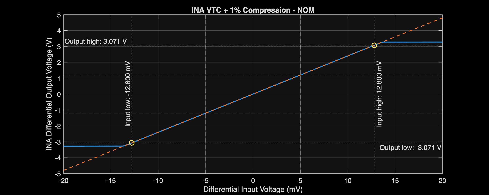
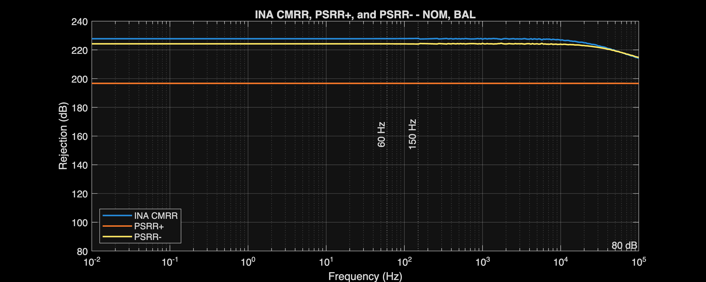
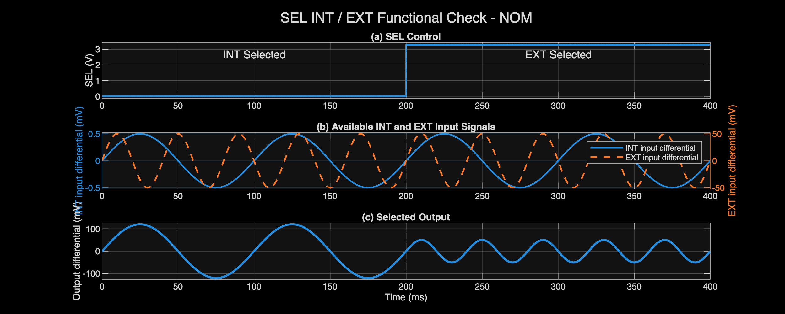
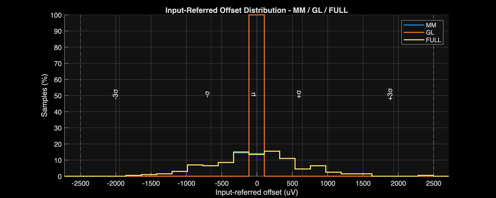
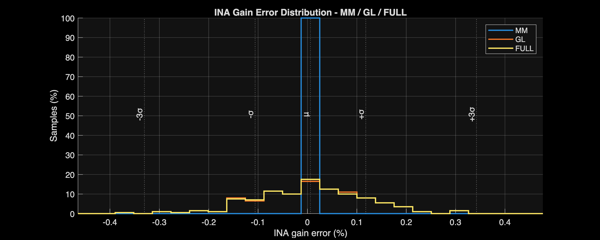
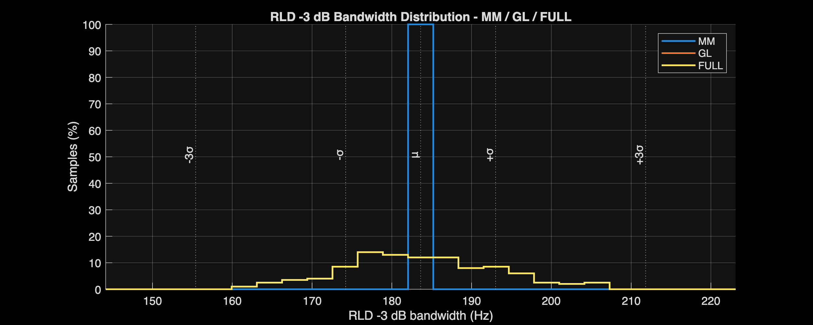
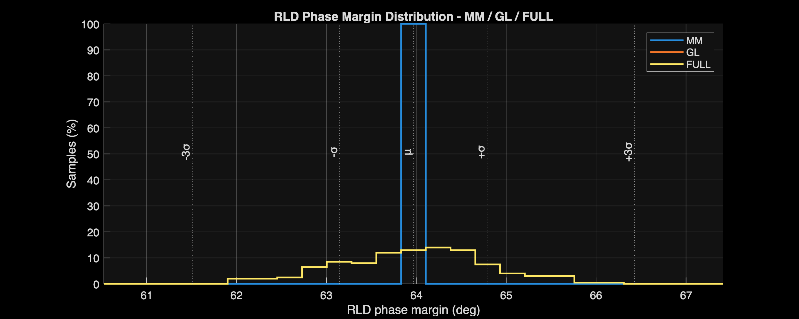
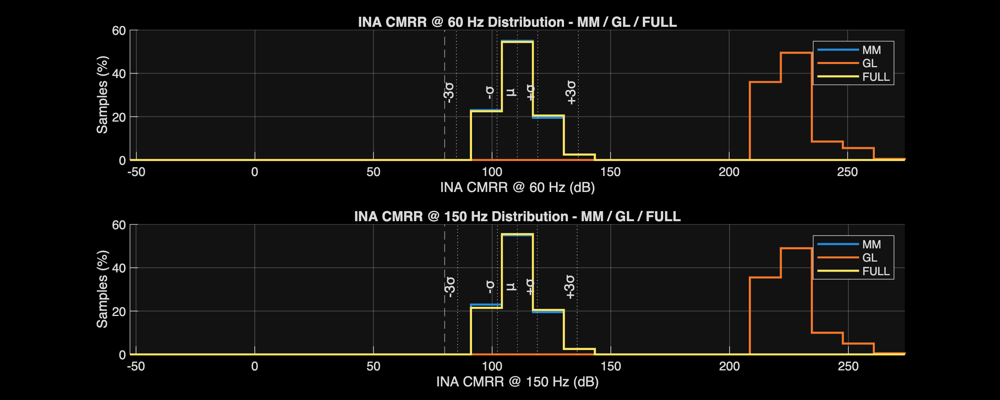
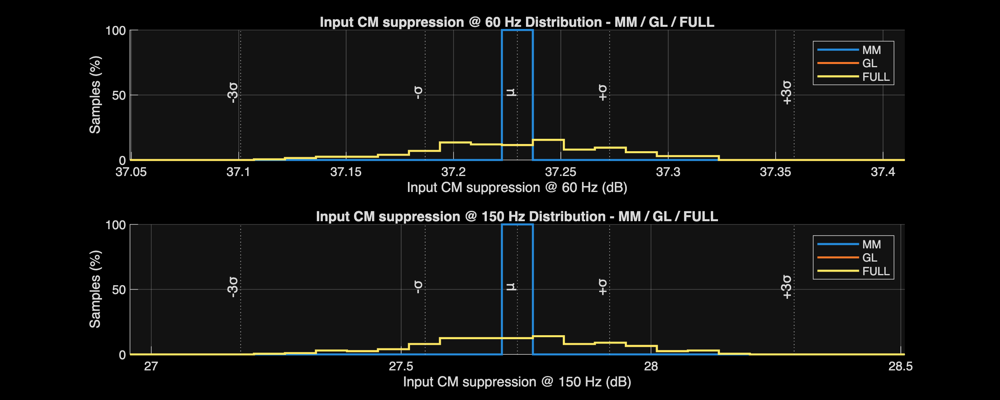

# INA + RLD Verification Report

[← Project report](../../Project_Report.md)

## Circuit and role

The INA provides nominal gain of 240 V/V. RLD senses common mode and drives the body model through the safety network.

[Circuit schematic](../../Design_Files/IC%20Design/Schematic/AFE_BLOCKS/INA/INA.sch)

## Verification snapshot

Updated 2026-10-17 from archived analyzer CSV exports. This documentation update did not rerun simulations.

Blank specification cells mean report-only. Exported worst-case values meet their listed limits; this is pre-layout block verification, not post-layout or silicon signoff.

Very large deterministic CMRR/PSRR values reflect schematic symmetry and numerical cancellation. Use mismatch results to assess imbalance sensitivity; neither dataset guarantees extracted-layout or silicon rejection.

The PVT campaign uses NOM/FF/SS/FS/SF, 3.0/3.3/3.6 V, and −40/27/125°C: 45 operating conditions.

Nominal columns refer to NOM process, 3.3 V, and 27°C. Compact corner names encode process, supply, and temperature. Sweep labels identify a fixed supply or temperature rather than a single corner.

VTC ranges use the analyzer’s 1% linearity criterion. A tested boundary without a crossing is a bound, not an exact compression point. THD is checked at 60 Hz against 0.05%; stimulus amplitudes are retained in the metric names.

### Operating point

| Parameter | Unit | Spec | NOM | Full-PVT worst | Corner |
| :--- | :--- | :--- | :--- | :--- | :--- |
| Total current | mA | ≤6.2 | 3.862 | 4.815 | FFVHTH |
| Total power | mW |  | 12.745 | 17.333 | FFVHTH |
| Output CM error | mV | ±20 | -0.132 | 12.617 | SSVHTH |

### Accuracy and usable range

| Parameter | Unit | Spec | NOM | Full-PVT worst | Corner |
| :--- | :--- | :--- | :--- | :--- | :--- |
| Input-referred offset | uV | ±2500 | 0 | 0.001 | FFVHTH |
| S1 gain error | % | ±0.5 | 0.001 | -0.068 | SSVLTL |
| S2 gain error | % | ±0.25 | 0.01 | 0.029 | FFVHTH |
| INA gain error | % | ±0.5 | 0.011 | -0.077 | SSVLTL |
| Input range low | mV | ≤-5 | -12.8 | -11.2 | FSVLTH |
| Input range high | mV | ≥5 | 12.8 | 11.2 | SSVLTH |
| Output range low | V | ≤-1.2 | -3.071 | -2.687 | SSVLTH |
| Output range high | V | ≥1.2 | 3.071 | 2.687 | SSVLTH |

Input range high: nominal 12.8 mV; full-PVT worst 11.2 mV at `SSVLTH`.

### Frequency response

| Parameter | Unit | Spec | NOM | Full-PVT worst | Corner |
| :--- | :--- | :--- | :--- | :--- | :--- |
| S1 gain | V/V |  | 60.001 | 59.959 | SSVLTL |
| S1 gain dB | dB |  | 35.563 | 35.557 | SSVLTL |
| S1 -3 dB bandwidth | kHz |  | 261.876 | 209.064 | SSVLTH |
| S2 gain | V/V |  | 4 | 4.001 | FFVHTH |
| S2 gain dB | dB |  | 12.042 | 12.044 | FFVHTH |
| S2 -3 dB bandwidth | MHz |  | 2.617 | 2.125 | SSVLTH |
| INA gain | V/V |  | 240.027 | 239.815 | SSVLTL |
| INA gain dB | dB |  | 47.605 | 47.598 | SSVLTL |
| Gain flatness 0.05-150 Hz | dB | ≤0.1 | 1.432e-06 | 2.246e-06 | SSVLTH |
| INA -3 dB bandwidth | kHz |  | 259.251 | 207.051 | SSVLTH |

S1 gain: nominal 60.001 V/V; full-PVT worst 59.959 V/V at `SSVLTL`.

### Common-mode and supply rejection

| Parameter | Unit | Spec | NOM | Full-PVT worst | Corner |
| :--- | :--- | :--- | :--- | :--- | :--- |
| INA CMRR @ 60 Hz | dB | ≥80 | 227.801 | 214.902 | NOMVLTH |
| INA CMRR @ 150 Hz | dB | ≥80 | 227.965 | 214.928 | NOMVLTH |
| INA PSRR+ @ 60 Hz | dB | ≥80 | 196.681 | 185.964 | SSVHTH |
| INA PSRR+ @ 150 Hz | dB | ≥80 | 196.681 | 185.964 | SSVHTH |
| INA PSRR- @ 60 Hz | dB | ≥80 | 224.205 | 206.506 | SSVLTH |
| INA PSRR- @ 150 Hz | dB | ≥80 | 224.068 | 206.492 | SSVLTH |

INA CMRR @ 60 Hz: nominal 227.801 dB; full-PVT worst 214.902 dB at `NOMVLTH`.

### Noise and distortion

| Parameter | Unit | Spec | NOM | Full-PVT worst | Corner |
| :--- | :--- | :--- | :--- | :--- | :--- |
| Input-referred noise 0.05-150 Hz | uVrms | ≤4 | 2.677 | 3.107 | SSVLTH |
| THD @ 60 Hz, 5 mVpp | % | ≤0.05 | 9.267e-05 | 1.025e-04 | SFVLTH |

Input-referred noise 0.05-150 Hz: nominal 2.677 uVrms; full-PVT worst 3.107 uVrms at `SSVLTH`.

### RLD stability and interference rejection

| Parameter | Unit | Spec | NOM | Full-PVT worst | Corner |
| :--- | :--- | :--- | :--- | :--- | :--- |
| RTI residual - BAL | uVpp | ≤1000 | 0.003 | 0.004 | SFVHTH |
| RTI residual - MIS-P | uVpp | ≤1000 | 8.519 | 9.247 | SSVLTL |
| RTI residual - MIS-N | uVpp | ≤1000 | 8.519 | 9.247 | SSVLTL |
| RTI residual - MIS-RLD | uVpp | ≤1000 | 0.003 | 0.004 | SFVHTH |
| RLD gain | V/V |  | 4.999 | 4.999 | FSVLTH |
| RLD -3 dB bandwidth | Hz |  | 182.771 | 163.955 | SSVLTL |
| RLD phase margin | deg | ≥60 | 64.006 | 62.118 | SSVLTH |
| Input CM suppression @ 60 Hz | dB | ≥35 | 37.231 | 37.121 | SSVLTL |
| Input CM suppression @ 150 Hz | dB | ≥25 | 27.735 | 27.309 | SSVLTL |

RLD phase margin: nominal 64.006 deg; full-PVT worst 62.118 deg at `SSVLTH`.

Input CM suppression @ 60 Hz: nominal 37.231 dB; full-PVT worst 37.121 dB at `SSVLTL`.

### Functional checks

Nominal functional trace; selector or gain-control behavior is separate from static gain accuracy.

## Monte Carlo verification

MM applies local mismatch; GL applies global variation; FULL combines both. These are nominal-supply/temperature MC campaigns, not combined worst-PVT-plus-mismatch yield.

| Mode | Requested | Valid | Failed | Overall yield |
| :--- | :--- | :--- | :--- | :--- |
| MM | 200 | 200 | 0 | 100% |
| GL | 200 | 200 | 0 | 100% |
| FULL | 200 | 200 | 0 | 100% |

“Failed” is the analyzer’s exported non-valid count; it may include missing or invalid measurements and must not automatically be interpreted as demonstrated circuit failures. Sample yield applies only to measured MC metrics, not production yield.

### FULL sampled statistics

| Parameter | Unit | Spec | Min | Mean | Max | Yield |
| :--- | :--- | :--- | :--- | :--- | :--- | :--- |
| Total current | mA | ≤6.2 | 3.651 | 3.868 | 4.15 | 100% |
| Total power | mW |  | 12.049 | 12.766 | 13.695 |  |
| Output CM error | mV | ±20 | -11.406 | -0.036 | 12.663 | 100% |
| Input-referred offset | uV | ±2500 | -1757.36 | -5.782 | 2412.76 | 100% |
| S1 gain | V/V |  | 59.824 | 59.998 | 60.14 |  |
| S1 gain error | % | ±0.5 | -0.293 | -0.003 | 0.233 | 100% |
| S2 gain | V/V |  | 3.997 | 4 | 4.004 |  |
| S2 gain error | % | ±0.25 | -0.086 | 0.009 | 0.088 | 100% |
| INA gain | V/V |  | 239.092 | 240.014 | 240.772 |  |
| INA gain error | % | ±0.5 | -0.378 | 0.006 | 0.322 | 100% |
| INA CMRR @ 60 Hz | dB | ≥80 | 96.784 | 110.7 | 139.705 | 100% |
| INA CMRR @ 150 Hz | dB | ≥80 | 96.784 | 110.626 | 138.874 | 100% |
| RLD -3 dB bandwidth | Hz |  | 160.929 | 183.614 | 207.221 |  |
| RLD phase margin | deg | ≥60 | 62.028 | 63.968 | 66.135 | 100% |
| Input CM suppression @ 60 Hz | dB | ≥35 | 37.11 | 37.23 | 37.322 | 100% |
| Input CM suppression @ 150 Hz | dB | ≥25 | 27.232 | 27.733 | 28.148 | 100% |

The source CSVs retain μ±σ and μ±3σ. Those statistical extrapolations are not additional simulated extrema.

FULL Input-referred offset: -1757.36 to 2412.76 uV; mean -5.782 uV.

FULL S1 gain error: -0.293 to 0.233 %; mean -0.003 %.

FULL RLD -3 dB bandwidth: 160.929 to 207.221 Hz; mean 183.614 Hz.

FULL RLD phase margin: 62.028 to 66.135 deg; mean 63.968 deg.

FULL INA CMRR @ 60 Hz: 96.784 to 139.705 dB; mean 110.7 dB.

FULL S1 gain: 59.824 to 60.14 V/V; mean 59.998 V/V.

## Sources and reproduction

- [MATLAB analyzer](../../Measurement_Results/IC_Simulation/AFE_BLOCKS/INA_RLD/INA_RLD_Analyze.m)
- [Representative-corner comparison](../../Measurement_Results/IC_Simulation/AFE_BLOCKS/INA_RLD/Reports/INA_RLD_table_report.csv)
- [Full-PVT worst cases](../../Measurement_Results/IC_Simulation/AFE_BLOCKS/INA_RLD/Reports/INA_RLD_worst_case_report.csv)
- [All exported PVT measurements](../../Measurement_Results/IC_Simulation/AFE_BLOCKS/INA_RLD/Reports/INA_RLD_full_pvt_report.csv)
- [MM statistics](../../Measurement_Results/IC_Simulation/AFE_BLOCKS/INA_RLD/Reports/MM_MC_Summary.csv)
- [GL statistics](../../Measurement_Results/IC_Simulation/AFE_BLOCKS/INA_RLD/Reports/GL_MC_Summary.csv)
- [FULL statistics](../../Measurement_Results/IC_Simulation/AFE_BLOCKS/INA_RLD/Reports/FULL_MC_Summary.csv)
- [MC coverage and yield](../../Measurement_Results/IC_Simulation/AFE_BLOCKS/INA_RLD/Reports/MC_Run_Summary.csv)
- [Xschem testbenches](../../Design_Files/IC%20Design/Testbench/AFE_BLOCKS/INA_RLD)

Regenerate SPICE netlists after schematic edits, finish the simulation jobs, then run the analyzer from its own directory. MATLAB reads exports; it does not launch ngspice.

## Scope and next checks

These results exclude extracted parasitics, package effects, switched-ADC loading, and silicon measurements. Repeat the same limits after layout; do not infer integrated AFE signoff from individual block passes.
