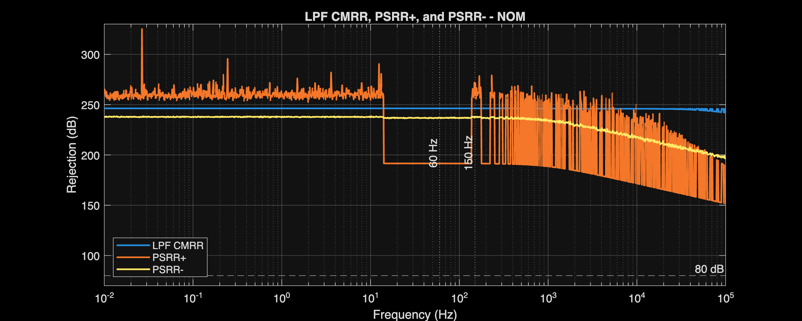
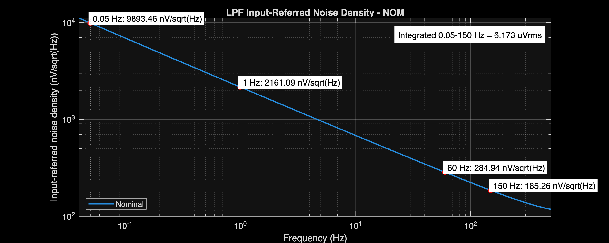
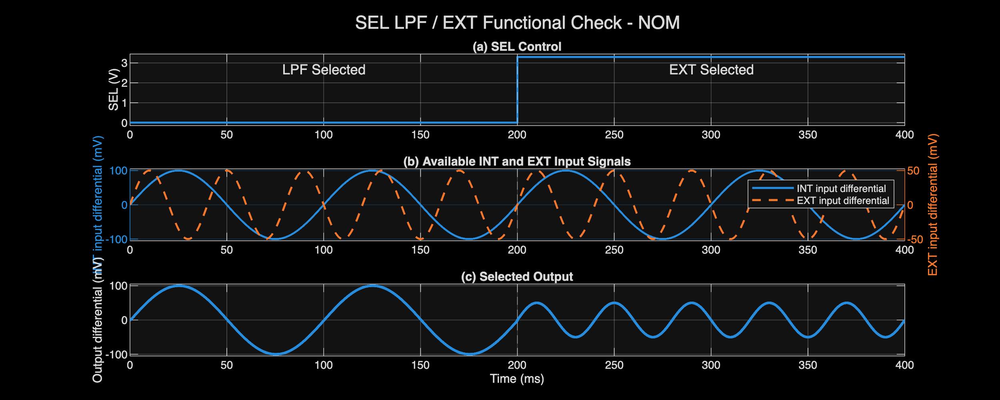
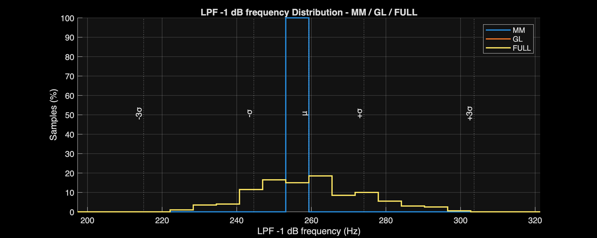
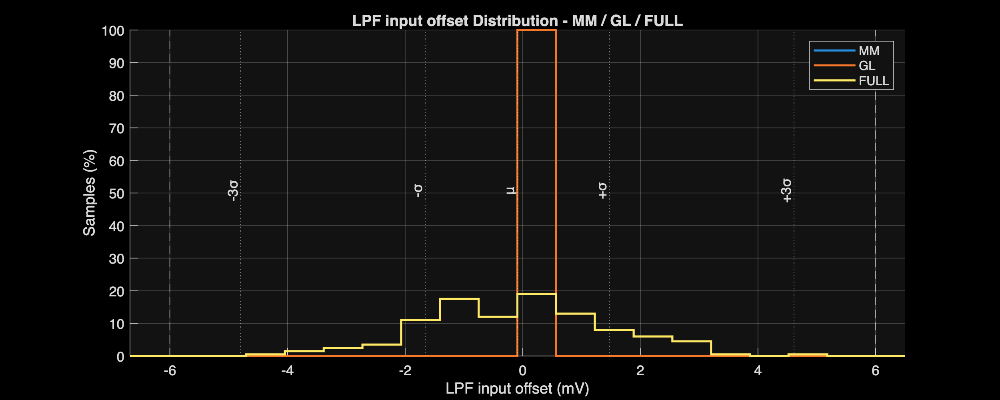
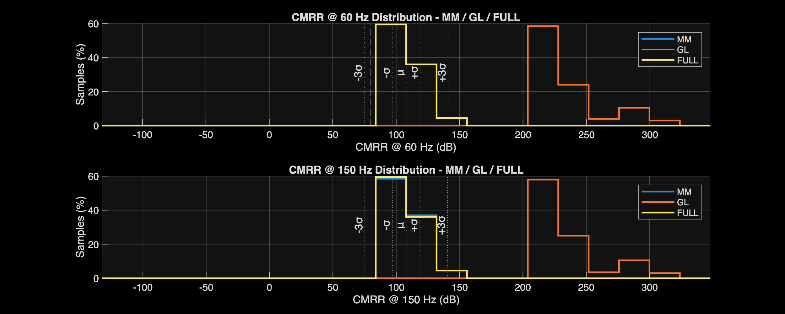

# LPF Verification Report

[← Project report](../../Project_Report.md)

## Circuit and role

The unity-gain differential LPF preserves the ECG passband through 150 Hz. Its −1 dB frequency is the passband acceptance metric.

[Circuit schematic](../../Design_Files/IC%20Design/Schematic/AFE_BLOCKS/LPF/LPF.sch)

## Verification conditions

Checked 2026-10-17 against the latest analyzer CSV exports. No simulations were rerun for this documentation update.

Blank specification cells mean report-only. Exported worst-case values meet their listed limits; this is pre-layout block verification, not post-layout or silicon signoff.

Very large deterministic CMRR/PSRR values reflect schematic symmetry and numerical cancellation. Use mismatch results to assess imbalance sensitivity; neither dataset guarantees extracted-layout or silicon rejection.

The PVT campaign uses NOM/FF/SS/FS/SF, 3.0/3.3/3.6 V, and −40/27/125°C: 45 operating conditions.

Nominal columns refer to NOM process, 3.3 V, and 27°C. Compact corner names encode process, supply, and temperature. Sweep labels identify a fixed supply or temperature rather than a single corner.

VTC ranges use the analyzer’s 1% linearity criterion. A tested boundary without a crossing is a bound, not an exact compression point. THD is checked at 60 Hz against 0.05%; stimulus amplitudes are retained in the metric names.

## Nominal and full-PVT results

### Operating point

| Parameter | Unit | Spec | NOM | Full-PVT worst | Corner |
| :--- | :--- | :--- | :--- | :--- | :--- |
| FDC bias current | uA | 40±10 | 40.113 | 49.606 | FFVHTH |
| CMFB bias current | uA | 40±10 | 40.113 | 49.606 | FFVHTH |
| Total current | mA | ≤2.5 | 1.605 | 2.196 | FFVHTH |
| Total power | mW |  | 5.296 | 7.904 | FFVHTH |
| Output CM error | mV | ±20 | -0.132 | 11.997 | SSVHTH |

### Accuracy and usable range

| Parameter | Unit | Spec | NOM | Full-PVT worst | Corner |
| :--- | :--- | :--- | :--- | :--- | :--- |
| LPF input offset | mV | ±6 | 0 | 0 | FFNOMTH |
| Passband gain error | % | ±0.5 | -0.024 | -0.048 | SSVLTL |
| Input range low | V | ≤-1.2 | -3.158 | -2.798 | FSVLTH |
| Input range high | V | ≥1.2 | 3.158 | 2.798 | FSVLTH |
| Output range low | V | ≤-1.2 | -3.157 | -2.797 | FSVLTH |
| Output range high | V | ≥1.2 | 3.157 | 2.797 | FSVLTH |

Input range high: nominal 3.158 V; full-PVT worst 2.798 V at `FSVLTH`.

### Frequency response

| Parameter | Unit | Spec | NOM | Full-PVT worst | Corner |
| :--- | :--- | :--- | :--- | :--- | :--- |
| Passband gain | V/V |  | 1 | 1 | SSVLTL |
| Loss @ 150 Hz | dB |  | 0.361 | 0.762 | SSVHTL |
| LPF -1 dB frequency | Hz | ≥150 | 258.688 | 174.134 | SSVHTL |
| LPF -3 dB frequency | Hz |  | 506.908 | 340.983 | SSVHTL |

LPF -1 dB frequency: nominal 258.688 Hz; full-PVT worst 174.134 Hz at `SSVHTL`.

### Common-mode and supply rejection

| Parameter | Unit | Spec | NOM | Full-PVT worst | Corner |
| :--- | :--- | :--- | :--- | :--- | :--- |
| CMRR @ 60 Hz | dB | ≥80 | 246.296 | 215 | FFVLTH |
| CMRR @ 150 Hz | dB | ≥80 | 246.284 | 214.997 | FFVLTH |
| PSRR+ @ 60 Hz | dB | ≥80 | 191.531 | 184.861 | SSNOMTL |
| PSRR+ @ 150 Hz | dB | ≥80 | 260.999 | 184.686 | SSNOMTL |
| PSRR- @ 60 Hz | dB | ≥80 | 236.995 | 205.247 | FFVLTH |
| PSRR- @ 150 Hz | dB | ≥80 | 237.817 | 205.217 | FFVLTH |

CMRR @ 60 Hz: nominal 246.296 dB; full-PVT worst 215 dB at `FFVLTH`.

### Noise and distortion

| Parameter | Unit | Spec | NOM | Full-PVT worst | Corner |
| :--- | :--- | :--- | :--- | :--- | :--- |
| Input-referred noise 0.05-150 Hz | uVrms |  | 6.173 | 7.033 | SSVHTH |
| THD @ 60 Hz, 1.2 Vpp | % | ≤0.05 | 0.004 | 0.006 | SSVHTL |

Input-referred noise 0.05-150 Hz: nominal 6.173 uVrms; full-PVT worst 7.033 uVrms at `SSVHTH`.

### Functional checks

Nominal functional trace; selector or gain-control behavior is separate from static gain accuracy.

## Monte Carlo verification

MM applies local mismatch; GL applies global variation; FULL combines both. These are nominal-supply/temperature MC campaigns, not combined worst-PVT-plus-mismatch yield.

| Mode | Requested | Valid | Failed | Overall yield |
| :--- | :--- | :--- | :--- | :--- |
| MM | 200 | 200 | 0 | 100% |
| GL | 200 | 200 | 0 | 100% |
| FULL | 200 | 200 | 0 | 100% |

Counts and yield apply to the measured MC metrics at nominal supply and temperature. Missing or invalid results prevent a pass; they are not demonstrated circuit failures. Sample yield is not production yield.

### FULL sampled statistics

| Parameter | Unit | Spec | Min | Mean | Max | Yield |
| :--- | :--- | :--- | :--- | :--- | :--- | :--- |
| FDC bias current | uA | 40±10 | 38.54 | 40.127 | 41.844 | 100% |
| CMFB bias current | uA | 40±10 | 38.552 | 40.121 | 41.793 | 100% |
| Total current | mA | ≤2.5 | 1.523 | 1.608 | 1.695 | 100% |
| Total power | mW |  | 5.026 | 5.308 | 5.593 |  |
| Output CM error | mV | ±20 | -11.911 | -0.194 | 14.858 | 100% |
| LPF input offset | mV | ±6 | -4.611 | -0.091 | 5.066 | 100% |
| Passband gain | V/V |  | 1 | 1 | 1 |  |
| Passband gain error | % | ±0.5 | -0.031 | -0.025 | -0.02 | 100% |
| LPF -1 dB frequency | Hz | ≥150 | 224.387 | 259.343 | 297.067 | 100% |
| LPF -3 dB frequency | Hz |  | 439.604 | 508.181 | 582.181 |  |
| CMRR @ 60 Hz | dB | ≥80 | 91.179 | 107.885 | 154.616 | 100% |
| CMRR @ 150 Hz | dB | ≥80 | 91.169 | 107.835 | 154.675 | 100% |

The source CSVs retain μ±σ and μ±3σ. Those statistical extrapolations are not additional simulated extrema.

FULL Passband gain: 1 to 1 V/V; mean 1 V/V.

FULL LPF input offset: -4.611 to 5.066 mV; mean -0.091 mV.

FULL CMRR @ 60 Hz: 91.179 to 154.616 dB; mean 107.885 dB.

## Sources and reproduction

- [MATLAB analyzer](../../Measurement_Results/IC_Simulation/AFE_BLOCKS/LPF/LPF_Analyze.m)
- [Representative-corner comparison](../../Measurement_Results/IC_Simulation/AFE_BLOCKS/LPF/Reports/LPF_table_report.csv)
- [Full-PVT worst cases](../../Measurement_Results/IC_Simulation/AFE_BLOCKS/LPF/Reports/LPF_worst_case_report.csv)
- [All exported PVT measurements](../../Measurement_Results/IC_Simulation/AFE_BLOCKS/LPF/Reports/LPF_full_pvt_report.csv)
- [MM statistics](../../Measurement_Results/IC_Simulation/AFE_BLOCKS/LPF/Reports/MM_MC_Summary.csv)
- [GL statistics](../../Measurement_Results/IC_Simulation/AFE_BLOCKS/LPF/Reports/GL_MC_Summary.csv)
- [FULL statistics](../../Measurement_Results/IC_Simulation/AFE_BLOCKS/LPF/Reports/FULL_MC_Summary.csv)
- [MC coverage and yield](../../Measurement_Results/IC_Simulation/AFE_BLOCKS/LPF/Reports/MC_Run_Summary.csv)
- [Xschem testbenches](../../Design_Files/IC%20Design/Testbench/AFE_BLOCKS/LPF)

Regenerate SPICE netlists after schematic edits, finish the simulation jobs, then run the analyzer from its own directory. MATLAB reads exports; it does not launch ngspice.

## Limitations and next steps

These results exclude extracted parasitics, package effects, switched-ADC loading, and silicon measurements. Repeat the same limits after layout; do not infer integrated AFE signoff from individual block passes.
