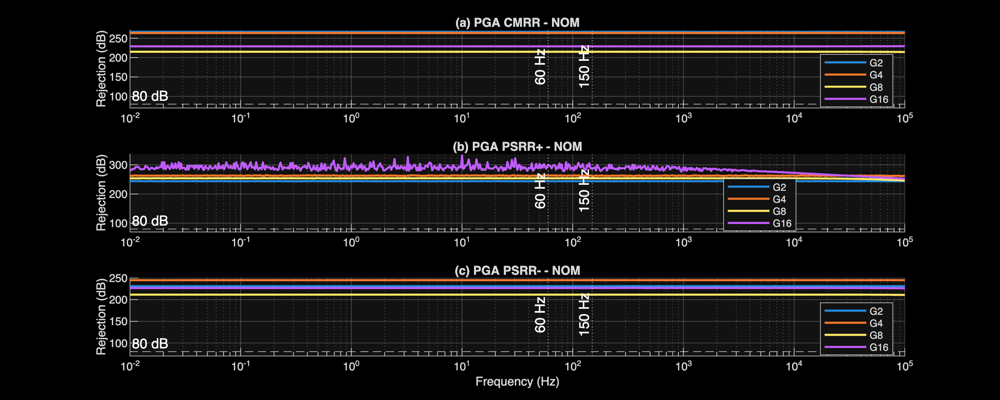
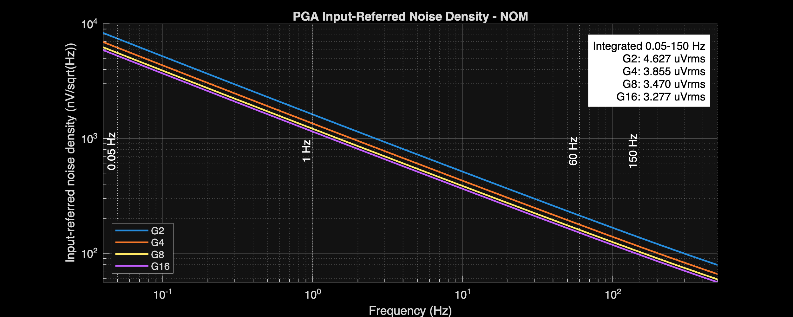
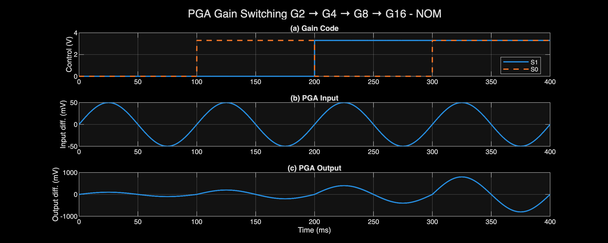
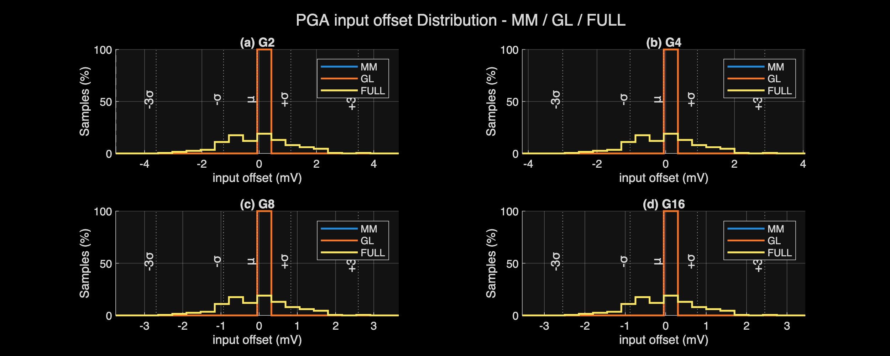
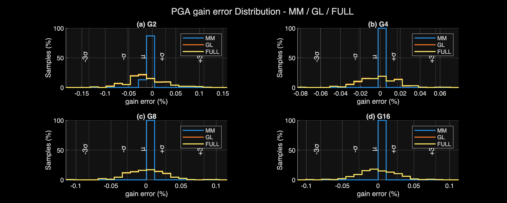
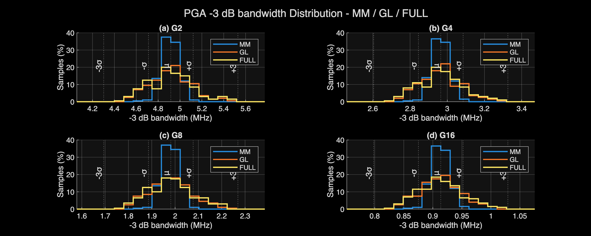
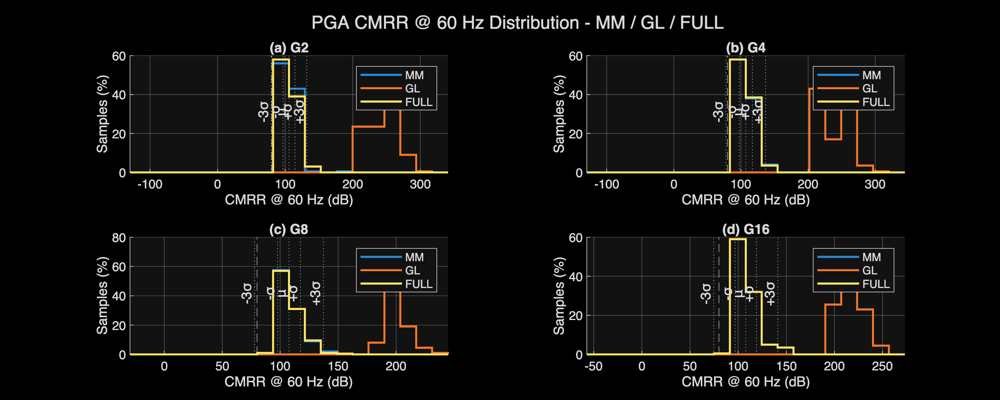

# PGA Design and Verification Report

[← Project report](../../Project_Report.md)

## Circuit and role

The differential PGA selects gains of 2, 4, 8, or 16. Range and THD verification are gain-dependent.

[Circuit schematic](../../Design_Files/IC%20Design/Schematic/AFE_BLOCKS/PGA/PGA.sch)

## Design requirements and sequence

The PGA provides differential gains of 2, 4, 8, and 16. Gain error must remain within ±1%, and THD within 0.05%. Required input range decreases with gain so the output can retain the specified ±2.4-V differential range.

The design uses one FDOTA with a symmetric switched-resistor feedback network. The resistor ratios set the gains; transmission-gate resistance and parasitics determine how closely the physical circuit follows those ratios.

### 1. Set a common input resistance and calculate feedback levels

For matched differential branches,

$$
G_d\approx\frac{R_{F,\mathrm{eff}}}{R_{\mathrm{IN}}}.
$$

Choose approximately 20 kΩ for each input resistor. The required feedback values are then

$$
R_F=\{2,4,8,16\}(20\ \mathrm{k\Omega})
=\{40,80,160,320\}\ \mathrm{k\Omega}.
$$

The fully differential feedback relation and its noise-gain consequences follow [TI's amplifier analysis](https://www.ti.com/lit/pdf/SLOA054).

### 2. Decompose the feedback into selectable sections

Use nominal segment values of 40, 40, 120, and 120 kΩ per side. With the two bypass controls, the selected series path becomes:

| S1/S0 | Selected effective path, ideal switches | Target feedback | Target gain |
| :--- | :--- | :--- | :--- |
| 00 | R1 | 40 kΩ | 2 |
| 01 | R1 + R2 | 80 kΩ | 4 |
| 10 | R1 + R4 | 160 kΩ | 8 |
| 11 | R1 + R2 + R3 + R4 | 320 kΩ | 16 |

At low control levels, the corresponding bypass transmission gates conduct. At high levels, the resistor sections are inserted. The same selection is applied to both differential halves.

The G8 path includes a bypass around the middle section; it is not simply the first three series resistors. This distinction follows from the actual switch connections.

### 3. Calculate resistor geometry and retain model-corrected lengths

Use the same W = 2 µm poly width throughout the network. With 2 kΩ/square, the uncorrected length is

$$
L_{\mathrm{calc}}=\frac{R_{\mathrm{target}}W}{R_\square}.
$$

| Components, P/N pairs grouped | Target segment R | Calculated L | Integer L | Implemented W/L |
| :--- | :--- | :--- | :--- | :--- |
| RINP/RINN | 20 kΩ | 20 µm | 20 µm | 2/20 µm |
| RFBP1/RFBN1 | 40 kΩ | 40 µm | 40 µm | 2/40.04 µm |
| RFBP2/RFBN2 | 40 kΩ | 40 µm | 40 µm | 2/40.32 µm |
| RFBP3/RFBN3 | 120 kΩ | 120 µm | 120 µm | 2/121.28 µm |
| RFBP4/RFBN4 | 120 kΩ | 120 µm | 120 µm | 2/121.14 µm |

The small unequal length adjustments belong to the implemented model/circuit solution. Their individual optimization history is not archived, so they are not attributed to a fabricated tuning procedure.

The PDK includes effective geometry, separate end resistances, temperature dependence, and substrate capacitance. Therefore the final gain must use the complete selected network rather than drawn L/W alone. [GF180 resistor model structure](https://gf180mcu-pdk.readthedocs.io/en/latest/analog/model_parameters/LV/LV_4.html)

### 4. Size the switches to limit gain error and distortion

Each transmission gate uses an NMOS of W/L = 25/0.28 µm and a PMOS of 50/0.28 µm. Short L reduces channel resistance; the wider PMOS compensates qualitatively for lower hole mobility.

This 2:1 width ratio is a design choice, not proof of equal NMOS and PMOS conductance over the full signal range. Wider switches reduce on-resistance but increase charge injection, feedthrough, and node capacitance.

A first-order gain-error screen is

$$
\left|\frac{\Delta G}{G}\right|
\sim\frac{R_{\mathrm{ON,eff}}}{R_{F,\mathrm{eff}}}
$$

for a small series-equivalent switch resistance. At G2, a 1% allowance corresponds to approximately 400 Ω relative to a 40-kΩ feedback path. This is a sensitivity screen, not a universal equivalent circuit for every bypass state.

The exported data do not contain switch on-resistance versus voltage, so no unique calculated switch width can be claimed. Nominal/PVT gain and THD validate the implemented dimensions under the tested signals.

The complementary-control inverters use NMOS W/L = 1/0.5 µm and PMOS W/L = 2/0.5 µm. Equal channel lengths simplify the complementary pair; the 2:1 width ratio balances drive qualitatively. Larger widths would charge the switch gates faster but increase control capacitance and switching current. No delay/load optimization is recoverable from DC gain data; switching traces remain the relevant check.

### 5. Set input range from output swing before testing distortion

For the required differential output magnitude of 2.4 V,

$$
|V_{\mathrm{IN,max}}|=\frac{2.4}{G}
=\{1.2,\ 0.6,\ 0.3,\ 0.15\}\ \mathrm V.
$$

This sets gain-dependent range tests without changing the output requirement. G16 is the closest measured range case: worst input range is approximately ±0.160 V against ±0.150 V required.

THD tests use the amplitudes retained in the result tables. They must not be confused with the separate usable-range endpoints.

### 6. Compare the ideal network with simulation

Nominal gain errors are −0.011%, −0.001%, +0.002%, and +0.001% for G2/G4/G8/G16. Worst PVT magnitudes are 0.409%, 0.120%, 0.133%, and 0.053%, all below 1%.

G2 has the largest measured worst-case error and THD, consistent with stronger sensitivity to the switch/feedback network at the smallest feedback resistance. The results are consistent with that trade-off, but do not isolate its cause from amplifier nonlinearity.

The FDOTA's internal W/L, bias, and compensation follow the [FDOTA design report](../ANALOG_BLOCKS/FDOTA_Report.md). Only the external gain network and switch states change between PGA settings.

## Verification conditions

Checked 2026-10-17 against the latest analyzer CSV exports. No simulations were rerun for this documentation update.

Blank specification cells mean report-only. Exported worst-case values meet their listed limits; this is pre-layout block verification, not post-layout or silicon signoff.

Very large deterministic CMRR/PSRR values reflect schematic symmetry and numerical cancellation. Use mismatch results to assess imbalance sensitivity; neither dataset guarantees extracted-layout or silicon rejection.

The 45-corner campaign covers G2/G4/G8/G16: 180 gain/corner combinations. Gain error is limited to ±1%. Power, bandwidth, and noise remain report-only.

Nominal columns refer to NOM process, 3.3 V, and 27°C. Compact corner names encode process, supply, and temperature. Sweep labels identify a fixed supply or temperature rather than a single corner.

VTC ranges use the analyzer’s 1% linearity criterion. A tested boundary without a crossing is a bound, not an exact compression point. THD is checked at 60 Hz against 0.05%; stimulus amplitudes are retained in the metric names.

## Nominal and full-PVT results

### Operating point

| Parameter | Unit | Spec | NOM | Full-PVT worst | Corner |
| :--- | :--- | :--- | :--- | :--- | :--- |
| FDC bias current | uA | 40±10 | 40.113 | 49.606 | FFVHTH |
| CMFB bias current | uA | 40±10 | 40.113 | 49.606 | FFVHTH |
| Total current | mA | ≤2.5 | 1.605 | 2.196 | FFVHTH |
| Total power | mW |  | 5.296 | 7.905 | FFVHTH |
| Output CM error | mV | ±20 | -0.132 | 11.992 | SSVHTH |

### Accuracy and usable range

| Parameter | Unit | Spec | NOM | Full-PVT worst | Corner |
| :--- | :--- | :--- | :--- | :--- | :--- |
| G2 input offset | mV | ±5 | -4.732e-08 | -1.250e-06 | FFVHTH |
| G2 gain error | % | ±1 | -0.011 | 0.409 | SSVLTH |
| G2 input range low | V | ≤-1.2 | -1.551 | -1.329 | SSVLTH |
| G2 input range high | V | ≥1.2 | 1.551 | 1.329 | SSVLTH |
| G2 output range low | V | ≤-2.4 | -3.098 | -2.66 | SSVLTH |
| G2 output range high | V | ≥2.4 | 3.098 | 2.66 | SSVLTH |
| G4 input offset | mV | ±5 | -1.887e-07 | -1.102e-06 | FFVHTH |
| G4 gain error | % | ±1 | -0.001 | 0.12 | SSVLTH |
| G4 input range low | V | ≤-0.6 | -0.769 | -0.671 | FSVLTH |
| G4 input range high | V | ≥0.6 | 0.769 | 0.671 | FSVLTH |
| G4 output range low | V | ≤-2.4 | -3.074 | -2.686 | FSVLTH |
| G4 output range high | V | ≥2.4 | 3.074 | 2.686 | FSVLTH |
| G8 input offset | mV | ±5 | -1.204e-07 | -3.057e-06 | SSNOMTL |
| G8 gain error | % | ±1 | 0.002 | 0.133 | SSVLTH |
| G8 input range low | V | ≤-0.3 | -0.379 | -0.329 | FSVLTH |
| G8 input range high | V | ≥0.3 | 0.379 | 0.329 | FSVLTH |
| G8 output range low | V | ≤-2.4 | -3.028 | -2.634 | FSVLTH |
| G8 output range high | V | ≥2.4 | 3.028 | 2.634 | FSVLTH |
| G16 input offset | mV | ±5 | -5.528e-08 | -1.288e-06 | FFNOMTH |
| G16 gain error | % | ±1 | 0.001 | -0.053 | FFVLTL |
| G16 input range low | V | ≤-0.15 | -0.186 | -0.16 | FSVLTH |
| G16 input range high | V | ≥0.15 | 0.186 | 0.16 | FSVLTH |
| G16 output range low | V | ≤-2.4 | -2.968 | -2.562 | FSVLTH |
| G16 output range high | V | ≥2.4 | 2.968 | 2.562 | FSVLTH |

G2 input range high: nominal 1.551 V; full-PVT worst 1.329 V at `SSVLTH`.

### Frequency response

| Parameter | Unit | Spec | NOM | Full-PVT worst | Corner |
| :--- | :--- | :--- | :--- | :--- | :--- |
| G2 gain @ 10 Hz | V/V |  | 2 | 2.008 | SSVLTH |
| G2 gain @ 150 Hz | V/V |  | 2 | 2.008 | SSVLTH |
| G2 -3 dB bandwidth | MHz |  | 4.912 | 3.257 | SSVLTH |
| G4 gain @ 10 Hz | V/V |  | 4 | 4.005 | SSVLTH |
| G4 gain @ 150 Hz | V/V |  | 4 | 4.005 | SSVLTH |
| G4 -3 dB bandwidth | MHz |  | 2.963 | 1.962 | SSVLTH |
| G8 gain @ 10 Hz | V/V |  | 8 | 8.011 | SSVLTH |
| G8 gain @ 150 Hz | V/V |  | 8 | 8.011 | SSVLTH |
| G8 -3 dB bandwidth | MHz |  | 1.98 | 1.245 | SSVLTH |
| G16 gain @ 10 Hz | V/V |  | 16 | 15.992 | FFVLTL |
| G16 gain @ 150 Hz | V/V |  | 16 | 15.992 | FFVLTL |
| G16 -3 dB bandwidth | MHz |  | 0.913 | 0.595 | SSVLTH |

G2 -3 dB bandwidth: nominal 4.912 MHz; full-PVT worst 3.257 MHz at `SSVLTH`.

### Common-mode and supply rejection

| Parameter | Unit | Spec | NOM | Full-PVT worst | Corner |
| :--- | :--- | :--- | :--- | :--- | :--- |
| G2 CMRR @ 60 Hz | dB | ≥80 | 266.092 | 214.886 | SSVLNOM |
| G2 CMRR @ 150 Hz | dB | ≥80 | 266.075 | 214.887 | SSVLNOM |
| G2 PSRR+ @ 60 Hz | dB | ≥80 | 243.91 | 186.984 | SSVHNOM |
| G2 PSRR+ @ 150 Hz | dB | ≥80 | 243.912 | 186.984 | SSVHNOM |
| G2 PSRR- @ 60 Hz | dB | ≥80 | 230.941 | 202.079 | SSVLNOM |
| G2 PSRR- @ 150 Hz | dB | ≥80 | 230.944 | 202.078 | SSVLNOM |
| G4 CMRR @ 60 Hz | dB | ≥80 | 263.207 | 210.094 | SSVLTH |
| G4 CMRR @ 150 Hz | dB | ≥80 | 263.279 | 210.094 | SSVLTH |
| G4 PSRR+ @ 60 Hz | dB | ≥80 | 263.833 | 188.643 | SSVHNOM |
| G4 PSRR+ @ 150 Hz | dB | ≥80 | 261.966 | 188.643 | SSVHNOM |
| G4 PSRR- @ 60 Hz | dB | ≥80 | 244.955 | 201.051 | FFVLNOM |
| G4 PSRR- @ 150 Hz | dB | ≥80 | 244.95 | 201.051 | FFVLNOM |
| G8 CMRR @ 60 Hz | dB | ≥80 | 215.07 | 185.09 | SSNOMNOM |
| G8 CMRR @ 150 Hz | dB | ≥80 | 215.057 | 185.09 | SSNOMNOM |
| G8 PSRR+ @ 60 Hz | dB | ≥80 | 253.845 | 189.557 | SSVHNOM |
| G8 PSRR+ @ 150 Hz | dB | ≥80 | 254.26 | 189.557 | SSVHNOM |
| G8 PSRR- @ 60 Hz | dB | ≥80 | 211.58 | 181.017 | SSNOMNOM |
| G8 PSRR- @ 150 Hz | dB | ≥80 | 211.568 | 181.017 | SSNOMNOM |
| G16 CMRR @ 60 Hz | dB | ≥80 | 229.097 | 199.956 | SSVLTH |
| G16 CMRR @ 150 Hz | dB | ≥80 | 229.096 | 199.956 | SSVLTH |
| G16 PSRR+ @ 60 Hz | dB | ≥80 | 298.716 | 190.043 | SSVHNOM |
| G16 PSRR+ @ 150 Hz | dB | ≥80 | 287.007 | 190.043 | SSVHNOM |
| G16 PSRR- @ 60 Hz | dB | ≥80 | 226.827 | 197.017 | FFVLNOM |
| G16 PSRR- @ 150 Hz | dB | ≥80 | 226.829 | 197.017 | FFVLNOM |

G2 CMRR @ 60 Hz: nominal 266.092 dB; full-PVT worst 214.886 dB at `SSVLNOM`.

### Noise and distortion

| Parameter | Unit | Spec | NOM | Full-PVT worst | Corner |
| :--- | :--- | :--- | :--- | :--- | :--- |
| G2 input-referred noise 0.05-150 Hz | uVrms |  | 4.627 | 5.267 | SSVHTH |
| G2 THD @ 60 Hz, 1.20 Vpp | % | ≤0.05 | 0.015 | 0.023 | FSVLTL |
| G4 input-referred noise 0.05-150 Hz | uVrms |  | 3.855 | 4.391 | SSVHTH |
| G4 THD @ 60 Hz, 0.60 Vpp | % | ≤0.05 | 0.004 | 0.006 | FSVLTL |
| G8 input-referred noise 0.05-150 Hz | uVrms |  | 3.47 | 3.952 | SSVHTH |
| G8 THD @ 60 Hz, 0.30 Vpp | % | ≤0.05 | 2.146e-04 | 5.248e-04 | SSVLTL |
| G16 input-referred noise 0.05-150 Hz | uVrms |  | 3.277 | 3.733 | SSVHTH |
| G16 THD @ 60 Hz, 0.15 Vpp | % | ≤0.05 | 2.296e-04 | 4.064e-04 | FFVLTH |

G2 input-referred noise 0.05-150 Hz: nominal 4.627 uVrms; full-PVT worst 5.267 uVrms at `SSVHTH`.

### Functional checks

Nominal functional trace; selector or gain-control behavior is separate from static gain accuracy.

Nominal functional trace; selector or gain-control behavior is separate from static gain accuracy.

## Monte Carlo verification

MM applies local mismatch; GL applies global variation; FULL combines both. These are nominal-supply/temperature MC campaigns, not combined worst-PVT-plus-mismatch yield.

| Mode | Requested | Valid | Failed | Overall yield |
| :--- | :--- | :--- | :--- | :--- |
| MM | 200 | 200 | 0 | 100% |
| GL | 200 | 200 | 0 | 100% |
| FULL | 200 | 200 | 0 | 100% |

Counts and yield apply to the measured MC metrics at nominal supply and temperature. Missing or invalid results prevent a pass; they are not demonstrated circuit failures. Sample yield is not production yield.

### FULL sampled statistics

| Parameter | Unit | Spec | Min | Mean | Max | Yield |
| :--- | :--- | :--- | :--- | :--- | :--- | :--- |
| FDC bias current | uA | 40±10 | 38.54 | 40.127 | 41.844 | 100% |
| CMFB bias current | uA | 40±10 | 38.552 | 40.121 | 41.793 | 100% |
| Total current | mA | ≤2.5 | 1.523 | 1.608 | 1.695 | 100% |
| Total power | mW |  | 5.026 | 5.308 | 5.593 |  |
| Output CM error | mV | ±20 | -11.906 | -0.194 | 14.851 | 100% |
| G2 input offset | mV | ±5 | -3.458 | -0.068 | 3.799 | 100% |
| G2 gain @ 10 Hz | V/V |  | 1.998 | 2 | 2.002 |  |
| G2 gain @ 150 Hz | V/V |  | 1.998 | 2 | 2.002 |  |
| G2 gain error | % | ±1 | -0.124 | -0.012 | 0.113 | 100% |
| G2 -3 dB bandwidth | MHz |  | 4.468 | 4.916 | 5.489 |  |
| G2 CMRR @ 60 Hz | dB | ≥80 | 91.691 | 105.672 | 143.495 | 100% |
| G2 CMRR @ 150 Hz | dB | ≥80 | 91.691 | 105.672 | 143.495 | 100% |
| G4 input offset | mV | ±5 | -2.882 | -0.057 | 3.167 | 100% |
| G4 gain @ 10 Hz | V/V |  | 3.997 | 4 | 4.003 |  |
| G4 gain @ 150 Hz | V/V |  | 3.997 | 4 | 4.003 |  |
| G4 gain error | % | ±1 | -0.076 | -0.002 | 0.066 | 100% |
| G4 -3 dB bandwidth | MHz |  | 2.699 | 2.965 | 3.289 |  |
| G4 CMRR @ 60 Hz | dB | ≥80 | 92.162 | 107.19 | 151.701 | 100% |
| G4 CMRR @ 150 Hz | dB | ≥80 | 92.162 | 107.19 | 151.699 | 100% |
| G8 input offset | mV | ±5 | -2.594 | -0.051 | 2.85 | 100% |
| G8 gain @ 10 Hz | V/V |  | 7.992 | 8 | 8.008 |  |
| G8 gain @ 150 Hz | V/V |  | 7.992 | 8 | 8.008 |  |
| G8 gain error | % | ±1 | -0.104 | 6.287e-04 | 0.096 | 100% |
| G8 -3 dB bandwidth | MHz |  | 1.779 | 1.982 | 2.216 |  |
| G8 CMRR @ 60 Hz | dB | ≥80 | 91.27 | 107.595 | 151.398 | 100% |
| G8 CMRR @ 150 Hz | dB | ≥80 | 91.27 | 107.595 | 151.398 | 100% |
| G16 input offset | mV | ±5 | -2.449 | -0.048 | 2.692 | 100% |
| G16 gain @ 10 Hz | V/V |  | 15.985 | 16 | 16.013 |  |
| G16 gain @ 150 Hz | V/V |  | 15.985 | 16 | 16.013 |  |
| G16 gain error | % | ±1 | -0.094 | 5.000e-05 | 0.081 | 100% |
| G16 -3 dB bandwidth | MHz |  | 0.83 | 0.914 | 1.014 |  |
| G16 CMRR @ 60 Hz | dB | ≥80 | 91.189 | 107.921 | 154.431 | 100% |
| G16 CMRR @ 150 Hz | dB | ≥80 | 91.189 | 107.921 | 154.429 | 100% |

The source CSVs retain μ±σ and μ±3σ. Those statistical extrapolations are not additional simulated extrema.

FULL G2 input offset: -3.458 to 3.799 mV; mean -0.068 mV.

FULL G2 gain error: -0.124 to 0.113 %; mean -0.012 %.

FULL G2 -3 dB bandwidth: 4.468 to 5.489 MHz; mean 4.916 MHz.

FULL G2 CMRR @ 60 Hz: 91.691 to 143.495 dB; mean 105.672 dB.

## Measurement sources

- [MATLAB analyzer](../../Measurement_Results/IC_Simulation/AFE_BLOCKS/PGA/PGA_Analyze.m)
- [Representative-corner comparison](../../Measurement_Results/IC_Simulation/AFE_BLOCKS/PGA/Reports/PGA_table_report.csv)
- [Full-PVT worst cases](../../Measurement_Results/IC_Simulation/AFE_BLOCKS/PGA/Reports/PGA_worst_case_report.csv)
- [All exported PVT measurements](../../Measurement_Results/IC_Simulation/AFE_BLOCKS/PGA/Reports/PGA_full_pvt_report.csv)
- [MM statistics](../../Measurement_Results/IC_Simulation/AFE_BLOCKS/PGA/Reports/MM_MC_Summary.csv)
- [GL statistics](../../Measurement_Results/IC_Simulation/AFE_BLOCKS/PGA/Reports/GL_MC_Summary.csv)
- [FULL statistics](../../Measurement_Results/IC_Simulation/AFE_BLOCKS/PGA/Reports/FULL_MC_Summary.csv)
- [MC coverage and yield](../../Measurement_Results/IC_Simulation/AFE_BLOCKS/PGA/Reports/MC_Run_Summary.csv)
- [Xschem testbenches](../../Design_Files/IC%20Design/Testbench/AFE_BLOCKS/PGA)

## Limitations and next steps

These results exclude extracted parasitics, package effects, switched-ADC loading, and silicon measurements. Repeat the same limits after layout; do not infer integrated AFE signoff from individual block passes.
