# FDOTA Design and Verification Report

[← System-level project report](../../Project_Report.md)

| Item | Result |
| :--- | :--- |
| Verification level | Pre-layout schematic |
| Deterministic coverage | 45/45 PVT corners pass |
| Statistical coverage | MM, GL, and FULL: 200/200 valid runs each |
| Overall status | **Pass** |

## 1. Architecture

The FDOTA separates differential amplification from output common-mode regulation.

- **FDC:** a symmetric two-stage differential signal path with one compensation branch per output.
- **CMFB amplifier:** compares the sensed output common mode with `REF` and drives `VCMFB`.
- **Output sensor:** matched resistors average `OUTP` and `OUTN`; matched capacitors preserve high-frequency symmetry.

Schematic sources: [FDOTA](<../../Design_Files/IC Design/Schematic/ANALOG_BLOCKS/FDOTA/FDOTA/FDOTA.sch>), [FDC](<../../Design_Files/IC Design/Schematic/ANALOG_BLOCKS/FDOTA/FDC/FDC.sch>), and [CMFB](<../../Design_Files/IC Design/Schematic/ANALOG_BLOCKS/FDOTA/CMFB/CMFB.sch>).

The top-level schematic shows the FDC, output common-mode sensor, and CMFB loop as one closed system.

## 2. Sizing assumptions and method

The following hand calculations retain the first-pass sizing assumptions. They explain design choices; they are not a new device-level extraction. Current acceptance limits and simulation values are listed in the verification results below.

The supplied FDC and CMFB worksheets provided a useful sequence, but several assumptions did not match the implemented circuits. The FDC uses 2.5-pF compensation per side and 0.5-µm output devices, not the worksheet's 2-pF and 1-µm values. The CMFB amplifier is a single-stage error amplifier, not a two-stage Miller OTA. The calculations below use the implemented topologies and dimensions.

### 2.1 Governing equations

The core $g_m/I_D$ relations are [Silveira, Flandre, and Jespers](https://people.engr.tamu.edu/spalermo/ecen474/gm_ID_methodology_silveira_jssc_1996.pdf):

$$
g_m=\left(\frac{g_m}{I_D}\right)I_D,
\qquad
J_D=\frac{I_D}{W_{eff}},
\qquad
W_{eff}=\frac{I_D}{J_D},
\qquad
A_{v,int}=\frac{g_m}{g_{ds}}.
$$

The corrected flow is:

1. Convert bandwidth, phase-margin, load, and slew specifications into $g_m$ and current bounds.
2. Select $L$ and $g_m/I_D$ from current density, intrinsic gain, and speed.
3. Calculate $W_{eff}=I_D/J_D$ and round to matched layout units.
4. Estimate gain, poles, zero, and slew rate.
5. Close both loops with transistor-level AC, transient, PVT, and Monte Carlo simulation.

For a Miller-compensated two-stage path,

$$
g_{m1}\approx2\pi f_uC_c,
\qquad
f_{p2}\approx\frac{g_{m2}}{2\pi(C_L+C_c)}.
$$

The unity-gain relation is derived in [Berkeley EE 140, Lecture 22](https://www-inst.cs.berkeley.edu/~ee140/sp12/lectures/Lec22w.CMOSOpAmpCompensation.ee140.s12.ctn.pdf). The pole approximation is summarized in [P. E. Allen's two-stage compensation notes](https://www.pallen.ece.gatech.edu/Academic/ECE_6412/Spring_2004/L120-CompOpAmpsI%282UP%29.pdf).

Ignoring higher poles and the compensation zero,

$$
PM\approx90^\circ-\tan^{-1}\left(\frac{f_u}{f_{p2}}\right),
$$

so the second-stage lower bound is

$$
g_{m2}\gtrsim2\pi f_u(C_L+C_c)\tan(PM_{target}).
$$

This replaces the worksheet's fixed `kp2` multiplier, which has no topology-independent derivation.

The local 180-nm tables use `nfet_03v3` and `pfet_03v3` devices at a 1.65-V drain-to-source magnitude. Representative values at $g_m/I_D=10\ \text{V}^{-1}$ are:

| $L$ (µm) | NMOS $I_D/W$ (µA/µm) | NMOS $g_m/g_{ds}$ (dB) | NMOS $(g_m/I_D)f_T$ (GHz/V) | PMOS $I_D/W$ (µA/µm) | PMOS $g_m/g_{ds}$ (dB) | PMOS $(g_m/I_D)f_T$ (GHz/V) |
| ---: | ---: | ---: | ---: | ---: | ---: | ---: |
| 0.5 | 4.381 | 44.80 | 54.34 | 1.265 | 48.34 | 12.62 |
| 1.0 | 2.257 | 51.75 | 13.75 | 0.5309 | 56.26 | 2.668 |
| 2.0 | 1.055 | 55.27 | 3.067 | 0.2390 | 61.99 | 0.6172 |
| 4.0 | 0.4959 | 58.41 | 0.7020 | 0.1128 | 67.40 | 0.1501 |

At $g_m/I_D=10\ \text{V}^{-1}$, NMOS current density falls from 4.381 to 0.4959 µA/µm as length increases from 0.5 to 4 µm.

Over the same length change, NMOS intrinsic gain rises from 44.80 to 58.41 dB.

At $g_m/I_D=10\ \text{V}^{-1}$, PMOS current density falls from 1.265 to 0.1128 µA/µm as length increases from 0.5 to 4 µm.

PMOS intrinsic gain rises from 48.34 to 67.40 dB over the same length range.

These tables guide sizing; they do not replace final-hierarchy operating-point data. Exact device $g_m/I_D$ depends on its in-circuit terminal and body voltages.

## 3. FDC core

The FDC schematic shows the symmetric signal paths and the matched compensation networks.

### 3.1 Design targets and sizing flow

These targets allocate the FDC design within the integrated FDOTA. PVT requirements apply to the complete FDOTA, not to a separate FDC verification campaign.

| Quantity | Design target | Nominal specification | PVT specification |
| :--- | ---: | ---: | ---: |
| Supply, $V_{DD}$ | 3.3 V | 3.3 V | 3.0–3.6 V |
| Load per output, $C_L$ | 40 pF | 40 pF | 40 pF |
| Miller capacitor per side, $C_c$ | 2.50 pF | 2.50 pF | 2.50 pF |
| Differential UGF | 10 MHz | $\ge10$ MHz | $\ge8$ MHz |
| Differential phase margin | 65° | $\ge65^\circ$ | $\ge60^\circ$ |
| Differential gain | 90 dB | $\ge90$ dB | $\ge85$ dB |
| Differential slew rate | 6 V/µs | $\ge6$ V/µs | $\ge4$ V/µs |
| Differential settling | 200 ns | $\le200$ ns | $\le300$ ns |
| Total integrated current | 2.0 mA | $\le2.0$ mA | $\le2.5$ mA |
| FDC bias reference | 40 µA | 40 µA nominal | $40\pm10$ µA |

The differential design-support fixture and integrated FDOTA use 40 pF per output. The separate common-mode plant fixture uses 10 pF. These nominal fixtures support sizing and control-polarity checks; only integrated FDOTA results are reported.

The 10-MHz UGF target is 25% above the PVT minimum. The implemented integrated nominal result is 14.586 MHz, leaving additional transistor-level margin.

Each result becomes the input to the next sizing step:

| Step | Starting requirement | Calculated result | Next design decision |
| ---: | :--- | :--- | :--- |
| 1 | Slew rate and 20.046-µA tail current | $C_c\le3.34$ pF | Choose 2.50 pF per side |
| 2 | $C_c$ and 10-MHz UGF | $g_{m1}=157.1$ µS | Set M1/M2 current and width |
| 3 | M1/M2 current, $g_m/I_D$, and $J_D$ | $W_{1,calc}=105.1$ µm | Enlarge to 200 µm for noise and matching |
| 4 | Branch current and PMOS $J_D$ | $W_{3,calc}=138.5$ µm | Use 200 µm for matching and final current |
| 5 | 65° PM, 40-pF load, and $C_c$ | $g_{m2,min}=5.726$ mS | Allocate about 0.67 mA per output branch |
| 6 | Branch current and device current density | $W_{6,7}=500.1$ µm; $W_{8,9}=100.0$ µm | Use 500/100 µm |
| 7 | Implemented $g_{mP}$ and $C_c$ | $1/g_{mP}\approx153\ \Omega$ | Choose matched 3.5-kΩ $R_z$ branches |
| 8 | Complete differential and CMFB loops | Gain, pole, zero, and slew estimates | Verify both return ratios over PVT and Monte Carlo |

The compensation value is fixed before input-pair sizing. With the 20.046-µA tail and 6-V/µs nominal slew target,

$$
C_c\le\frac{20.046\ \mu\text{A}}{6\ \text{V}/\mu\text{s}}
=3.34\ \text{pF}.
$$

Selecting 2.50 pF per side leaves slew margin and becomes the input to the UGF calculation below.

### 3.2 Required input transconductance

The formal UGF requirement gives

$$
g_{m1,min}=2\pi(8\ \text{MHz})(2.50\ \text{pF})
=125.7\ \mu\text{S}.
$$

The 10-MHz nominal target gives

$$
g_{m1,target}=2\pi(10\ \text{MHz})(2.50\ \text{pF})
=157.1\ \mu\text{S}.
$$

### 3.3 M1/M2 current and width

Select $L=2$ µm and $g_m/I_D=20\ \text{V}^{-1}$. The NMOS table gives $J_D=0.07476\ \mu\text{A}/\mu\text{m}$ and $g_m/g_{ds}=510.58$.

$$
I_{D1}=\frac{157.1\ \mu\text{S}}{20\ \text{V}^{-1}}
=7.854\ \mu\text{A},
$$

$$
W_{1,calc}=\frac{7.854\ \mu\text{A}}
{0.07476\ \mu\text{A}/\mu\text{m}}
=105.1\ \mu\text{m}.
$$

The nearest integer is 105 µm. This is the minimum UGF-derived width. Because MOS flicker-noise voltage scales approximately as $1/(WLf)$, the final pair is enlarged by

$$
\frac{W_{used}}{W_{calc}}=\frac{200}{105.1}=1.90.
$$

The implemented $W_{eff}=200$ µm reduces flicker noise and mismatch and lowers current density, which supports higher transconductance efficiency at the final branch current. The trade-offs are increased input capacitance, first-stage-node capacitance, area, and potentially lower high-frequency pole locations. The 14.586-MHz nominal UGF confirms adequate bandwidth, while the 3.083-µVrms nominal and 3.513-µVrms worst-PVT noise results remain below the 4-µVrms limit.

### 3.4 M3/M4 active-load width

For the CMFB-controlled PMOS loads, select $L=2$ µm and $g_m/I_D=16\ \text{V}^{-1}$. The table gives $J_D=0.05669\ \mu\text{A}/\mu\text{m}$.

$$
W_{3,calc}=\frac{7.854\ \mu\text{A}}
{0.05669\ \mu\text{A}/\mu\text{m}}
=138.5\ \mu\text{m}.
$$

The nearest integer is 139 µm. The implemented value is 200 µm per device. The added area improves matching between the two CMFB-controlled loads and supports the final branch current.

### 3.5 M5/M10 mirror sizing

Choose $L=2$ µm and a reference current density near $2\ \mu\text{A}/\mu\text{m}$:

$$
W_{10,calc}=\frac{40\ \mu\text{A}}{2\ \mu\text{A}/\mu\text{m}}
=20\ \mu\text{m}.
$$

The 20-µA tail is one-half of the reference current, so

$$
W_{5,calc}=W_{10}\frac{20\ \mu\text{A}}{40\ \mu\text{A}}
=10\ \mu\text{m}.
$$

The implemented 20- and 10-µm widths preserve this 2:1 ratio. The 2-µm length improves current-source output resistance; the trade-off is additional area and capacitance.

### 3.6 First-stage gain estimate

At the selected lookup points,

$$
g_{ds1}=\frac{157.1\ \mu\text{S}}{510.58}
=0.308\ \mu\text{S},
$$

$$
g_{m3}=(16)(7.854\ \mu\text{A})=125.7\ \mu\text{S},
\qquad
g_{ds3}=\frac{125.7}{1608.33}=0.0781\ \mu\text{S}.
$$

Therefore

$$
A_1\approx\frac{157.1}{0.308+0.0781}
=407.2\ \text{V/V}=52.20\ \text{dB}.
$$

## 4. Output-stage and compensation calculation

### 4.1 Transconductance and current

For the 65° nominal design target,

$$
g_{m2,min}=2\pi(10\ \text{MHz})(40\ \text{pF}+2.5\ \text{pF})\tan65^\circ
=5.726\ \text{mS}.
$$

Allocate approximately 0.67 mA to each output branch from the 2.0-mA nominal current target. The two branches use about 1.34 mA and leave margin for the input tail, references, CMFB, and PVT growth. The later isolated-FDC operating point reports

$$
I_{out,branch}\approx
\frac{1400.48-40.092-20.046}{2}
=670.2\ \mu\text{A}.
$$

Choose $L=0.5$ µm for output-stage speed and current density. Select approximately $g_m/I_D=9.78\ \text{V}^{-1}$ for the PMOS devices and $8.33\ \text{V}^{-1}$ for the NMOS devices. Interpolation of the local tables gives

$$
J_P\approx1.340\ \mu\text{A}/\mu\text{m},
\qquad
J_N\approx6.702\ \mu\text{A}/\mu\text{m}.
$$

The corresponding transconductances at the allocated branch current are

$$
g_{mP}\approx6.55\ \text{mS},
\qquad
g_{mN}\approx5.58\ \text{mS},
$$

so the PMOS stage transconductance exceeds the 5.726-mS lower bound by about 14%. The current densities now give independent width estimates:

$$
W_{6,7,calc}=\frac{670.2}{1.340}=500.1\ \mu\text{m},
\qquad
W_{8,9,calc}=\frac{670.2}{6.702}=100.0\ \mu\text{m}.
$$

These values round directly to the implemented 500-µm PMOS and 100-µm NMOS devices.

### 4.2 Gain estimate

Using interpolated intrinsic gains gives

$$
A_2\approx111.3\ \text{V/V}=40.93\ \text{dB}.
$$

The estimated total differential gain is

$$
A_0\approx(407.2)(111.3)=4.533\times10^4\ \text{V/V}
=93.13\ \text{dB}.
$$

### 4.3 Pole and phase-margin estimate

The non-dominant-pole estimate is

$$
f_{p2}\approx\frac{6.55\ \text{mS}}
{2\pi(42.5\ \text{pF})}=24.53\ \text{MHz},
$$

$$
PM_{2pole}\approx90^\circ-\tan^{-1}\left(\frac{10}{24.53}\right)
=67.82^\circ.
$$

### 4.4 Nulling resistors

For a series nulling resistor, the signed zero is [Geiger, Allen, and Strader, Chapter 6](https://class.ece.iastate.edu/ee508/GAS_book/chap6.pdf)

$$
\omega_z\approx\frac{1}{C_c(1/g_{mP}-R_z)}.
$$

$1/g_{mP}\approx153\ \Omega$. The implemented $R_z\approx3.5$ kΩ gives $f_z\approx-19.0$ MHz; the negative sign denotes a left-half-plane zero. The final value is simulation-tuned, following the compensation principles established by [Ahuja](https://doi.org/10.1109/JSSC.1983.1052012).

### 4.5 Slew-rate check

The classical Miller slew estimate is [Johns and Martin, Chapter 6](https://www.d.umn.edu/~htang/ECE5211_doc_files/ECE5211_files/Chapter6.pdf)

$$
SR\approx\frac{I_{tail}}{C_c}
=\frac{20.046\ \mu\text{A}}{2.50\ \text{pF}}
=8.02\ \text{V}/\mu\text{s}.
$$

The output stage needs only $(4\ \text{V}/\mu\text{s})(40\ \text{pF})=160$ µA per output to meet the formal slew requirement, below the estimated 670-µA branch current.

The 2.5-pF value is also below the nominal slew-derived maximum:

$$
C_c\le\frac{I_{tail}}{SR_{target}}
=\frac{20.046\ \mu\text{A}}{6\ \text{V}/\mu\text{s}}
=3.34\ \text{pF}.
$$

Thus 2.5 pF provides stability margin without consuming all of the slew budget. Each MIM device uses $35.36\times35.36$ µm, or about 1250 µm² at 2 fF/µm². Cc1 and Cc2 are identical because any differential mismatch would create unequal poles and convert differential motion into common-mode error.

Rz1 and Rz2 are also identical. Each poly resistor has $L/W=7/4=1.75$ squares, giving approximately 3.5 kΩ with a 2-kΩ/square layer. The matched pair places the two compensation zeros at the same frequency. The value is larger than $1/g_{mP}$, so the first-order zero is in the left half-plane; transistor-level loop simulation confirms 77.134° nominal phase margin.

### 4.6 Complete component-size audit

`W_{calc}` is obtained from the preceding current-density calculation or from the fixed mirror ratio. `W_{round}` is the closest whole-micrometre width. `W_used = W × m` because the listed devices use `nf=1`.

| Component(s) | Function | $L_{used}$ (µm) | $W_{calc}$ (µm) | $W_{round}$ (µm) | Schematic geometry | Implemented value |
| :---: | :--- | ---: | ---: | ---: | :---: | ---: |
| M1/M2 | NMOS input pair | 2.0 | 105.1 | 105 | $100\ \mu\text{m}\times m2$ | $W_{eff}=200$ µm |
| M3/M4 | PMOS CMFB-controlled loads | 2.0 | 138.5 | 139 | $50\ \mu\text{m}\times m4$ | $W_{eff}=200$ µm |
| M5 | NMOS tail mirror | 2.0 | 10.0 | 10 | $10\ \mu\text{m}\times m1$ | $W_{eff}=10$ µm |
| M10 | NMOS 40-µA reference | 2.0 | 20.0 | 20 | $20\ \mu\text{m}\times m1$ | $W_{eff}=20$ µm |
| M6/M7 | PMOS output stages | 0.5 | 500.1 | 500 | $50\ \mu\text{m}\times m10$ | $W_{eff}=500$ µm |
| M8/M9 | NMOS output loads | 0.5 | 100.0 | 100 | $100\ \mu\text{m}\times m1$ | $W_{eff}=100$ µm |
| Cc1/Cc2 | Matched Miller capacitors | — | — | — | $35.36\times35.36$ µm each | 2.50 pF each |
| Rz1/Rz2 | Matched zero-setting resistors | 7.0 | 4.0 width | — | 1.75 squares each | 3.5 kΩ each |

The passive calculations and implemented geometries are:

| Component(s) | Calculation | Calculated geometry | Implemented geometry |
| :---: | :--- | :---: | :---: |
| Cc1/Cc2 | $A=2.5\text{pF}/(2\text{fF}/\mu\text{m}^2)=1250\ \mu\text{m}^2$ | Square side $35.355$ µm | $35.36\times35.36$ µm each |
| Rz1/Rz2 | $N_\square=3.5\text{k}/2\text{k}=1.75$; choose $W=4$ µm | $L=1.75(4)=7.0$ µm | $W/L=4/7$ µm each |

M1/M2 and M3/M4 use $L=2$ µm for higher intrinsic gain and matching than minimum-length devices, while retaining more speed than a 4-µm choice. Their final widths are larger than the first-pass result to improve noise and matching.

M5/M10 use the same 1:2 mirror rule as the SEOTA. The 0.5-µm output devices trade intrinsic gain for current density and speed; their calculated and implemented widths agree within 0.1%.

The matched Cc/Rz branches preserve differential symmetry. Square MIM capacitors avoid unequal orientation and aspect-ratio effects; the 4-µm resistor width reduces current density and mismatch at the cost of area.

### 4.7 Estimate-to-simulation comparison

| Metric | First-order estimate | Nominal simulation | Specification |
| :--- | ---: | ---: | ---: |
| DC gain | 93.13 dB | 92.064 dB | $\ge85$ dB |
| UGF | 10 MHz sizing target | 14.586 MHz | $\ge8$ MHz |
| Phase margin | 67.82° two-pole screen | 77.134° | $\ge60^\circ$ |
| Slew rate | 8.02 V/µs | 7.208 V/µs | $\ge4$ V/µs |

The gain estimate is within 1.07 dB of the integrated result, and the slew estimate is within 11.3%. The nominal UGF exceeds its 10-MHz target.

The 67.82° two-pole result is conservative because it excludes the intended LHP zeros. At the 14.586-MHz simulated crossover, a 19.0-MHz LHP zero provides about 37.5° of lead; internal poles remove part of that lead, yielding 77.134°.

The full transistor-level return ratio is therefore used for signoff. Output swing is not signed off with the square-law shortcut $V_{OV}\approx2/(g_m/I_D)$ because it omits body effect, real saturation voltage, and terminal-voltage dependence.

## 5. Common-mode feedback block

The CMFB schematic shows the error amplifier that converts sensed common-mode error into the `VCMFB` control voltage.

### 5.1 Design targets and sizing flow

CMFB sizing is driven by the integrated FDOTA requirements: output common-mode error within ±20 mV and common-mode settling within 1 µs. These are not separate standalone-CMFB signoff limits. For a first-order 1% response,

$$
t_s\approx\frac{4.6}{2\pi f_{CL}},
$$

so the 1-µs requirement implies $f_{CL}\gtrsim0.733$ MHz. The tighter 400-ns nominal target requires

$$
f_{CL,target}=\frac{4.6}{2\pi(400\ \text{ns})}=1.83\ \text{MHz}.
$$

The implemented CMFB is a single-stage NMOS differential pair with a PMOS active load. It does not use Miller compensation.

| Quantity | Design target | Nominal specification | PVT specification |
| :--- | ---: | ---: | ---: |
| Output common mode | $V_{DD}/2$ | 1.65 V at nominal | $V_{DD}/2$ |
| Output CM error | 0 V | $\le\pm10$ mV | $\le\pm20$ mV |
| Step-induced CM disturbance | $\le40$ mV | $\le40$ mV | $\le60$ mV |
| CMFB slew, rise/fall | 3/3 V/µs | $\ge3/3$ V/µs | $\ge2/2$ V/µs |
| Integrated CMFB settling | 400 ns | $\le400$ ns | $\le1000$ ns |
| Equivalent first-order bandwidth | 1.83 MHz | $\ge1.83$ MHz | $\ge0.733$ MHz |
| Error-amplifier DC gain | 40 dB | $\ge40$ dB | Internal design check |
| Standalone `CMFB_OUT` load | 10 pF | 10 pF | Internal design check |

The integrated common-mode loop determines signoff. The error amplifier alone cannot predict settling because the loop also contains the FDC common-mode plant and output sensor. IEEE return-ratio analysis likewise treats differential and common-mode stability as properties of the complete balanced feedback paths, not isolated amplifier gain [Hurst and Lewis](https://doi.org/10.1109/82.476178).

Each result becomes the input to the next sizing step:

| Step | Starting requirement | Calculated result | Next design decision |
| ---: | :--- | :--- | :--- |
| 1 | 400-ns nominal settling | $f_{CL,target}=1.83$ MHz | Require a faster error-amplifier output pole |
| 2 | Fixed 40-µA tail | 19.912 µA per side | Select M1/M2 inversion level |
| 3 | $g_m/I_D=12$ V$^{-1}$ and NMOS $J_D$ | $g_{m1}=244.2$ µS; $W_{1,calc}=14.18$ µm | Use 15-µm M1/M2 |
| 4 | 10-pF standalone load | $g_m/(2\pi C)=3.89$ MHz | Confirm 2.12× margin over 1.83 MHz |
| 5 | Same branch current and PMOS $J_D$ | $W_{3,calc}=206.2$ µm | Use 205.5-µm M3/M4 |
| 6 | 40-µA reference and 1:1 mirror | $W_5=W_{10}=20$ µm | Use $L=2$ µm for current accuracy |
| 7 | Sensor loading and symmetry | 100-kΩ R1/R2; 50-fF C1/C2 | Use matched geometries |
| 8 | Complete FDC, sensor, and CMFB | Common-mode return ratio and transient response | Sign off PVT and Monte Carlo |

### 5.2 Input-pair sizing

The fixed 40-µA tail gives 19.912 µA per input branch. Select $L=1$ µm and $g_m/I_D=12\ \text{V}^{-1}$ for high transconductance efficiency with more speed and less area than a 2-µm device. The NMOS table gives $J_D=1.404\ \mu\text{A}/\mu\text{m}$, so

$$
W_{1,calc}=\frac{19.912\ \mu\text{A}}
{1.404\ \mu\text{A}/\mu\text{m}}
=14.18\ \mu\text{m}.
$$

The nearest integer is 14 µm; the implemented width is 15 µm. The extra micrometre improves pair matching with little loading penalty. With the implemented size,

$$
J_{D1,impl}=\frac{19.912}{15}
=1.327\ \mu\text{A}/\mu\text{m},
$$

which interpolates to $g_m/I_D\approx12.26\ \text{V}^{-1}$ and $g_{m1}\approx244.2\ \mu$S.

With the 10-pF capacitor used at `CMFB_OUT` in the standalone testbench, this transconductance gives the output-pole reference

$$
f_{p,out}\approx\frac{244.2\ \mu\text{S}}{2\pi(10\ \text{pF})}
=3.89\ \text{MHz}.
$$

This is 2.12 times the 1.83-MHz settling-derived target. It is a sizing check for M1/M2, not the UGF of the complete CMFB loop.

The same 40-µA tail current sets the 1:1 bias mirror. At the selected $L=2$ µm and approximately $2\ \mu\text{A}/\mu\text{m}$,

$$
W_{5,calc}=W_{10,calc}
=\frac{40\ \mu\text{A}}{2\ \mu\text{A}/\mu\text{m}}
=20\ \mu\text{m}.
$$

Both widths are implemented directly. Equal $W/L$ copies the reference current 1:1; the 2-µm length reduces current error from channel-length modulation.

### 5.3 PMOS-load sizing

At $L=1$ µm and $g_m/I_D\approx17\ \text{V}^{-1}$, the PMOS table gives $J_D=0.09658\ \mu\text{A}/\mu\text{m}$.

$$
W_{3,calc}=\frac{19.912\ \mu\text{A}}
{0.09658\ \mu\text{A}/\mu\text{m}}
=206.2\ \mu\text{m}.
$$

The implemented $W_{eff}=205.5$ µm matches the lookup result.

The $L=1$ µm choice for M1–M4 is a gain-speed compromise. The lookup tables show materially more intrinsic gain than at 0.5 µm, while retaining much higher $f_T$ and lower area than a 2-µm choice. M3/M4 are made large because their low PMOS current density at $g_m/I_D\approx17$ requires about 206 µm and because mismatch directly appears as CMFB offset.

### 5.4 Gain estimate

Interpolating the lookup-table intrinsic gains gives $g_m/g_{ds}\approx392.5$ for M1/M2 and 878.8 for M3/M4. Therefore

$$
g_{ds,N}\approx\frac{244.2\ \mu\text{S}}{392.5}
=0.622\ \mu\text{S},
$$

$$
g_{m,P}\approx(16.99)(19.912\ \mu\text{A})
=338.3\ \mu\text{S},
\qquad
g_{ds,P}\approx0.385\ \mu\text{S}.
$$

The first-order gain is

$$
A_{CMFB}\approx\frac{244.2}{0.622+0.385}
=242.5\ \text{V/V}=47.69\ \text{dB}.
$$

### 5.5 Testbench and loop interpretation

The standalone open-loop test does not measure the raw error amplifier. It connects a 10-pF capacitor to `CMFB_OUT`, adds an ideal common-mode plant with `PLANT_GAIN=500`, and writes

$$
T_{CM}(s)=\frac{V_{OUTCM}(s)}{V_{CMFB,REF}(s)-V_{CMFB,IN}(s)}.
$$

The ideal-plant return ratio is a design diagnostic, not the intrinsic CMFB amplifier gain or the integrated FDOTA loop response. The 3.89-MHz output-pole reference from Section 5.2 is the valid first-order device-sizing check.

The integrated transistor-level FDOTA settles its common-mode loop in 309.735 ns nominally and 418.338 ns at the worst PVT corner. These correspond to first-order equivalent bandwidths of

$$
f_{eq,nom}=\frac{4.6}{2\pi(309.735\ \text{ns})}=2.36\ \text{MHz},
$$

$$
f_{eq,worst}=\frac{4.6}{2\pi(418.338\ \text{ns})}=1.75\ \text{MHz}.
$$

Both exceed the formal 0.733-MHz minimum. The nominal value also exceeds the 1.83-MHz design target. This is the relevant estimate-to-simulation check because it includes the actual FDC plant and sensor.

### 5.6 Complete component-size audit

The matched approximately 100-kΩ sensor resistors produce

$$
V_{sense}\approx\frac{V_{OUTP}+V_{OUTN}}{2}.
$$

Matched 50-fF capacitors preserve high-frequency symmetry. Resistor and capacitor mismatch would convert differential output into common-mode error, consistent with the CMFB mismatch sensitivity described by [Bult and Geelen](https://doi.org/10.1109/ISCAS.1990.112716).

| Component(s) | Function | $L_{used}$ (µm) | $W_{calc}$ (µm) | $W_{round}$ (µm) | Schematic geometry | Implemented value |
| :---: | :--- | ---: | ---: | ---: | :---: | ---: |
| M1/M2 | NMOS error input pair | 1.0 | 14.18 | 14 | $15\ \mu\text{m}\times m1$ | $W_{eff}=15$ µm |
| M3/M4 | PMOS active load | 1.0 | 206.2 | 206 | $41.1\ \mu\text{m}\times m5$ | $W_{eff}=205.5$ µm |
| M5 | NMOS tail source | 2.0 | 20.0 | 20 | $20\ \mu\text{m}\times m1$ | $W_{eff}=20$ µm |
| M10 | NMOS bias reference | 2.0 | 20.0 | 20 | $20\ \mu\text{m}\times m1$ | $W_{eff}=20$ µm |
| R1/R2 | Common-mode sensor | 100.0 | 2.0 width | — | 50 squares each | 100 kΩ each |
| C1/C2 | HF sensor symmetry | — | — | — | $5\times5$ µm MIM each | 50 fF each |

The sensor geometries are calculated from the process sheet resistance and MIM density:

| Component(s) | Calculation | Calculated geometry | Implemented geometry |
| :---: | :--- | :---: | :---: |
| R1/R2 | $N_\square=100\text{k}/2\text{k}=50$; choose $W=2$ µm | $L=50(2)=100$ µm | $W/L=2/100$ µm each |
| C1/C2 | $A=50\text{fF}/(2\text{fF}/\mu\text{m}^2)=25\ \mu\text{m}^2$ | Square side $5$ µm | $5\times5$ µm each |

M5 and M10 use equal $W/L$, so the 40-µA reference is copied 1:1 into the CMFB tail. Their $L=2$ µm reduces mirror channel-length modulation; the trade-off is area and parasitic capacitance.

R1/R2 use $100/2=50$ squares of 2-kΩ/square poly. The 2-µm width balances matching area against parasitic capacitance.

The large 100-kΩ value minimizes differential-output loading, while a still larger value would increase thermal noise and parasitic sensitivity. C1/C2 use square $5\times5$-µm MIM geometries, giving 25 µm² at 2 fF/µm².

The square form supports matched orientation. Each 50-fF capacitor is only 0.125% of the verified 40-pF load per FDOTA output, so symmetry is improved without materially reducing bandwidth.

Lower sensor capacitance supports GBW and slew rate, consistent with the continuous-time CMFB trade-off reported by [Hernandez-Garduno and Silva-Martinez](https://doi.org/10.1109/JSSC.2005.852047).

### 5.7 Estimate-to-simulation comparison

| Metric | First-order estimate | Nominal simulation | Specification |
| :--- | ---: | ---: | ---: |
| Intrinsic error-amplifier gain | 47.69 dB | Not isolated | $\ge40$ dB internal check |
| Error-amplifier output-pole reference | 3.89 MHz into 10 pF | Not isolated | $\ge1.83$ MHz design target |
| Integrated settling | 400-ns design target | 309.735 ns | $\le400$ ns nominal |
| Equivalent settling bandwidth | 1.83-MHz design target | 2.36 MHz | $\ge1.83$ MHz nominal |

The intrinsic gain estimate and an ideal-plant return ratio are different quantities; numerical proximity is not validation. Standalone testbench outputs are internal design diagnostics and are not reported here. The causal validation is the integrated 309.735-ns settling result versus the 400-ns design target, followed by the 418.338-ns worst-corner result versus the 1-µs specification.

## Integrated FDOTA verification conditions

Checked 2026-10-17 against the latest analyzer CSV exports. No simulations were rerun for this documentation update.

Blank specification cells mean report-only. Exported worst-case values meet their listed limits; this is pre-layout block verification, not post-layout or silicon signoff.

Very large deterministic CMRR/PSRR values reflect schematic symmetry and numerical cancellation. Use mismatch results to assess imbalance sensitivity; neither dataset guarantees extracted-layout or silicon rejection.

The PVT campaign uses NOM/FF/SS/FS/SF, 3.0/3.3/3.6 V, and −40/27/125°C: 45 operating conditions.

Nominal columns refer to NOM process, 3.3 V, and 27°C. Compact corner names encode process, supply, and temperature. Sweep labels identify a fixed supply or temperature rather than a single corner.

Integrated FDOTA OL and CL verification benches each use five `*_PVT_{NOM,FF,SS,FS,SF}.sch` files plus one `*_MC.sch`. Each MC file runs MM, GL, and FULL separately.

FDC and CMFB testbenches are design-support fixtures only. They have no `NOM` filename qualifier or PVT/MC campaign. Their MATLAB terminal summaries and local plots support sizing and debugging; standalone fixture results are intentionally excluded from this report.

## Nominal and full-PVT results

### Operating point

| Parameter | Unit | Spec | NOM | Full-PVT worst | Corner |
| :--- | :--- | :--- | :--- | :--- | :--- |
| FDC bias current | uA | 40±10 | 40.113 | 49.606 | FFVHTH |
| CMFB bias current | uA | 40±10 | 40.113 | 49.606 | FFVHTH |
| Total current | mA | ≤2.5 | 1.605 | 2.196 | FFVHTH |
| Total power | mW |  | 5.296 | 7.904 | FFVHTH |
| Output common mode, DC | V |  | 1.65 | 1.812 | SSVHTH |
| Output CM error | mV | ±20 | -0.132 | 11.982 | SSVHTH |

### Frequency response

| Parameter | Unit | Spec | NOM | Full-PVT worst | Corner |
| :--- | :--- | :--- | :--- | :--- | :--- |
| Differential DC gain | dB | ≥85 | 92.064 | 90.321 | FFVLTH |
| Differential UGF | MHz | ≥8 | 14.586 | 9.415 | SSVLTH |
| Differential phase margin | deg | ≥60 | 77.134 | 69.171 | FFVLTH |

Differential phase margin: nominal 77.134 deg; full-PVT worst 69.171 deg at `FFVLTH`.

### Accuracy and usable range

| Parameter | Unit | Spec | NOM | Full-PVT worst | Corner |
| :--- | :--- | :--- | :--- | :--- | :--- |
| Input differential offset | uV | ±3000 | 0 | 0 | SFVHNOM |
| Closed-loop differential gain | dB |  | -2.156e-04 | -1.967e-04 | SFVHTL |
| Gain error | % | ±0.01 | -0.002 | -0.003 | FFVLTH |
| Input CM low | mV | ≤1000 | 870 | 975 | SSVHNOM |
| Input CM high | V | ≥2.3 | 3.3 | 2.945 | FSVLTH |
| Input CM high headroom | mV |  | 0 | 55 | FSVLTH |
| Differential output swing low | V | ≤-1.8 | -3.248 | -2.898 | FSVLTH |
| Differential output swing high | V | ≥1.8 | 3.248 | 2.898 | FSVLTH |

Differential output swing high: nominal 3.248 V; full-PVT worst 2.898 V at `FSVLTH`.

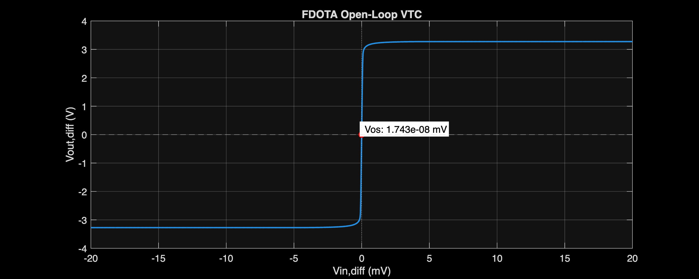

Differential output swing high: nominal 3.248 V; full-PVT worst 2.898 V at `FSVLTH`.

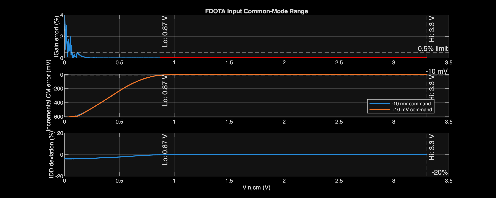

Differential output swing high: nominal 3.248 V; full-PVT worst 2.898 V at `FSVLTH`.

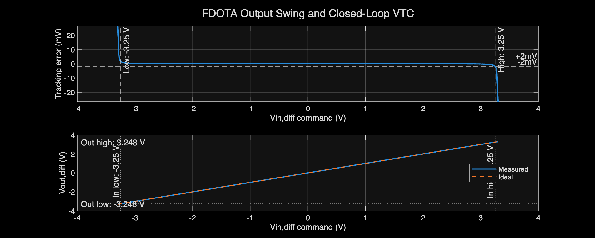

### Common-mode and supply rejection

| Parameter | Unit | Spec | NOM | Full-PVT worst | Corner |
| :--- | :--- | :--- | :--- | :--- | :--- |
| CMRR @ 60 Hz | dB | ≥80 | 311.857 | 206.212 | SFVLTH |
| CMRR @ 150 Hz | dB | ≥80 | 312.608 | 206.212 | SFVLTH |
| PSRR+ @ 60 Hz | dB | ≥80 | 282.189 | 187.596 | SFVLTH |
| PSRR+ @ 150 Hz | dB | ≥80 | 282.095 | 187.596 | SFVLTH |
| PSRR- @ 60 Hz | dB | ≥80 | 292.288 | 197.663 | SFVLTH |
| PSRR- @ 150 Hz | dB | ≥80 | 291.04 | 197.662 | SFVLTH |

CMRR @ 60 Hz: nominal 311.857 dB; full-PVT worst 206.212 dB at `SFVLTH`.

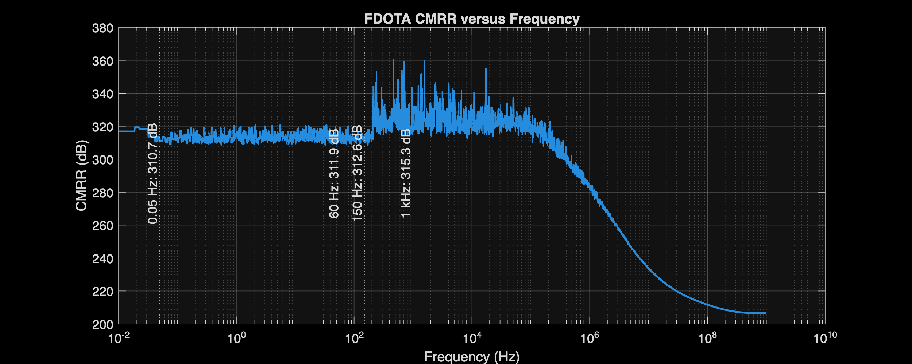

PSRR+ @ 60 Hz: nominal 282.189 dB; full-PVT worst 187.596 dB at `SFVLTH`.

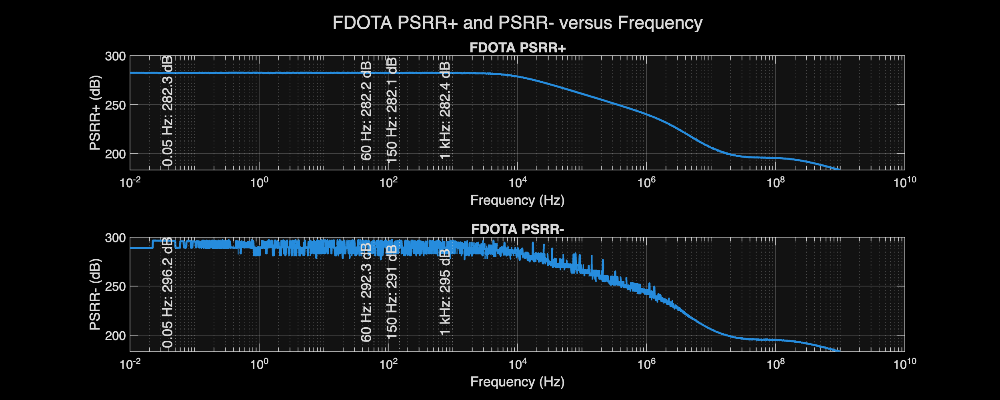

### Noise and distortion

| Parameter | Unit | Spec | NOM | Full-PVT worst | Corner |
| :--- | :--- | :--- | :--- | :--- | :--- |
| Input-referred noise 0.05-150 Hz | uVrms | ≤4 | 3.083 | 3.513 | SSVHTH |

Input-referred noise 0.05-150 Hz: nominal 3.083 uVrms; full-PVT worst 3.513 uVrms at `SSVHTH`.

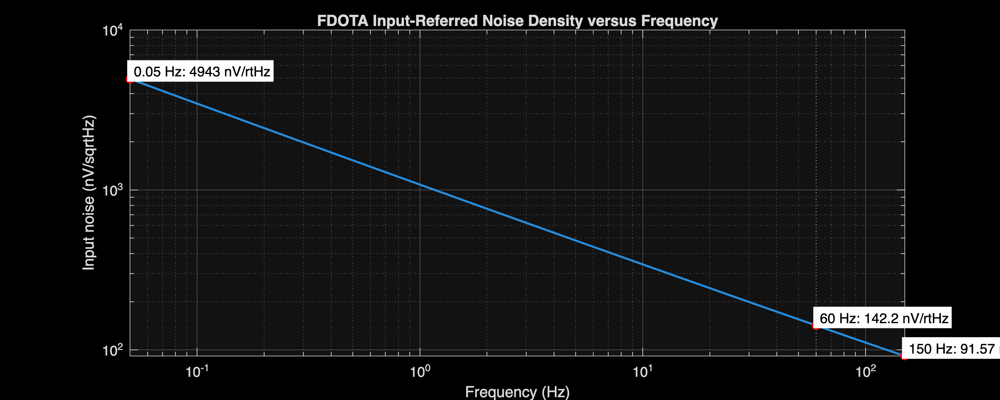

### Transient response

| Parameter | Unit | Spec | NOM | Full-PVT worst | Corner |
| :--- | :--- | :--- | :--- | :--- | :--- |
| Differential SR rise | V/us | ≥4 | 7.208 | 5.099 | SSVLTL |
| Differential SR fall | V/us | ≥4 | 7.208 | 5.099 | SSVLTL |
| Differential settling time | ns | ≤300 | 175.867 | 246.549 | SSVLTL |
| Differential-step CM disturbance | mV | ≤60 | 37.052 | 47.416 | SSNOMTH |
| CMFB SR rise | V/us | ≥2 | 3.556 | 2.475 | SSVLTL |
| CMFB SR fall | V/us | ≥2 | 3.498 | 2.577 | SSVLTH |
| CMFB settling time | ns | ≤1000 | 309.735 | 418.338 | SSVLTH |

Differential settling time: nominal 175.867 ns; full-PVT worst 246.549 ns at `SSVLTL`.

Differential-step CM disturbance: nominal 37.052 mV; full-PVT worst 47.416 mV at `SSNOMTH`.

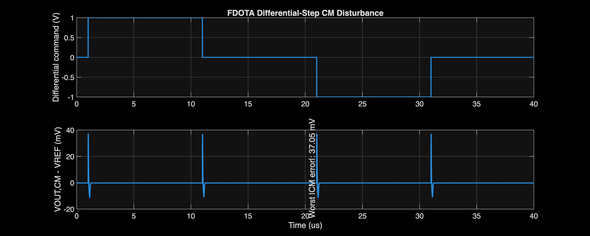

Differential settling time: nominal 175.867 ns; full-PVT worst 246.549 ns at `SSVLTL`.

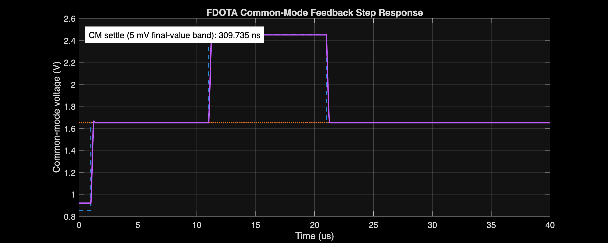

## Monte Carlo verification

MM applies local mismatch; GL applies global variation; FULL combines both. These are nominal-supply/temperature MC campaigns, not combined worst-PVT-plus-mismatch yield.

| Mode | Requested | Valid | Failed | Overall yield |
| :--- | :--- | :--- | :--- | :--- |
| MM | 200 | 200 | 0 | 100% |
| GL | 200 | 200 | 0 | 100% |
| FULL | 200 | 200 | 0 | 100% |

Counts and yield apply to the measured MC metrics at nominal supply and temperature. Missing or invalid results prevent a pass; they are not demonstrated circuit failures. Sample yield is not production yield.

### FULL sampled statistics

| Parameter | Unit | Spec | Min | Mean | Max | Yield |
| :--- | :--- | :--- | :--- | :--- | :--- | :--- |
| FDC bias current | uA | 40±10 | 38.743 | 40.101 | 41.738 | 100% |
| CMFB bias current | uA | 40±10 | 38.732 | 40.109 | 41.627 | 100% |
| Total current | mA | ≤2.5 | 1.52 | 1.607 | 1.746 | 100% |
| Total power | mW |  | 5.016 | 5.302 | 5.761 |  |
| Differential DC gain | dB | ≥85 | 91.143 | 92.032 | 93 | 100% |
| Differential UGF | MHz | ≥8 | 12.859 | 14.628 | 16.843 | 100% |
| Differential phase margin | deg | ≥60 | 73.403 | 77.075 | 80.543 | 100% |
| Input differential offset | uV | ±3000 | -2094.05 | 30.523 | 2352.39 | 100% |
| Gain error | % | ±0.01 | -0.003 | -0.003 | -0.002 | 100% |
| Output CM error | mV | ±20 | -10.457 | -0.453 | 13.117 | 100% |

The source CSVs retain μ±σ and μ±3σ. Those statistical extrapolations are not additional simulated extrema.

FULL Input differential offset: -2094.05 to 2352.39 uV; mean 30.523 uV.

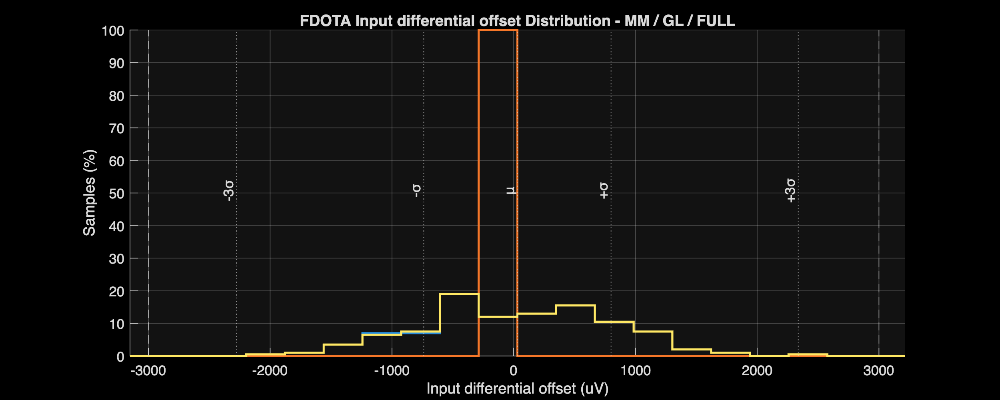

FULL Differential DC gain: 91.143 to 93 dB; mean 92.032 dB.

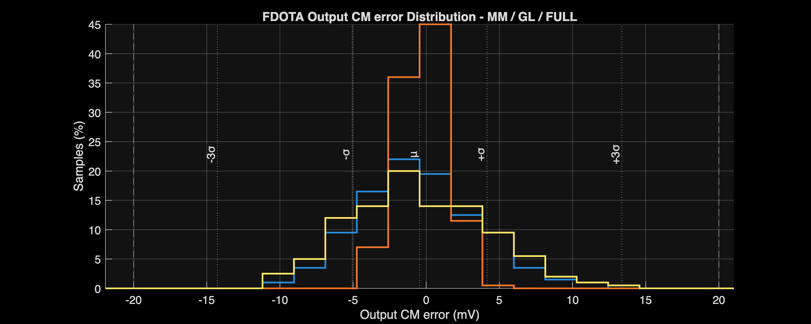

FULL Differential DC gain: 91.143 to 93 dB; mean 92.032 dB.

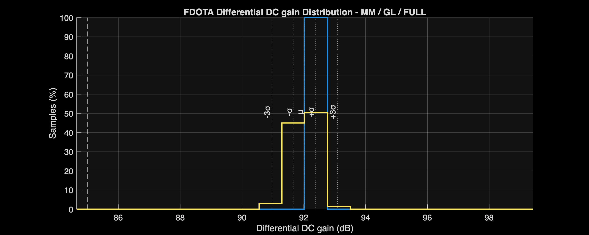

FULL Differential UGF: 12.859 to 16.843 MHz; mean 14.628 MHz.

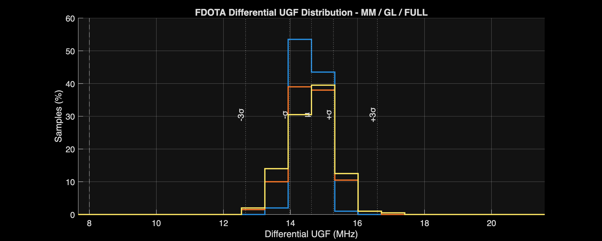

FULL Differential phase margin: 73.403 to 80.543 deg; mean 77.075 deg.

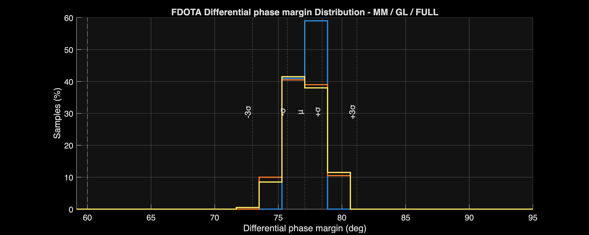

FULL Gain error: -0.003 to -0.002 %; mean -0.003 %.

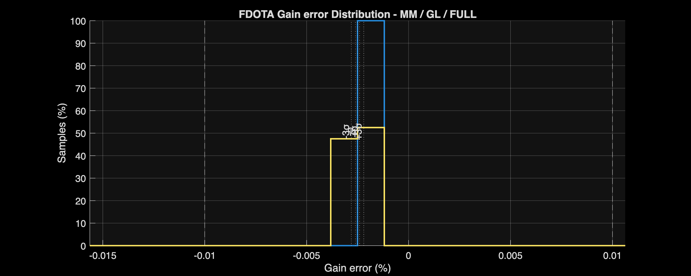

## Sources and reproduction

- [MATLAB analyzer](../../Measurement_Results/IC_Simulation/ANALOG_BLOCKS/FDOTA/FDOTA_Analyze.m)
- [Representative-corner comparison](../../Measurement_Results/IC_Simulation/ANALOG_BLOCKS/FDOTA/Results/FDOTA_table_report.csv)
- [Full-PVT worst cases](../../Measurement_Results/IC_Simulation/ANALOG_BLOCKS/FDOTA/Results/FDOTA_worst_case_report.csv)
- [MM statistics](../../Measurement_Results/IC_Simulation/ANALOG_BLOCKS/FDOTA/Results/MM_FDOTA_MC_Summary.csv)
- [GL statistics](../../Measurement_Results/IC_Simulation/ANALOG_BLOCKS/FDOTA/Results/GL_FDOTA_MC_Summary.csv)
- [FULL statistics](../../Measurement_Results/IC_Simulation/ANALOG_BLOCKS/FDOTA/Results/FULL_FDOTA_MC_Summary.csv)
- [MC coverage and yield](../../Measurement_Results/IC_Simulation/ANALOG_BLOCKS/FDOTA/Results/FDOTA_MC_Run_Summary.csv)
- [Xschem testbenches](../../Design_Files/IC%20Design/Testbench/ANALOG_BLOCKS/FDOTA)

Regenerate SPICE netlists after schematic edits, finish the simulation jobs, then run the analyzer from its own directory. MATLAB reads exports; it does not launch ngspice.

## Limitations and next steps

These results exclude extracted parasitics, package effects, switched-ADC loading, and silicon measurements. Repeat the same limits after layout; do not infer integrated AFE signoff from individual block passes.

## Design-method references

- F. Silveira, D. Flandre, and P. G. A. Jespers, “A $g_m/I_D$ Based Methodology for the Design of CMOS Analog Circuits and Its Application to the Synthesis of a Silicon-on-Insulator Micropower OTA,” *IEEE Journal of Solid-State Circuits*, 1996. [DOI: 10.1109/4.535416](https://doi.org/10.1109/4.535416)
- P. G. A. Jespers and B. Murmann, “Basic Sizing Using the $g_m/I_D$ Methodology,” in *Systematic Design of Analog CMOS Circuits*, Cambridge University Press, 2017. [DOI: 10.1017/9781108125840.003](https://doi.org/10.1017/9781108125840.003)
- P. G. A. Jespers and B. Murmann, “Lookup Table Generation and Usage,” in *Systematic Design of Analog CMOS Circuits*, 2017. [DOI: 10.1017/9781108125840.008](https://doi.org/10.1017/9781108125840.008)
- A. A. Youssef, B. Murmann, and H. Omran, “Analog IC Design Using Precomputed Lookup Tables: Challenges and Solutions,” *IEEE Access*, 2020. [DOI: 10.1109/ACCESS.2020.3010875](https://doi.org/10.1109/ACCESS.2020.3010875)
- M. J. M. Pelgrom, A. C. J. Duinmaijer, and A. P. G. Welbers, “Matching Properties of MOS Transistors,” *IEEE Journal of Solid-State Circuits*, 1989. [DOI: 10.1109/JSSC.1989.572629](https://doi.org/10.1109/JSSC.1989.572629)
- B. K. Ahuja, “An Improved Frequency Compensation Technique for CMOS Operational Amplifiers,” *IEEE Journal of Solid-State Circuits*, 1983. [DOI: 10.1109/JSSC.1983.1052012](https://doi.org/10.1109/JSSC.1983.1052012)
- K. Bult and G. J. G. M. Geelen, “A General Description of Common-Mode Feedback in Fully-Differential Amplifiers,” *IEEE ISCAS*, 1990. [DOI: 10.1109/ISCAS.1990.112716](https://doi.org/10.1109/ISCAS.1990.112716)
- M. Banu, J. M. Khoury, and Y. Tsividis, “Design Considerations for Common-Mode Feedback Circuits in Fully-Differential Operational Transconductance Amplifiers with Tuning,” *IEEE ISCAS*, 1991. [DOI: 10.1109/ISCAS.1991.176624](https://doi.org/10.1109/ISCAS.1991.176624)
- P. J. Hurst and S. H. Lewis, “Determination of Stability Using Return Ratios in Balanced Fully Differential Feedback Circuits,” *IEEE Transactions on Circuits and Systems II*, 1995. [DOI: 10.1109/82.476178](https://doi.org/10.1109/82.476178)
- D. Hernandez-Garduno and J. Silva-Martinez, “Continuous-Time Common-Mode Feedback for High-Speed Switched-Capacitor Networks,” *IEEE Journal of Solid-State Circuits*, 2005. [DOI: 10.1109/JSSC.2005.852047](https://doi.org/10.1109/JSSC.2005.852047)
- P. E. Allen, “Compensation of Op Amps—I,” Georgia Institute of Technology, ECE 6412 lecture notes. [PDF](https://www.pallen.ece.gatech.edu/Academic/ECE_6412/Spring_2004/L120-CompOpAmpsI%282UP%29.pdf)
- University of California, Berkeley, “CMOS Op Amp Compensation,” EE 140 Lecture 22. [PDF](https://www-inst.cs.berkeley.edu/~ee140/sp12/lectures/Lec22w.CMOSOpAmpCompensation.ee140.s12.ctn.pdf)
- D. A. Johns and K. Martin, *Analog Integrated Circuit Design*, Chapter 6 course copy hosted by the University of Minnesota Duluth. [PDF](https://www.d.umn.edu/~htang/ECE5211_doc_files/ECE5211_files/Chapter6.pdf)
