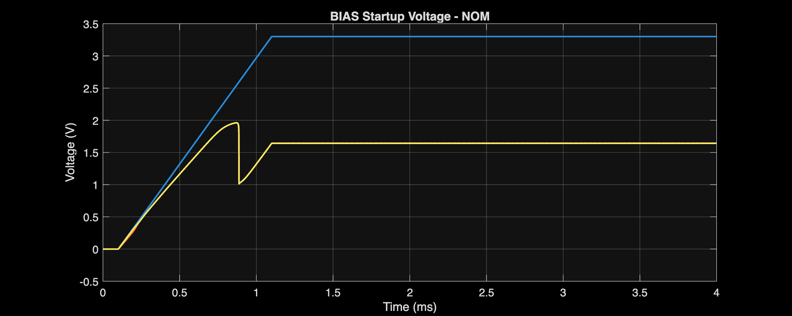
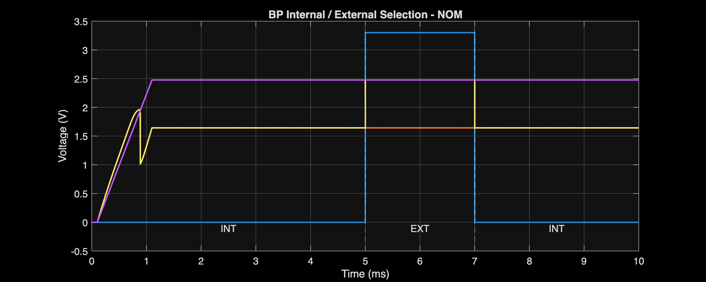
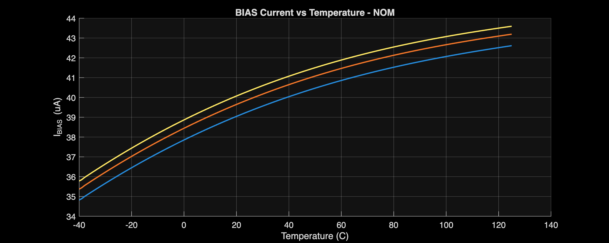
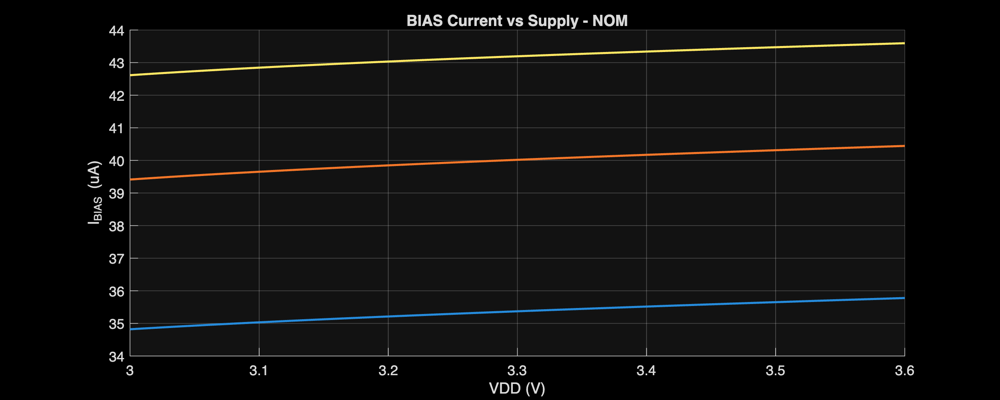
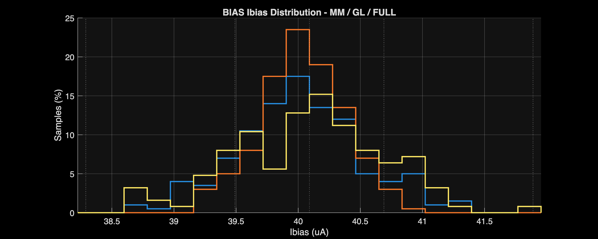
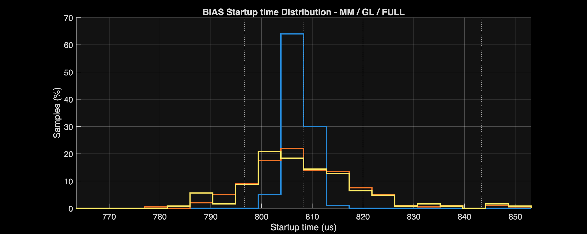

# BIAS and Mirror Design and Verification Report

[← Project report](../../Project_Report.md)

## Circuit and role

The master bias core and current mirror provide the reference and distributed bias currents. Their files are maintained under POWER_BLOCKS.

[Circuit schematic](../../Design_Files/IC%20Design/Schematic/POWER_BLOCKS/BIAS/BIAS.sch)

[MIRROR schematic](../../Design_Files/IC%20Design/Schematic/POWER_BLOCKS/MIRROR/MIRROR.sch)

## Design requirements and sequence

The design starts from a 40-µA reference shared by the amplifier bias mirrors. The accepted current range is 30–50 µA. Mirror error must remain within ±1%, and the startup device must turn off after initialization.

The following sequence reconstructs the implemented design from its topology and dimensions. It is not a record of the original optimization history. A transistor geometry without a unique analytical solution is identified as a design choice, not presented as a calculated optimum.

### 1. Generate a current without an external precision voltage

MP1/MP2 form a nominally equal-current PMOS mirror. Q1/Q2 use emitter-area multiplicities of 1 and 30. Equal emitter currents therefore produce an approximate junction-voltage difference

$$
\Delta V_{EB}=V_T\ln(30),\qquad
V_T=\frac{kT}{q}=25.865\ \mathrm{mV}\quad(27^\circ\mathrm C),
$$

$$
\Delta V_{EB}\approx87.97\ \mathrm{mV}.
$$

The junction exponential law supplies the voltage difference. The MOS/BJT loop, not the area ratio alone, establishes the current. Base currents, finite output resistance, and unequal branch currents are neglected in this first-order expression.

### 2. Include the unequal NMOS pair before choosing RS

MN1 and MN2 share a gate voltage but have different widths. Kirchhoff's voltage law around their source paths gives

$$
I_{RS}R_S=\Delta V_{EB}+V_{GS1}-V_{GS2}.
$$

MN1 has \(W/L=24/4\), versus \(16/4\) for MN2. At equal current, the wider device generally requires less overdrive. Its negative \(V_{GS1}-V_{GS2}\) reduces the voltage across RS.

Consequently, using \(R_S=\Delta V_{EB}/40\,\mu\mathrm A=2.20\ \mathrm{k\Omega}\) would be incorrect for this implemented topology. The NMOS body effect and operating-point voltages must remain in the calculation.

### 3. Translate the current-setting resistance into geometry

RS is an n-well resistor with drawn \(W=3\) µm and \(L=1.52\) µm. The installed typical model includes a body resistor and two terminal resistors. Its nominal geometry corrections give

$$
W_{\mathrm{eff}}=3-2(0.222)=2.556\ \mu\mathrm m,
\qquad
L_{\mathrm{eff}}=1.52-2(0.0102)=1.4996\ \mu\mathrm m.
$$

At 27°C, including the separate body and terminal temperature factors,

$$
R_S\approx
\frac{1000(1.00461)(1.4996)+2(250)(1.00348)}
{2.556}
=785.7\ \Omega.
$$

The 40-µA target then requires approximately 31.43 mV across RS. The loop equation implies \(V_{GS1}-V_{GS2}\approx-56.54\) mV. This is a consistency requirement, not an independently exported MOS operating-point measurement.

The simple drawn rectangle would predict only 506.7 Ω. This difference explains why sheet resistance alone cannot justify the final short-resistor length. The PDK explicitly models separate body/end resistances and substrate capacitance. [GF180 resistor models](https://gf180mcu-pdk.readthedocs.io/en/latest/analog/model_parameters/LV/LV_4.html)

### 4. Set transistor ratios, matching area, and startup strength

| Devices | Implemented size | Reason for W and L | Main trade-off |
| :--- | :--- | :--- | :--- |
| MP1/MP2 | W/L = 16/4 µm, m = 1 | Equal geometry establishes a 1:1 reference mirror; long L reduces drain-voltage sensitivity | More gate area and startup capacitance than minimum-length devices |
| MN1/MN2 | W/L = 24/4 and 16/4 µm | The 1.5 width ratio creates the required MOS voltage difference; equal long L limits unequal channel-length effects | Current also depends on MOS parameters and body effect |
| Q1/Q2 | Same PNP unit, m = 1/30 | An integer area ratio of 30 creates the junction-voltage difference | Larger ratio increases area and junction capacitance |
| MST | W/L = 0.5/10 µm | A narrow, long device weakly couples the startup nodes and suppresses steady-state leakage | Too weak can delay startup; too strong perturbs the established reference |
| RS | W/L = 3/1.52 µm | Model-corrected resistance closes the MOS/BJT current equation | Well resistance and temperature variation move the reference current |
| All MIRROR outputs | W/L = 16/4 µm, m = 1 | Match the master PMOS dimensions for nominal 1:1 current copies | Different drain voltages still cause mirror error |

The 16-µm PMOS width corresponds to a nominal current density of \(40/16=2.5\) µA/µm. This is an implemented operating choice, not a separately recovered lookup-table optimum. Wider devices improve matching but increase distribution-node capacitance.

No unique calculated integer W/L can be recovered from the exported branch-current summaries alone. Those summaries do not contain the complete \(g_m/I_D\), \(g_{ds}\), and terminal-bias data needed to reproduce every MOS sizing decision.

### 5. Compare the intended current with the measured reference

The reference target is 40 µA; nominal simulation gives 40.018 µA, a +0.045% difference. The complete DC grid spans 31.071–49.466 µA. The high-current limit has only 0.534 µA margin.

Mirror error reaches 0.149% in deterministic DC sweeps and remains below ±1% in the sampled MC results. This supports the matched long-channel mirror choice, but does not establish mismatch yield at every PVT extreme.

Startup succeeds in all 45 tested cases. The worst startup time is 3.702 ms under the tested supply ramp. MST's minimum reported turn-off margin is 0.742 V. These validate initialization and turn-off for that stimulus, not for every possible supply-ramp shape.

## Verification conditions

Checked 2026-10-17 against the latest analyzer CSV exports. No simulations were rerun for this documentation update.

Blank specification cells mean report-only. Exported worst-case values meet their listed limits; this is pre-layout block verification, not post-layout or silicon signoff.

Startup coverage is 45/45; actual startup failures are 0 among 45 completed cases. The separate DC grid contains 50,630 points.

The BIAS core produces BP; MIRROR distributes the current. VREF is not part of this block. Total current includes the instantiated testbench load.

Nominal columns refer to NOM process, 3.3 V, and 27°C. Compact corner names encode process, supply, and temperature. Sweep labels identify a fixed supply or temperature rather than a single corner.

TC uses the full −40–125°C current range normalized to the 27°C current; line regulation uses the 3.0–3.6 V current range normalized to the 3.3 V current. Comparison TC/LR use 3.3 V/27°C. Worst cases search 15 temperature and 15 supply sweeps.

These are range-over-span metrics, not fitted local derivatives. The normalization is identical for every slice:

$$
TC=\frac{I_{\max,T}-I_{\min,T}}{I(27^\circ\mathrm C)\,(165^\circ\mathrm C)}10^6,
\qquad
LR=\frac{I_{\max,V}-I_{\min,V}}{I(3.3\,\mathrm V)\,(0.6\,\mathrm V)}100.
$$

The Ibias worst case is selected by the greatest absolute deviation from 40 µA, not automatically by the highest current. BP uses the minimum exported voltage; MST margin uses the minimum; mirror error uses the maximum magnitude.

## Nominal and full-PVT results

### Operating point and mirroring

| Parameter | Unit | Spec | NOM | Full-PVT worst | Corner |
| :--- | :--- | :--- | :--- | :--- | :--- |
| Ibias | uA | 40±10 | 40.018 | 49.466 | FFVHTH |
| Total current | uA |  | 119.978 | 148.377 | FFVHTH |
| Total power | uW |  | 395.928 | 534.156 | FFVHTH |
| BP | V |  | 1.642 | 1.137 | FSVLTH |
| Mirror error | % | ±1 | -0.003 | 0.149 | FSVLTH |
| MST margin | V | >0 | 1.541 | 0.742 | FFVHTH |

The nominal current is 40.018 µA. The DC grid spans 31.071–49.466 µA across process, supply, and temperature.

### Startup and selector

| Parameter | Unit | Spec | NOM | Full-PVT worst | Corner |
| :--- | :--- | :--- | :--- | :--- | :--- |
| Startup time | us |  | 807.522 | 3701.808 | SSVLTL |

Startup time: nominal 807.522 us; full-PVT worst 3701.808 us at `SSVLTL`.

Startup time: nominal 807.522 us; full-PVT worst 3701.808 us at `SSVLTL`.

Nominal selector waveform; functional illustration, not a separate electrical pass/fail limit.

### Reference quality

| Parameter | Unit | Spec | NOM | Full-PVT worst | Corner |
| :--- | :--- | :--- | :--- | :--- | :--- |
| Temperature coefficient | ppm/C |  | 1184.733 | 1235.503 | FFVL sweep |
| Line regulation | %/V |  | 4.293 | 5.322 | SSTL sweep |

Temperature coefficient: nominal 1184.733 ppm/C; full-PVT worst 1235.503 ppm/C at `FFVL sweep`.

Line regulation: nominal 4.293 %/V; full-PVT worst 5.322 %/V at `SSTL sweep`.

Selector checks are report-only. The current archived extrema are:

| Quantity | Value | Unit | Process | Condition |
| :--- | :--- | :--- | :--- | :--- |
| Maximum \|BP INT SEL error\| | 9.467e-01 | nV | SF | VH |
| Maximum \|BP EXT SEL error\| | 2.445 | nV | SS | VL |

## Monte Carlo verification

MM applies local mismatch; GL applies global variation; FULL combines both. These are nominal-supply/temperature MC campaigns, not combined worst-PVT-plus-mismatch yield.

| Mode | Requested | Valid | Failed | Overall yield |
| :--- | :--- | :--- | :--- | :--- |
| MM | 200 | 200 | 0 | 100% |
| GL | 200 | 200 | 0 | 100% |
| FULL | 200 | 200 | 0 | 100% |

Counts and yield apply to the measured MC metrics at nominal supply and temperature. Missing or invalid results prevent a pass; they are not demonstrated circuit failures. Sample yield is not production yield.

All three MC campaigns are complete: 200/200 valid samples and 100% measured yield per mode.

### FULL sampled statistics

| Parameter | Unit | Spec | Min | Mean | Max | Yield |
| :--- | :--- | :--- | :--- | :--- | :--- | :--- |
| Ibias | uA | 40±10 | 38.563 | 40.034 | 41.785 | 100% |
| Total current | uA |  | 115.394 | 120.021 | 125.113 |  |
| BP | V |  | 1.554 | 1.643 | 1.73 |  |
| Mirror error | % | ±1 | -0.467 | 0.02 | 0.431 | 100% |
| MST margin | V | >0 | 1.356 | 1.54 | 1.735 | 100% |
| Startup time | us |  | 784.605 | 808.521 | 849.014 |  |
| Startup success |  | PASS | 1 | 1 | 1 | 100% |

The source CSVs retain μ±σ and μ±3σ. Those statistical extrapolations are not additional simulated extrema.

FULL Ibias: 38.563 to 41.785 uA; mean 40.034 uA.

FULL Startup time: 784.605 to 849.014 us; mean 808.521 us.

## Measurement sources

- [MATLAB analyzer](../../Measurement_Results/IC_Simulation/POWER_BLOCKS/BIAS/BIAS_Analyze.m)
- [Representative-corner comparison](../../Measurement_Results/IC_Simulation/POWER_BLOCKS/BIAS/Reports/BIAS_comparison_report.csv)
- [Full-PVT worst cases](../../Measurement_Results/IC_Simulation/POWER_BLOCKS/BIAS/Reports/BIAS_worst_case_report.csv)
- [MM statistics](../../Measurement_Results/IC_Simulation/POWER_BLOCKS/BIAS/Reports/MM_MC_Summary.csv)
- [GL statistics](../../Measurement_Results/IC_Simulation/POWER_BLOCKS/BIAS/Reports/GL_MC_Summary.csv)
- [FULL statistics](../../Measurement_Results/IC_Simulation/POWER_BLOCKS/BIAS/Reports/FULL_MC_Summary.csv)
- [MC coverage and yield](../../Measurement_Results/IC_Simulation/POWER_BLOCKS/BIAS/Reports/MC_Run_Summary.csv)
- [Xschem testbenches](../../Design_Files/IC%20Design/Testbench/POWER_BLOCKS/BIAS)

## Limitations and next steps

These results exclude extracted parasitics, package effects, switched-ADC loading, and silicon measurements. Repeat the same limits after layout; do not infer integrated AFE signoff from individual block passes.
