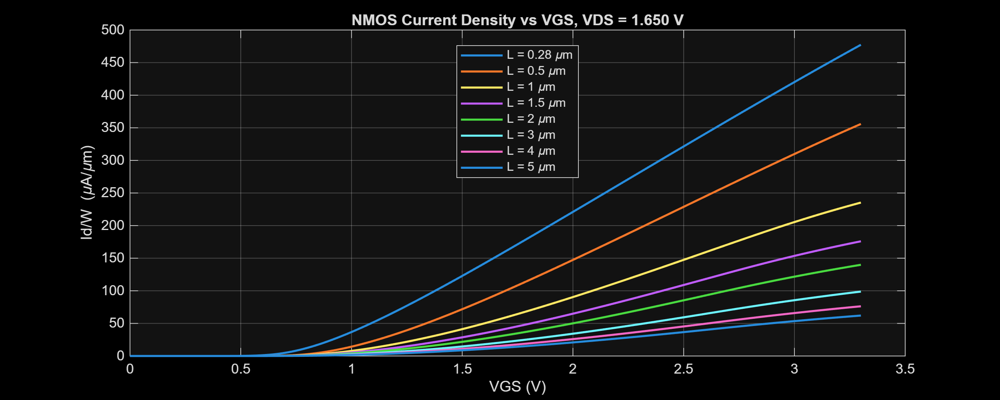
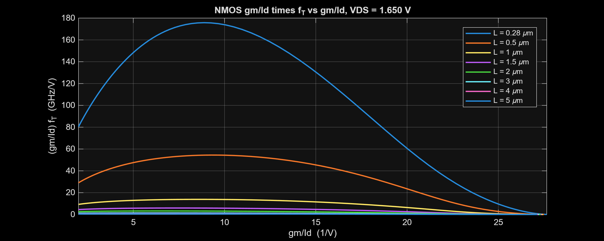
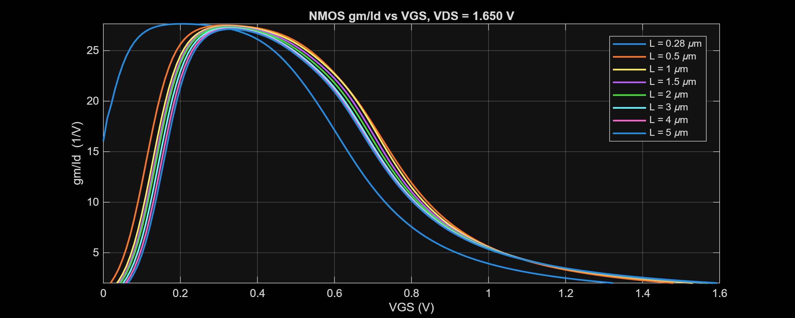
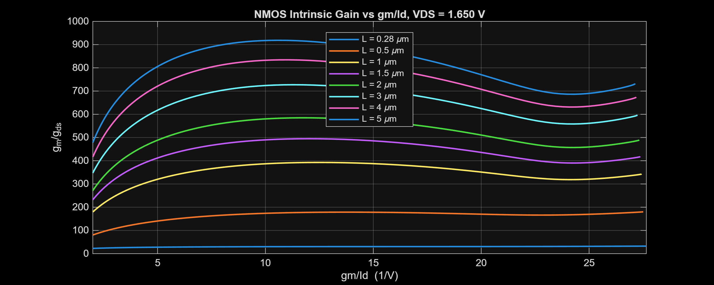
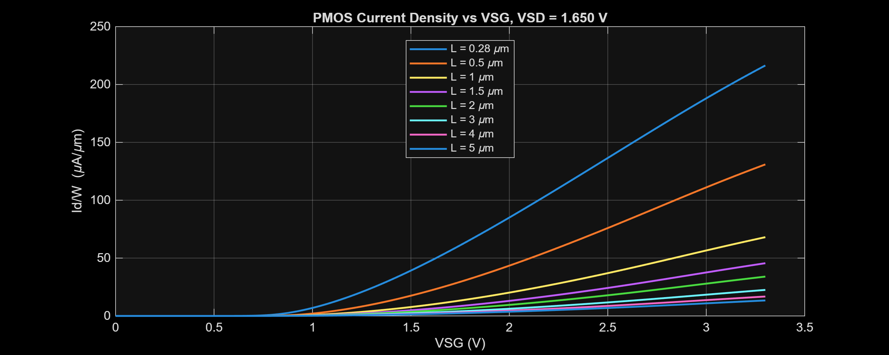
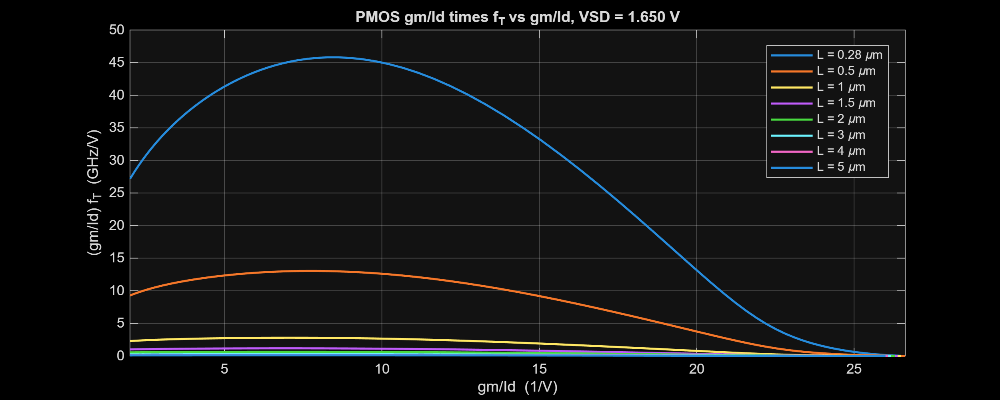
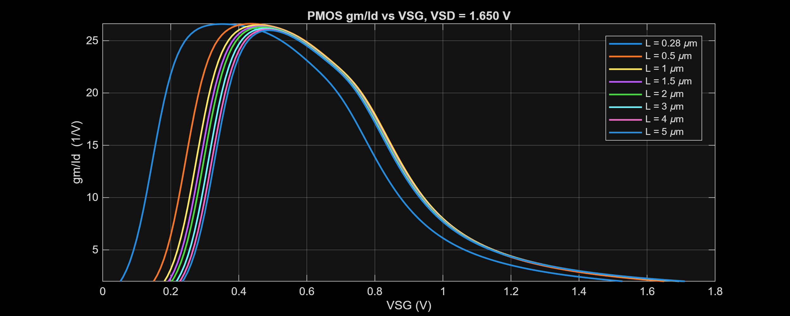
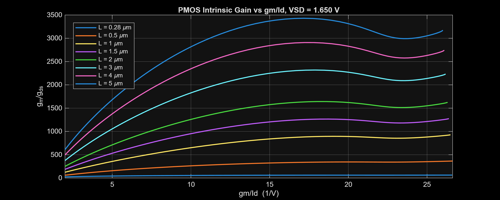

# $g_m/I_D$ Characterization Report

[← System-level project report](../../Project_Report.md)

## Purpose

Updated 2026-10-17. The characterization files are under `Measurement_Results/IC_Simulation/SIZING/Gm_Id`, separately from block-verification results.

The NMOS and PMOS characterization utilities provide the lookup data used to size the bias network and OTA devices. They report transconductance efficiency, current density, transition frequency, and intrinsic gain for the GlobalFoundries 180 nm MCU devices.

| Device | Analyzer | Status |
| :--- | :--- | :---: |
| NMOS | [`NMOS_Gm_Id.m`](../../Measurement_Results/IC_Simulation/SIZING/Gm_Id/NMOS_Gm_Id/NMOS_Gm_Id.m) | Available |
| PMOS | [`PMOS_Gm_Id.m`](../../Measurement_Results/IC_Simulation/SIZING/Gm_Id/PMOS_Gm_Id/PMOS_Gm_Id.m) | Available |

## Characterization and sizing sequence

The lookup method replaces a single square-law process constant with simulated device behavior at selected length and terminal bias. It follows the \(g_m/I_D\) approach introduced by [Silveira, Flandre, and Jespers, IEEE JSSC](https://people.engr.tamu.edu/spalermo/ecen474/gm_ID_methodology_silveira_jssc_1996.pdf).

### 1. Fix device type and bias conditions

The NMOS analyzer selects a nominal \(V_{DS}=1.65\) V; the PMOS analyzer uses \(V_{SD}=1.65\) V. Both print efficiency rows from 4 to 20 V⁻¹.

A lookup point is valid only for its characterized length, temperature, and terminal/body biases. The drain voltage in an actual input pair or current source can differ substantially from 1.65 V.

### 2. Convert circuit requirements into transconductance

For a first-pass Miller-compensated OTA,

$$
g_{m,\mathrm{required}}\approx2\pi f_uC_c.
$$

For a white-noise contribution, input-referred channel noise scales approximately as \(1/g_m\). Increasing \(g_m\) can therefore help both bandwidth and thermal noise, but raises current or device capacitance depending on the selected efficiency.

The circuit's topology-dependent noise coefficient must be retained. The lookup table alone does not predict total amplifier noise.

### 3. Select length before accepting an inversion level

Longer L generally improves intrinsic gain \(g_m/g_{ds}\) and matching area. Shorter L generally improves speed and reduces area for a given current.

Select \(g_m/I_D\) after checking those gain/speed trade-offs. Higher efficiency means less current for a required \(g_m\), but often lower current density and larger W.

### 4. Calculate current and width from the same lookup point

$$
I_D=\frac{g_m}{g_m/I_D},\qquad
J_D=\frac{I_D}{W},\qquad
W_{\mathrm{calc}}=\frac{I_D}{J_D}.
$$

Do not combine the efficiency from one channel length with the current density from another. Use magnitude conventions consistently for PMOS.

A first-pass SEOTA example uses \(f_u=10\) MHz and \(C_c=2\) pF:

$$
g_m=125.7\ \mu\mathrm S,\qquad
I_D=\frac{125.7}{20}=6.283\ \mu\mathrm A.
$$

For the local L = 4-µm NMOS row, \(J_D=0.03271\) µA/µm:

$$
W_{\mathrm{calc}}=\frac{6.283}{0.03271}=192.1\ \mu\mathrm m.
$$

| Quantity | First-pass calculation | Rounded value | Implemented SEOTA choice |
| :--- | :--- | :--- | :--- |
| Input-device L | Select for gain and matching | 4 µm | 4 µm |
| Input-device effective W | 192.1 µm | 192 µm | 400 µm |
| Branch current | 6.283 µA from minimum transconductance | Not integer-rounded | Approximately 10.023 µA from the implemented tail mirror |

The larger implemented width supports noise and matching. It is not obtained by simply rounding 192.1 µm. The final branch current also differs from the minimum-bandwidth calculation.

### 5. Re-evaluate the implemented operating point

For the implemented SEOTA pair,

$$
J_{D,\mathrm{used}}\approx\frac{10.023}{400}
=0.0251\ \mu\mathrm A/\mu\mathrm m.
$$

That density lies below the printed \(g_m/I_D=20\) row. The exact implemented efficiency must come from a wider valid lookup range or the final device operating point; it must not be asserted by extrapolating the terminal table.

The printed \(V_{\mathrm{OV}}\approx2/(g_m/I_D)\) is a square-law proxy, not a measured saturation voltage. Do not use it alone to certify input-common-mode range or output swing.

### 6. Check intrinsic gain, speed, and complete-circuit noise

The useful device checks are

$$
A_{\mathrm{intrinsic}}=\frac{g_m}{g_{ds}},\qquad
f_T\approx\frac{g_m}{2\pi C_{gg}}.
$$

The \(f_T\) relation is a first-order device-speed screen. Internal-node capacitances, Miller multiplication, and loading determine circuit poles.

For MOS area, larger WL generally improves flicker-noise and mismatch behavior, but increases capacitance. The SEOTA's 1.873-µVrms nominal integrated noise validates the complete implemented circuit under its tested conditions; it does not prove that one device alone produces that noise.

### 7. Use simulation to accept or reject the size

Compare calculated W, implemented W, current, gain, bandwidth, noise, and headroom. If the estimates disagree, identify whether the cause is bias dependence, passive loading, finite output resistance, or a missing pole.

Do not modify a specification merely to make the lookup-based estimate agree with a simulation. The detailed SEOTA and FDOTA reports retain the circuit-level calculations and comparisons.

## NMOS plots

The current-density curves determine width at the selected bias and length. The efficiency, intrinsic-gain, and speed curves show the competing choices; use the same characterization conditions when comparing them.

## PMOS plots

The PMOS plots use the corresponding source-referenced voltage convention. Read current density and efficiency from the same device-length curve before estimating width.

## Scope limitation

These plots are design-characterization aids rather than block-level pass/fail results. Device models and extracted-layout effects must be rechecked at the final physical-design stage.
